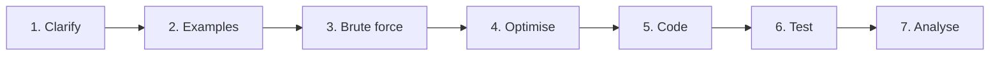

# 00 · Interview Playbook

> Before any pattern: a repeatable way to run a 45-minute coding interview, the
> complexity numbers you should know cold, and the Go idioms that keep you fast.

## What you'll learn

- A seven-step framework that works for almost any coding question.
- How to think out loud so the interviewer can follow (and help).
- A Big-O cheat sheet for Go data structures and classic algorithms.
- How to map wording in a problem statement to a technique — and to the module in this course that teaches it.
- The Go standard-library idioms you will reach for in nearly every problem (see [`gotchas.go`](gotchas.go)).

## The framework



| Step | What you do | Time (45 min slot) |
|---|---|---|
| **1. Clarify** | Restate the problem. Ask about input size, value ranges (negatives? zero? overflow?), duplicates, empty input, sortedness, return format, whether you may mutate the input. | 2–4 min |
| **2. Examples** | Work one normal example and one edge case by hand. Write them down — they become your tests. | 2–3 min |
| **3. Brute force** | State the obvious solution and its complexity *out loud*, even if you won't code it. It proves you understand the problem and gives a baseline. | 2 min |
| **4. Optimise** | Find the bottleneck in the brute force ("the inner loop searches for a complement…") and remove it with a pattern (hash map, two pointers, window, prefix sums, heap…). Agree the approach with the interviewer *before* coding. | 5–10 min |
| **5. Code** | Write clean Go: good names, small helpers, no clever one-liners. Narrate intent, not syntax. | 10–15 min |
| **6. Test** | Trace your examples through the code line by line. Then the edge cases: empty, one element, all equal, negatives, max values. | 3–5 min |
| **7. Analyse** | State time and space complexity and *why*. Mention trade-offs and what you'd do with more time (or different constraints). | 1–2 min |

Constraints are a hint. Rough budget for ~10⁸ simple operations per second:

| n up to | Acceptable complexity |
|---|---|
| 10–12 | O(n!) , O(2ⁿ · n) — permutations, brute-force subsets |
| 20–25 | O(2ⁿ) — bitmask / backtracking |
| 500 | O(n³) |
| 5 000 | O(n²) |
| 10⁶ | O(n log n) — sort, heap |
| 10⁸ | O(n) or O(log n) |

## How to talk while coding

- **Announce the plan, then the step.** "I'll keep a map from value to index. For each number I check if its complement is already there."
- **Name invariants.** "Everything left of `slow` is deduplicated." Invariants are what interviewers listen for.
- **Flag shortcuts honestly.** "I'm assuming the input fits in memory; if not, I'd stream it."
- **Don't go silent when stuck.** Say what you're trying: "Sorting would make this two pointers but costs O(n log n) — is that OK?"
- **Accept hints gracefully.** A hint is not a failure; ignoring one is.
- **Leave time to test.** Finding your own bug is a positive signal. Running out of time before testing is not.

## Big-O cheat sheet

### Data structures (Go)

| Structure | Access | Search | Insert | Delete | Notes |
|---|---|---|---|---|---|
| Slice `[]T` | O(1) | O(n) | O(1)* append, O(n) middle | O(n) middle, O(1) end | *amortized; see [01-complexity](../01-complexity/README.md) |
| Sorted slice | O(1) | O(log n) `slices.BinarySearch` | O(n) | O(n) | |
| Map `map[K]V` | — | O(1) avg | O(1) avg | O(1) avg | random iteration order |
| Set `map[K]struct{}` | — | O(1) avg | O(1) avg | O(1) avg | |
| Stack (slice) | O(1) top | O(n) | O(1) push | O(1) pop | |
| Queue / deque (slice or ring) | O(1) ends | O(n) | O(1) | O(1) | `q = q[1:]` leaks until GC; fine for interviews |
| Linked list (`container/list`) | O(n) | O(n) | O(1) at node | O(1) at node | |
| Binary heap (`container/heap`) | O(1) min | O(n) | O(log n) | O(log n) pop | `heap.Init` is O(n) |
| Balanced BST | O(log n) | O(log n) | O(log n) | O(log n) | not in stdlib; use sorted slice or heap |
| Trie | — | O(L) | O(L) | O(L) | L = key length |
| Union-Find | — | ~O(α(n)) | ~O(α(n)) | — | with path compression + rank |

### Algorithms

| Algorithm | Time | Space |
|---|---|---|
| Sort (`slices.Sort`, pdqsort) | O(n log n) | O(log n) |
| Binary search | O(log n) | O(1) |
| BFS / DFS on graph | O(V + E) | O(V) |
| Dijkstra (binary heap) | O((V + E) log V) | O(V) |
| Topological sort | O(V + E) | O(V) |
| Kruskal / Prim MST | O(E log E) | O(V) |
| Subsets / permutations | O(2ⁿ · n) / O(n! · n) | O(n) stack |
| 1-D DP over n states | O(n · transitions) | O(n), often O(1) |
| 2-D DP (two strings) | O(n · m) | O(n · m), often O(min(n, m)) |

## Pattern recognition

| Signal in the problem | Technique | Module |
|---|---|---|
| "Can this be faster?", constraints table, comparing approaches | Complexity analysis | [01-complexity](../01-complexity/README.md) |
| "Find a pair / count occurrences / seen before / group by" | Hash map / set, counting | [02-arrays-hashing](../02-arrays-hashing/README.md) |
| Sorted array, pair/triplet with target, in-place, palindrome | Two pointers | [03-two-pointers](../03-two-pointers/README.md) |
| "Longest/shortest **contiguous** subarray/substring such that…" | Sliding window | [04-sliding-window](../04-sliding-window/README.md) |
| "Sum of a range", "number of subarrays summing to k", many range queries | Prefix sums (+ hash map) | [05-prefix-sums](../05-prefix-sums/README.md) |
| "Next greater/smaller", matching brackets, evaluate expression | Stack / monotonic stack | [06-stacks-monotonic](../06-stacks-monotonic/README.md) |
| Sorted input, "minimum X such that…", O(log n) required | Binary search (on index or answer) | [07-binary-search](../07-binary-search/README.md) |
| Reverse/merge/detect cycle in a list, O(1) extra space | Linked-list pointers, fast/slow | [08-linked-lists](../08-linked-lists/README.md) |
| Hierarchy, BST, "path from root", level order | Tree DFS / BFS | [09-trees](../09-trees/README.md) |
| "Top k", "k-th largest", merge k sorted, running median | Heap | [10-heaps](../10-heaps/README.md) |
| Prefix matching, autocomplete, word search on many words | Trie | [11-tries](../11-tries/README.md) |
| Grid, islands, dependencies, "connected", "can reach" | Graph BFS/DFS, topo sort, union-find | [12-graphs](../12-graphs/README.md) |
| Weighted edges, cheapest path, connect all nodes cheaply | Dijkstra, Bellman-Ford, MST | [13-shortest-paths-mst](../13-shortest-paths-mst/README.md) |
| "All combinations / permutations / subsets", n ≤ 20 | Backtracking | [14-backtracking](../14-backtracking/README.md) |
| "Number of ways", "min cost", choices along a line | 1-D dynamic programming | [15-dp-1d](../15-dp-1d/README.md) |
| Two strings, grid paths, knapsack | 2-D dynamic programming | [16-dp-2d](../16-dp-2d/README.md) |
| Intervals, scheduling, "locally best choice works" | Greedy, sort by start/end | [17-greedy-intervals](../17-greedy-intervals/README.md) |
| "Single number", powers of two, subsets as masks, no extra space | Bit manipulation | [18-bit-manipulation](../18-bit-manipulation/README.md) |
| Pattern matching, palindromic substrings, string hashing | String algorithms | [19-strings](../19-strings/README.md) |
| "Design a cache / rate limiter / data structure with O(1) ops" | Composite data structures | [20-design-problems](../20-design-problems/README.md) |

## Go for coding interviews

Every idiom below is implemented and tested in [`gotchas.go`](gotchas.go).

```go
// Sorting
sort.Slice(xs, func(i, j int) bool { return xs[i].Count > xs[j].Count }) // not stable!
slices.SortFunc(ws, func(a, b string) int {
    return cmp.Or(cmp.Compare(len(a), len(b)), strings.Compare(a, b))
})

// Set
seen := map[int]struct{}{}
seen[x] = struct{}{}
if _, ok := seen[x]; ok { /* ... */ }

// Counting lowercase letters: arrays are comparable, maps are not
var c [26]int
c[s[i]-'a']++

// Building strings
var b strings.Builder
b.WriteString("x"); b.WriteByte(','); b.WriteRune('é')
s := b.String()

// Safe copies
cp := slices.Clone(cur)          // before appending `cur` to results
grid2 := make([][]int, len(grid)) // 2-D copy needs a loop over rows

// Numbers
best := math.MaxInt
best = min(best, x)              // builtins since Go 1.21
mid := lo + (hi-lo)/2

// Iterate code points, not bytes
for i, r := range s { _ = i; _ = r } // i = byte offset, r = rune

// Heap: implement Len/Less/Swap/Push/Pop, then use heap.Push / heap.Pop
h := &MinHeap{}
heap.Push(h, 3)
x := heap.Pop(h).(int)
```

## Common pitfalls

- **Map iteration order is random.** Never rely on it for output; sort keys first ([`SortedKeys`](gotchas.go)).
- **Sub-slices share memory.** `append(a[:2], x)` can overwrite `a[2]`. Use `slices.Clone` or `slices.Clip` ([`AliasingDemo`](gotchas.go)).
- **Backtracking results mutate.** `res = append(res, path)` stores a view; append `slices.Clone(path)`.
- **`s[i]` is a byte.** Use `[]rune(s)` or `range s` for Unicode; `len(s)` counts bytes.
- **Integer overflow is silent.** `int` is 64-bit on interview machines, but `(lo+hi)/2`, products and `-math.MinInt` still overflow.
- **`sort.Slice` is unstable.** Add a tie-breaker or use `sort.SliceStable` / `slices.SortStableFunc`.
- **Loop variables.** Since Go 1.22 each iteration gets a fresh variable, so closures capturing `i` are safe — but say so if your interviewer uses older Go.
- **`heap.Pop` vs `h.Pop`.** Always call the package functions; your methods are the plumbing.

## Problems

This module has no numbered problems — it is the reference you come back to. The
exercises are the idioms in [`gotchas.go`](gotchas.go):

| # | Idiom (link to file) | Key idea |
|---|---|---|
| 1 | [Sorting with comparators](gotchas.go) | `sort.Slice`, `slices.SortFunc`, `cmp.Or` |
| 2 | [Min-heap with `container/heap`](gotchas.go) | five methods; keep size-k heap for top-k |
| 3 | [Strings and runes](gotchas.go) | `strings.Builder`, `[]rune`, `[26]int` counts |
| 4 | [Map as set](gotchas.go) | `map[T]struct{}` |
| 5 | [Slice aliasing](gotchas.go) | `slices.Clone`, `slices.Clip` |
| 6 | [Numbers](gotchas.go) | `math.MaxInt`, `min`/`max`, overflow-safe midpoint |

## Practice tip

Before each mock interview, re-type `MinHeap` and `KLargest` from memory, then run
`go test ./course/00-interview-playbook/ -run TestKLargest`. If it takes more than
three minutes, do it again tomorrow. Read the framework table aloud once — it
makes step 1 (clarify) automatic.

## Next

[01 · Complexity →](../01-complexity/README.md)
