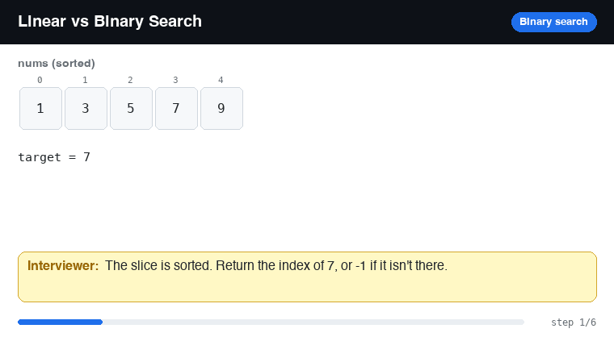

# Walkthrough: Linear vs Binary Search

**Module:** [01 · Complexity](../README.md) · **Difficulty:** Easy · **Solution:** [`p01_search.go`](../p01_search.go)



## The problem in plain words

You get a list of numbers sorted from smallest to largest, and a target. Return the position of the target, or -1 if it isn't in the list.

```
nums = [1, 3, 5, 7, 9], target = 7  →  3
nums = [1, 3, 5, 7, 9], target = 4  →  -1
```

## Mock interview

**Interviewer:** The slice is sorted in ascending order. Return the index of the target, or -1 if it isn't there.

**Candidate:** A few questions first. Can the slice be empty? Can values repeat? If they repeat, does any matching index do?

**Interviewer:** It can be empty, and you can assume the values are distinct.

**Candidate:** Let me check the examples. In `[1, 3, 5, 7, 9]`, 7 is at index 3, and 4 isn't there, so that gives -1. An empty slice always gives -1.

**Candidate:** The simplest solution is a linear scan: check each value from the left and stop when I find the target. That's O(n) time and O(1) space. It works on unsorted data too, but here it ignores the sorting.

**Interviewer:** Can you use the sorting?

**Candidate:** Yes. If I look at the middle value and it's smaller than the target, every value to its left is smaller too, so the target can only be on the right. One comparison throws away half the range. That's binary search.

I keep two indices, `lo` and `hi`, with this invariant: *if the target exists, it is in `nums[lo..hi]`.* Each step I look at `mid`:

- `nums[mid] == target`: return `mid`.
- `nums[mid] < target`: the target is strictly right of `mid`, so `lo = mid + 1`.
- `nums[mid] > target`: the target is strictly left of `mid`, so `hi = mid - 1`.

When `lo > hi` the range is empty, so I return -1.

**Interviewer:** Why `lo + (hi-lo)/2` and not `(lo+hi)/2`?

**Candidate:** `lo + hi` can overflow for very large indices. `lo + (hi-lo)/2` gives the same value and never goes past `hi`.

**Candidate:** In code it's a `for lo <= hi` loop with a `switch` on `nums[mid]`. I use `<=` because a range with one element, `lo == hi`, still needs checking.

**Candidate:** Testing on the example: `lo = 0`, `hi = 4`, so `mid = 2`. `nums[2] = 5` is less than 7, so `lo = 3`. Now `mid = 3 + (4-3)/2 = 3`, and `nums[3] = 7`. I return 3 after two comparisons. The linear scan needed four.

**Interviewer:** Complexity?

**Candidate:** The range halves every step, so it takes about log₂ n steps. That's **O(log n) time and O(1) space**. A million elements need about 20 comparisons instead of a million.

## What the animation shows

| Step | What happens | `lo` | `mid` | `hi` |
|---|---|---|---|---|
| 1 | Interviewer states the problem: find 7 | | | |
| 2 | Linear scan: 4 comparisons to reach index 3, O(n) | | | |
| 3 | Set up the range and the invariant | 0 | | 4 |
| 4 | `nums[2] = 5 < 7`, discard the left half | 0 | 2 | 4 |
| 5 | `nums[3] = 7`, found | 3 | 3 | 4 |
| 6 | Answer 3, with both complexities | | | |

## Detailed explanation

Binary search works because of the **discard argument**. If `nums[mid] < target`, then for every `i <= mid` we have `nums[i] <= nums[mid] < target`, so none of those positions can hold the target. Moving `lo` to `mid + 1` throws away only positions that can't be the answer. The same holds in reverse when `nums[mid] > target`.

So the invariant *"if the target exists, it is in `nums[lo..hi]`"* is true at the start (the range is the whole slice) and stays true after every step. When the range becomes empty (`lo > hi`), the target can't exist, and returning -1 is correct.

The loop always ends because the range shrinks by at least one each step: `lo` moves past `mid` or `hi` moves before it. After k steps at most n / 2ᵏ elements remain, so the loop runs at most about log₂ n + 1 times.

Edge cases:

- Empty slice: `hi = -1`, the loop never runs, and the answer is -1.
- One element: `lo == hi == mid`, one comparison decides.
- Target smaller than everything or larger than everything: `hi` drops below 0 or `lo` passes `n - 1`, and the loop ends.

## Complexity

| Approach | Time | Space |
|---|---|---|
| Linear scan (`LinearSearch`) | O(n) | O(1) |
| Binary search (`BinarySearch`) | O(log n) | O(1) |

## Common mistakes

- Writing `for lo < hi`, which skips the last one-element range and misses targets.
- Writing `lo = mid` or `hi = mid`, which can loop forever when `lo` and `hi` are next to each other.
- Computing `(lo + hi) / 2`, which can overflow on huge indices.
- Using binary search on unsorted data. It returns wrong answers without any error.

## Try it yourself

```sh
go test ./course/01-complexity/ -run TestSearch -v
```
