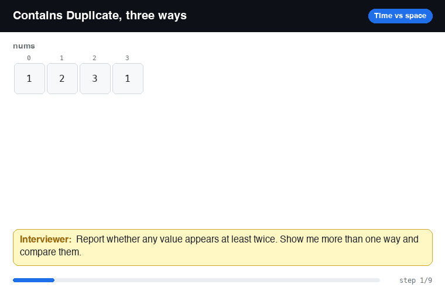

# Walkthrough: Contains Duplicate, three ways

**Module:** [01 · Complexity](../README.md) · **Difficulty:** Easy · **Solution:** [`p02_duplicates.go`](../p02_duplicates.go)



## The problem in plain words

You get a list of numbers. Say whether any number appears at least twice. The point of this lesson is to solve it three ways and compare what each one costs in time and memory.

```
[1, 2, 3, 1]  →  true    (1 appears twice)
[1, 2, 3, 4]  →  false
```

## Mock interview

**Interviewer:** Report whether any value appears at least twice in `nums`. Show me more than one way and compare them.

**Candidate:** Can the slice be empty, and am I allowed to change it?

**Interviewer:** It can be empty. Please don't modify the caller's slice.

**Candidate:** For `[1, 2, 3, 1]` the answer is true because 1 repeats. For `[1, 2, 3, 4]` it's false. An empty slice or a single value is false.

**Candidate:** The first way compares every pair `i < j`. That's n(n−1)/2 comparisons: **O(n²) time, O(1) space**. On the example it finds `nums[0] == nums[3]` after 3 comparisons, but with 10⁵ values it would make about 5 billion.

**Interviewer:** Can you do better?

**Candidate:** If I sort, equal values end up next to each other, so I only compare neighbours. Since I can't modify the input, I sort a copy with `slices.Clone`. That's **O(n log n) time and O(n) space** for the copy. On the example the sorted copy is `[1, 1, 2, 3]`, and `s[0] == s[1]`.

**Interviewer:** And faster still?

**Candidate:** A hash set. I walk the slice once. For each value I ask "have I seen this before?" If yes, I return true. If no, I add it. A Go map lookup is O(1) on average, so the whole pass is **O(n) time**, and the set costs **O(n) space**.

**Interviewer:** Why check before inserting?

**Candidate:** If I inserted first, every value would find itself in the set. Checking first means a hit can only come from an earlier position.

**Candidate:** In code: `seen := make(map[int]struct{}, len(nums))`, then a `range` loop that checks `seen[x]` and either returns true or adds `x`. After the loop I return false.

**Candidate:** Testing on `[1, 2, 3, 1]`: 1 is new, add it. 2 is new, add it. 3 is new, add it. Then 1 is already in the set, so I return true.

**Interviewer:** Which one would you ship?

**Candidate:** Usually the hash set. If memory were tight, sorting is the middle ground. If I'm allowed to sort in place, its extra space drops to O(log n) for the sort itself. For tiny inputs the brute force can be fastest, because hashing has a constant cost that Big-O hides.

## What the animation shows

| Step | Approach | What happens |
|---|---|---|
| 1 | | Interviewer states the problem |
| 2 | Brute force | Pair (0, 3) matches after 3 comparisons; O(n²) |
| 3 | Sort a copy | Sorted copy `[1, 1, 2, 3]`; `s[0] == s[1]`; O(n log n) |
| 4 | Hash set | Start with an empty set |
| 5 | Hash set | 1 is new → add |
| 6 | Hash set | 2 is new → add |
| 7 | Hash set | 3 is new → add |
| 8 | Hash set | 1 is already in the set → return true |
| 9 | | All three give true; the time/space table |

## Detailed explanation

All three functions answer the same question. They differ in what they spend.

- **Brute force** spends time. It looks at every pair once, and a duplicate must be one of those pairs, so it is correct. There are n(n−1)/2 pairs, which is O(n²).
- **Sorting** spends some time and some memory. After sorting, equal values are next to each other: if `a == b` and nothing between them in sorted order is different, they are neighbours. So checking `s[i] == s[i-1]` for each `i` finds any duplicate. The sort is O(n log n), and `slices.Clone` costs O(n) memory so the caller's slice stays the same (`TestContainsDuplicateDoesNotMutate` checks this).
- **Hash set** spends memory. The set holds every value seen so far. When a value is already in the set, it appeared at an earlier index, so it's a duplicate. If the loop ends without a hit, every value was new when it arrived, so there are no duplicates.

The hash set can stop early, so on inputs with an early duplicate it does very little work. Its worst case is a slice with no duplicates, where it touches every value once.

Edge cases: an empty slice and a single value both return false in all three versions. Extreme values like `math.MinInt` and `math.MaxInt` are fine because nothing adds or subtracts them.

## Complexity

| Approach | Time | Space |
|---|---|---|
| Brute force (`ContainsDuplicateBrute`) | O(n²) | O(1) |
| Sort a copy (`ContainsDuplicateSort`) | O(n log n) | O(n) for the copy |
| Hash set (`ContainsDuplicate`) | O(n) average | O(n) |

## Common mistakes

- Starting the inner loop at `j = 0` instead of `j = i + 1`, so every value matches itself.
- Sorting the caller's slice in place without asking. It changes their data.
- Adding to the set before checking it, so the first value always reports a duplicate.
- Forgetting that map operations are O(1) on average, not in the worst case. Mention it if asked about adversarial input.

## Try it yourself

```sh
go test ./course/01-complexity/ -run TestContainsDuplicate -v
```
