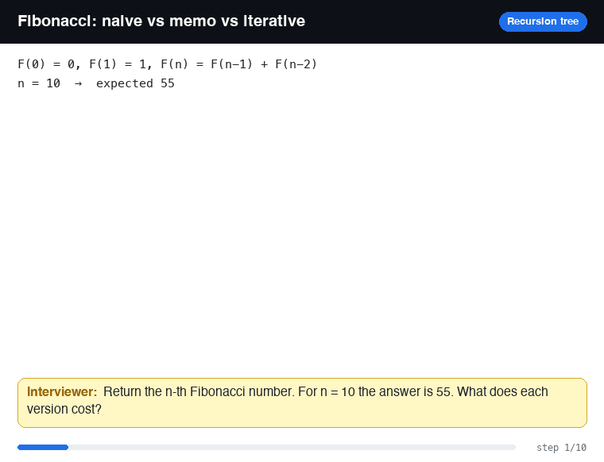

# Walkthrough: Fibonacci: naive vs memo vs iterative

**Module:** [01 · Complexity](../README.md) · **Difficulty:** Easy · **Solution:** [`p03_fibonacci.go`](../p03_fibonacci.go)



## The problem in plain words

The Fibonacci numbers start 0, 1, and each next one is the sum of the two before it: 0, 1, 1, 2, 3, 5, 8, … Return the n-th one. The lesson is how three ways of computing it cost very different amounts.

```
n = 2   →  1
n = 10  →  55
```

## Mock interview

**Interviewer:** Return the n-th Fibonacci number, with F(0) = 0 and F(1) = 1. For n = 10 the answer is 55. What does each approach cost?

**Candidate:** What range of n should I handle?

**Interviewer:** 0 ≤ n ≤ 92. F(93) overflows `int64`.

**Candidate:** Good. F(0) = 0 and F(1) = 1 are the base cases. F(10) = 55, as you said.

**Candidate:** The direct version copies the definition: `if n < 2 return n`, else return `FibNaive(n-1) + FibNaive(n-2)`. It's correct but slow. If I draw the call tree for F(5), F(3) is computed twice and F(2) three times. The tree has about φⁿ ≈ 1.618ⁿ nodes. F(5) makes 15 calls and F(10) makes 177. The stack is only n deep, so the space is O(n).

**Interviewer:** How do you fix the repeated work?

**Candidate:** Memoization. The first time I compute F(k), I store it in a map. Later calls for F(k) return the stored value without recursing. Each F(k) is computed once, so the tree collapses to a path. For F(5) that's 9 calls instead of 15. Time is **O(n)**, but I use O(n) for the memo and O(n) for the stack.

**Interviewer:** Can you drop the extra memory?

**Candidate:** Yes. Each value only needs the two before it, so I go bottom-up and keep just two variables: `prev, cur := 0, 1`. Each step does `prev, cur = cur, prev+cur`. After n steps, `prev` is F(n). That's **O(n) time and O(1) space**.

**Interviewer:** Why return `prev` and not `cur`?

**Candidate:** After step t, `prev` holds F(t) and `cur` holds F(t+1). The loop runs n times, so `prev` is F(n). Returning `prev` also makes n = 0 work: the loop doesn't run, and `prev` is 0.

**Candidate:** Testing `FibIter(10)`: the pair goes (0, 1) → (1, 1) → (1, 2) → (2, 3) → (3, 5) → … → (55, 89). `prev` is 55.

**Interviewer:** Complexity summary?

**Candidate:** Naive is O(φⁿ) time and O(n) stack. Memo is O(n) time and O(n) space. Iterative is **O(n) time and O(1) space**.

## What the animation shows

| Step | What happens |
|---|---|
| 1 | Interviewer states the problem: n = 10, expected 55 |
| 2 | `FibNaive(5)` call tree; repeated subtrees in red; 15 calls for F(5), 177 for F(10) |
| 3 | `FibMemo(5)` call tree; cache hits in green; 9 calls |
| 4 | `FibIter`: start with `prev, cur = 0, 1` |
| 5 | Step 1: `prev, cur = 1, 1` |
| 6 | Step 2: `prev, cur = 1, 2` |
| 7 | Step 3: `prev, cur = 2, 3` |
| 8 | Step 4: `prev, cur = 3, 5`; steps 5 to 9 repeat the same update |
| 9 | Step 10: `prev = 55`, `cur = 89` (one past the answer) |
| 10 | Answer 55 and the three complexities |

## Detailed explanation

**Why naive is exponential.** Let T(n) be the number of calls for F(n). Then T(n) = 1 + T(n−1) + T(n−2), which grows like the Fibonacci numbers themselves, about φⁿ with φ ≈ 1.618. Each step up in n multiplies the work by about 1.6, so +5 multiplies it by about 11. The benchmark in the module README shows exactly that.

**Why memo is linear.** The memo map makes sure each `fib(k)` for k ≥ 2 runs its body once. Every later call for the same k is a map lookup. There are n − 1 such bodies, each doing O(1) work plus two calls, so the total is O(n). The recursion still goes n levels deep before the first value is stored, so the stack is O(n).

**Why iterative is constant space.** The loop keeps this invariant: *after t iterations, `prev = F(t)` and `cur = F(t+1)`.* It holds at t = 0 (`prev = 0`, `cur = 1`). If it holds after t steps, then `prev, cur = cur, prev+cur` gives `prev = F(t+1)` and `cur = F(t) + F(t+1) = F(t+2)`. So after n steps `prev = F(n)`. Go's tuple assignment evaluates the right side first, so no temporary variable is needed.

Edge cases: n = 0 returns 0 and n = 1 returns 1 in all three. `cur` runs one step ahead, so at n = 92 it computes F(93), which wraps around. That's harmless because it isn't returned, but it's worth knowing.

## Complexity

| Approach | Time | Space |
|---|---|---|
| Naive recursion (`FibNaive`) | O(φⁿ) | O(n) stack |
| Memoized (`FibMemo`) | O(n) | O(n) memo + O(n) stack |
| Bottom-up (`FibIter`) | O(n) | O(1) |

## Common mistakes

- Saying naive recursion is O(2ⁿ) *space*. The tree is wide, but only one path is on the stack at a time, so space is O(n).
- Creating the memo map inside the recursive function, so every call gets a fresh empty map and nothing is reused.
- Returning `cur` from the loop, which is off by one.
- Ignoring overflow. `int64` holds F(92) but not F(93).

## Try it yourself

```sh
go test ./course/01-complexity/ -run TestFib -v
```
