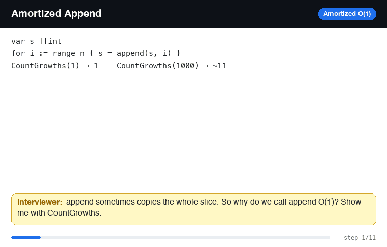

# Walkthrough: Amortized Append

**Module:** [01 · Complexity](../README.md) · **Difficulty:** Easy · **Solution:** [`p04_append_growth.go`](../p04_append_growth.go)



## The problem in plain words

When a Go slice is full, `append` makes a bigger array and copies everything over. That sounds expensive. Show why appending n items still costs only O(n) in total, by counting how often the slice has to grow.

```
CountGrowths(1)    →  1    (capacity 0 → 1)
CountGrowths(1000) →  ~11  (capacity roughly doubles each time)
```

## Mock interview

**Interviewer:** `append` sometimes copies the whole slice. So why do people say append is O(1)? Use `CountGrowths` to show me.

**Candidate:** Just to be clear about the terms: a slice has a length, which is how many items it holds, and a capacity, which is how big the backing array is. `append` only copies when length equals capacity.

**Interviewer:** Right.

**Candidate:** Let me think about the bad case first. If the array grew by exactly one slot each time, every append would copy everything already there: 0 + 1 + 2 + … + (n−1) ≈ n²/2 copies. That's O(n²) for n appends. `PrependN` really does cost that, because inserting at index 0 shifts every element every time.

**Interviewer:** So what does Go actually do?

**Candidate:** It grows the capacity *geometrically*. For small slices it doubles; past 256 elements it grows by about 1.25×, then rounds up to a memory size class. Let me trace the first few appends:

- append 0: capacity 0 → 1, nothing to copy.
- append 1: full, capacity 1 → 2, copy 1.
- append 2: full, capacity 2 → 4, copy 2.
- append 3: there's room, no copy.
- append 4: full, capacity 4 → 8, copy 4.
- appends 5, 6, 7: room, no copies.
- append 8: full, capacity 8 → 16, copy 8.

**Interviewer:** Those copies are getting bigger. Why is that fine?

**Candidate:** Because each big copy buys as much free room as it cost. After copying 8 values, the next 7 appends are free. If I add up all the copies, it's a series like 1 + 2 + 4 + … + n, which is less than 2n. So n appends do O(n) work in total, which is **O(1) amortized** per append.

**Candidate:** `CountGrowths` checks this. It appends n ints to a nil slice and counts how many times `cap(s)` changes. That count is only logarithmic in n: for 1000 appends it's about a dozen, not 1000.

**Interviewer:** Anything better than letting it grow?

**Candidate:** If I know the final size, `make([]int, 0, n)` allocates once, and no regrowth happens at all. That's `AppendNPreallocated`.

**Interviewer:** Complexity?

**Candidate:** `AppendN` is **O(n) total, O(1) amortized** per append. `AppendNPreallocated` is O(n) with no regrowth. `PrependN` is O(n²).

## What the animation shows

| Step | Append | Capacity | Copied | Note |
|---|---|---|---|---|
| 1 | | | | Interviewer asks why append is O(1) |
| 2 | | | | Growing by 1 each time would cost n²/2 copies |
| 3 | 0 | 0 → 1 | 0 | first allocation |
| 4 | 1 | 1 → 2 | 1 | full, double |
| 5 | 2 | 2 → 4 | 2 | full, double |
| 6 | 3 | 4 | 0 | room left |
| 7 | 4 | 4 → 8 | 4 | full, double |
| 8 | 5, 6, 7 | 8 | 0 | room left; 7 copies so far |
| 9 | 8 | 8 → 16 | 8 | full, double |
| 10 | 0..999 | 1 → 1280 | 1871 total | 12 growths, total copies < 2n |
| 11 | | | | Summary: O(n) total, O(1) amortized; prepend is O(n²) |

## Detailed explanation

**The accounting argument.** Suppose capacity doubles each time it runs out. Just after a growth to capacity 2c, the slice holds c items and has c free slots. The growth copied c items. The next c appends are free. So each of those c cheap appends can "pay" one unit toward the copy that came before them. Every append pays O(1), and the total is O(n).

**The sum argument.** With doubling, the copies happen at sizes 1, 2, 4, …, up to the last power of two below n. That sum is less than 2n. With a growth factor of 1.25× the sum is larger, about 4n, but still linear. Any constant factor greater than 1 gives O(n) total.

**What the animation simulates.** The tracer ports the runtime's growth rule: double while the capacity is under 256, then add `(cap + 768) / 4` until it's big enough, then round up to the allocator's size class. For 1000 appends that gives the capacities 1, 2, 4, …, 512, 848, 1280: 12 growths and 1871 copied elements in total. The doc comment says "~11" and the test only checks the count is between 5 and 60, because the exact policy depends on the Go version. Recent compilers can also start a non-escaping slice in a small stack buffer, which skips the first few growths.

**Why prepend is different.** `PrependN` appends a zero, then `copy(s[1:], s)` shifts every element right, then writes index 0. The shift is O(len) on *every* insert, so there's no cheap stretch to pay for it. The total is 1 + 2 + … + n = O(n²).

Edge cases: `CountGrowths(0)` is 0 because the loop never runs. `CountGrowths(1)` is 1.

## Complexity

| Approach | Time | Space |
|---|---|---|
| Let append grow (`AppendN`) | O(n) total, O(1) amortized each | O(n) |
| Preallocate (`AppendNPreallocated`) | O(n), no regrowth | O(n) |
| Insert at front (`PrependN`) | O(n²) | O(n) |
| Count regrowths (`CountGrowths`) | O(n) | O(n) |

## Common mistakes

- Saying a single append is O(1) worst case. It's O(1) *amortized*; one append can be O(n).
- Forgetting to assign the result: `append(s, x)` without `s = ...` loses the new array after a growth.
- Using `make([]int, n)` and then appending. That gives n zeros followed by your values. Use `make([]int, 0, n)`.
- Assuming exact capacities. The growth policy is a runtime detail and changes between Go versions.

## Try it yourself

```sh
go test ./course/01-complexity/ -run TestCountGrowthsIsLogarithmic -v
```
