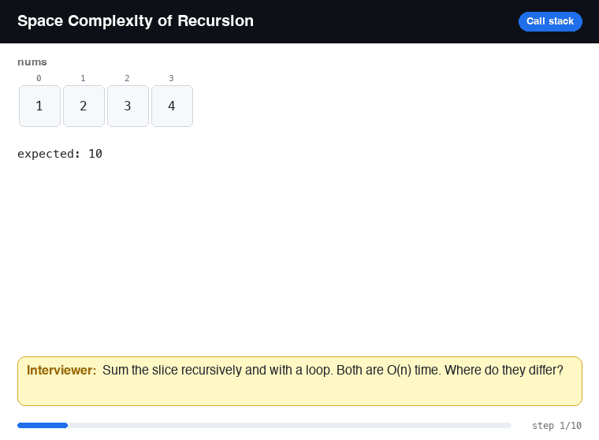

# Walkthrough: Space Complexity of Recursion

**Module:** [01 · Complexity](../README.md) · **Difficulty:** Easy · **Solution:** [`p05_recursion_space.go`](../p05_recursion_space.go)



## The problem in plain words

Add up a list of numbers in three ways: recursively one item at a time, recursively by splitting in half, and with a plain loop. All three take the same time. The lesson is that they use very different amounts of memory, because every unfinished function call takes up space on the call stack.

```
[1, 2, 3, 4]  →  10
[]            →  0
```

## Mock interview

**Interviewer:** Sum the slice recursively and with a loop. Both are O(n) time. Where do they differ?

**Candidate:** Is the empty slice allowed, and should it give 0?

**Interviewer:** Yes and yes.

**Candidate:** So `[1, 2, 3, 4]` gives 10 and `[]` gives 0.

**Candidate:** The recursive version reads like the definition: the sum is `nums[0]` plus the sum of `nums[1:]`, and the empty slice sums to 0. Slicing `nums[1:]` is O(1) in Go because it shares the backing array. So the time is O(n).

**Interviewer:** And the space?

**Candidate:** That's the catch. The first call can't finish until the second returns, the second waits for the third, and so on. On `[1, 2, 3, 4]` there are five calls alive at once: four for the elements and one for the empty base case. Each keeps a stack frame. So the space is **O(n)**, even though the function never allocates on the heap.

**Interviewer:** Can recursion use less stack?

**Candidate:** Yes, if it splits in half instead of peeling off one element. `SumHalves` sums the left half and the right half and adds them, like merge sort. The call tree still has n leaves, so the time is O(n), but it's only about log₂ n levels deep. On four elements the deepest chain is `SumHalves([1,2,3,4])` → `SumHalves([1,2])` → `SumHalves([1])`, three frames. So the stack is **O(log n)**.

**Candidate:** And the loop needs one frame and one accumulator, whatever the length: **O(1)** extra space.

**Interviewer:** Go stacks grow on demand. Does any of this matter in Go?

**Candidate:** It matters for memory, not for crashing. Go won't overflow at depth 10⁵ the way C or Python might; the test `TestSumRecursiveDeep` recurses 20,000 deep without trouble. But the memory is still used, and growing the stack costs time too. In an interview I'd still count it.

**Candidate:** Testing `SumRecursive([1, 2, 3, 4])`: the calls go down to `SumRecursive([])`, which returns 0. Then they unwind: 4 + 0 = 4, 3 + 4 = 7, 2 + 7 = 9, 1 + 9 = 10.

**Interviewer:** Summary?

**Candidate:** All three are O(n) time. Space is O(n) stack for `SumRecursive`, O(log n) stack for `SumHalves`, and **O(1)** for `SumIterative`.

## What the animation shows

| Step | What happens | Stack depth |
|---|---|---|
| 1 | Interviewer states the problem | |
| 2 | The recursive definition; each waiting call keeps a frame | 0 |
| 3 | Call `SumRecursive([1,2,3,4])` | 1 |
| 4 | Call `SumRecursive([2,3,4])` | 2 |
| 5 | Call `SumRecursive([3,4])` | 3 |
| 6 | Down to the base case `SumRecursive([])` | 5 |
| 7 | Unwind: returns 0, 4, 7, 9, 10 | 5 → 0 |
| 8 | `SumHalves` deepest path: `[1,2,3,4]` → `[1,2]` → `[1]` | 3 |
| 9 | `SumIterative`: total 0 → 1 → 3 → 6 → 10 | 1 |
| 10 | Answer 10 and the three space costs | |

## Detailed explanation

**Counting stack space.** The space a recursion uses is the *maximum number of calls alive at the same time*, times the size of one frame. It is not the total number of calls. `SumHalves` makes about 2n calls in total, but most of them have already returned before the next branch starts. At any moment only one root-to-leaf path is on the stack.

**SumRecursive.** Call k waits for call k+1, so all n + 1 calls are alive when the base case runs. Depth n + 1 means O(n) space.

**SumHalves.** Each level halves the slice, so after about log₂ n levels the pieces have length 1 or 0. The depth is ⌈log₂ n⌉ + 1, so the stack is O(log n). The work is still O(n): every element is a leaf exactly once, and each internal call does O(1) work besides its two calls. The `case 1` base returns the element directly, so the recursion never splits a one-element slice.

**SumIterative.** One loop, one variable. Nothing grows with n.

Edge cases: the empty slice returns 0 in all three. In `SumHalves`, `mid = len/2` is at least 1 whenever the length is at least 2, so both halves are shorter than the input and the recursion always ends.

## Complexity

| Approach | Time | Space |
|---|---|---|
| One-at-a-time recursion (`SumRecursive`) | O(n) | O(n) call stack |
| Split in half (`SumHalves`) | O(n) | O(log n) call stack |
| Loop (`SumIterative`) | O(n) | O(1) |

## Common mistakes

- Saying recursion is "free" because it doesn't call `make`. The stack frames are memory.
- Counting the total number of calls as the space. Only the calls alive at once count.
- Thinking `SumHalves` is O(n log n) time. It does O(1) work per call and makes O(n) calls, so it's O(n).
- Assuming re-slicing copies. `nums[1:]` is O(1) and shares memory; a version that copied would be O(n²) time.

## Try it yourself

```sh
go test ./course/01-complexity/ -run TestSum -v
```
