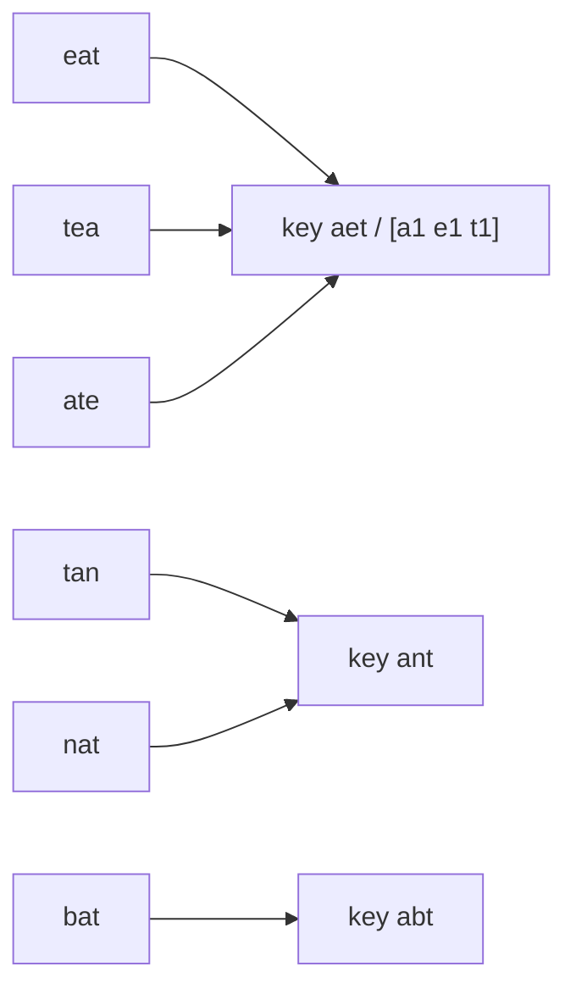

# 02 · Arrays & Hashing

> The single most useful optimisation in interviews: replace a search with a
> hash-map lookup. O(n²) becomes O(n) for the price of O(n) memory.

## What you'll learn

- When a map, a set (`map[T]struct{}`) or a fixed-size count array (`[26]int`) is the right tool.
- How to turn "for each x, search for y" into "for each x, look up y".
- Canonical keys for grouping (sorted string, letter-count array).
- Bucket sort when values are bounded (frequencies are at most n).
- Prefix/suffix passes and length-prefix framing — two techniques that recur in later modules.

## Recognize the pattern

- "Have we seen this before?", "contains duplicate", "first repeated…" → **set**.
- "Find two elements that sum/differ to target" (unsorted) → **map value → index**.
- "Count occurrences", "most/least frequent", "majority" → **counter map**.
- "Group things that are equivalent" (anagrams, same pattern, same shape) → **map canonical key → group**.
- Values in a small fixed range (lowercase letters, digits, 0..n) → **array instead of map**.
- "O(n) without sorting" on an unsorted array → almost always hashing.

## The idea

Take Two Sum. The brute force checks every pair:

```
for i:            for j > i:              is nums[i] + nums[j] == target?   O(n²)
```

The inner loop is really asking "*is `target - nums[i]` somewhere?*". A map answers that in O(1):

```
nums = [2, 7, 11, 15], target = 9

 j  x   need = 9-x   map before        found?
 0  2       7        {}                no  → store 2:0
 1  7       2        {2:0}             yes → return [0, 1]
```

Grouping works the same way, with a *canonical key* that is identical for all
equivalent items:



## Go template

```go
// 1. Seen-before set
seen := make(map[int]struct{}, len(nums))
for _, x := range nums {
    if _, ok := seen[x]; ok { /* duplicate */ }
    seen[x] = struct{}{}
}

// 2. Complement lookup (value -> index)
idx := make(map[int]int, len(nums))
for j, x := range nums {
    if i, ok := idx[target-x]; ok { return []int{i, j} }
    idx[x] = j                         // insert after lookup
}

// 3. Counting with a fixed alphabet; arrays are comparable and hashable
var cnt [26]int
for i := 0; i < len(s); i++ { cnt[s[i]-'a']++ }
groups := map[[26]int][]string{}
```

Reusable helpers live in [`arrayshashing.go`](arrayshashing.go): a generic
`Counter`, a generic `Set`, and `letterCounts`.

## Complexity

| Operation | Average | Worst |
|---|---|---|
| map insert / lookup / delete | O(1) | O(n) (pathological collisions) |
| iterate a map | O(n + buckets) | — |
| `[26]int` count / compare | O(1) per op, O(26) compare | — |

A typical hashing solution is **O(n) time, O(n) space**. If the interviewer
then asks for O(1) space, the usual answers are sorting (O(n log n)) or two
pointers ([03](../03-two-pointers/README.md)).

## Common pitfalls

- **Map iteration order is random.** If output order matters, track first-seen indices (see [`GroupAnagrams`](p04_group_anagrams.go)) or sort.
- **Slices can't be map keys** — `map[[]int]…` doesn't compile. Use an array (`[26]int`), a string, or a struct.
- **Self-pairing in Two Sum.** Look up the complement *before* inserting the current value.
- **Missing keys return the zero value.** `m[k]++` works on a missing key; but `v := m[k]` can't tell "absent" from 0 — use `v, ok := m[k]`.
- **Bytes vs runes.** `s[i]-'a'` assumes lowercase ASCII. For Unicode, `range s` yields runes; count them in `map[rune]int` ([`IsAnagramUnicode`](p02_valid_anagram.go)).
- **Integer overflow.** Products ([p06](p06_product_except_self.go)) and `x+1` at `math.MaxInt` ([p08](p08_longest_consecutive.go)) wrap silently. State your assumptions on ranges.
- **Preallocate.** `make(map[K]V, n)` avoids rehashing as the map grows.
- **Delimiters in data.** Joining with `","` breaks if a string contains a comma — length-prefix instead ([p07](p07_encode_decode.go)).

## Problems

| # | Problem | Difficulty | Key idea |
|---|---|---|---|
| 01 | [Contains Duplicate](p01_contains_duplicate.go) | Easy | Set membership; stop at first repeat |
| 02 | [Valid Anagram](p02_valid_anagram.go) | Easy | Equal `[26]int` letter counts |
| 03 | [Two Sum](p03_two_sum.go) | Easy | Map value → index; look up complement |
| 04 | [Group Anagrams](p04_group_anagrams.go) | Medium | Canonical key → group; arrays as map keys |
| 05 | [Top K Frequent Elements](p05_top_k_frequent.go) | Medium | Count, then bucket sort by frequency |
| 06 | [Product of Array Except Self](p06_product_except_self.go) | Medium | Prefix product × suffix product, no division |
| 07 | [Encode and Decode Strings](p07_encode_decode.go) | Medium | Length-prefix framing |
| 08 | [Longest Consecutive Sequence](p08_longest_consecutive.go) | Medium | Set; only count from run starts |

## Practice tip

Copy a problem's doc comment into a scratch file, delete the solution, and
re-solve it against the existing tests:

```sh
go test ./course/02-arrays-hashing/ -run TestTwoSum -v
```

Say the brute force out loud first, name its bottleneck ("the inner loop is a
search"), then write the hash version. Redo any problem you needed to peek at
after two days, then again after a week.

## Next

[03 · Two Pointers →](../03-two-pointers/README.md)
