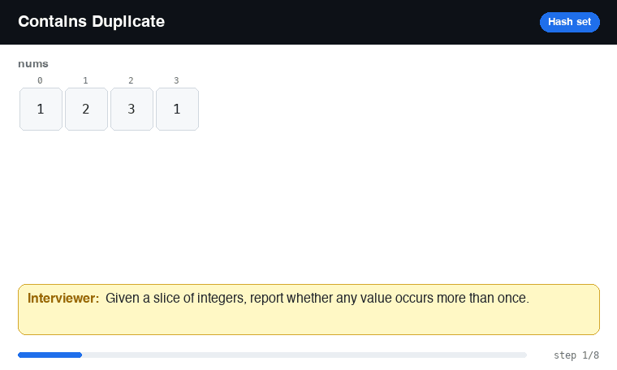

# Walkthrough: Contains Duplicate

**Module:** [02 · Arrays & Hashing](../README.md) · **Difficulty:** Easy · **Solution:** [`p01_contains_duplicate.go`](../p01_contains_duplicate.go)



## The problem in plain words

You get a list of whole numbers. Say whether any number shows up more than once.

```
[1, 2, 3, 1]  →  true    (1 appears twice)
[1, 2, 3, 4]  →  false
```

## Mock interview

**Interviewer:** Given a slice of integers, report whether any value occurs more than once.

**Candidate:** Can the slice be empty? And do I only need true or false, not which value repeats?

**Interviewer:** It can be empty, and a bool is enough.

**Candidate:** For `[1, 2, 3, 1]` the answer is true. For `[1, 2, 3, 4]` it's false. Empty or single-element slices are false.

**Candidate:** The brute force compares every pair `i < j`. That's n(n−1)/2 pairs, so **O(n²) time and O(1) space**. On four values that's 6 pairs; on 10⁵ values it's about 5 billion.

**Interviewer:** Where's the waste?

**Candidate:** The inner loop is really asking "have I seen this value before?" A set answers that question in O(1) on average. So I keep a set of values seen so far, and for each `x` I check the set first, then add `x`.

**Interviewer:** Why check before adding?

**Candidate:** If I added first, every value would find itself. Checking first means a hit always comes from an earlier index, which is a real duplicate.

**Candidate:** In code I use the package's `Set[int]`, which is a `map[int]struct{}`. The empty struct takes no memory. I preallocate it with `len(nums)`. In the loop: if `seen.Has(x)`, return true; otherwise `seen.Add(x)`. After the loop, return false.

**Candidate:** Testing on `[1, 2, 3, 1]`: 1 isn't in the set, add it. 2 isn't, add it. 3 isn't, add it. 1 is in the set, so I return true and stop.

**Interviewer:** Complexity?

**Candidate:** One pass with O(1) average set operations: **O(n) time**. The set can hold up to n values: **O(n) space**.

## What the animation shows

| Step | `x` | In set? | Set after | Decision |
|---|---|---|---|---|
| 1 | | | | Interviewer states the problem |
| 2 | | | | Brute force: 6 pairs, O(n²) |
| 3 | | | `{}` | Start with an empty set |
| 4 | 1 | no | `{1}` | add |
| 5 | 2 | no | `{1, 2}` | add |
| 6 | 3 | no | `{1, 2, 3}` | add |
| 7 | 1 | yes | `{1, 2, 3}` | return true (indices 0 and 3) |
| 8 | | | | Answer true and the complexity |

## Detailed explanation

The loop keeps this invariant: *before processing index i, the set holds exactly the distinct values in `nums[0..i-1]`.*

- If `nums[i]` is already in the set, it equals some earlier value, so there is a duplicate. Returning true is correct.
- If the loop finishes, every value was missing from the set when it arrived, so no value appeared twice. Returning false is correct.

The early return matters in practice. With a duplicate near the front, the function does almost no work. The worst case is a slice with no duplicates, where every value is checked and inserted once.

This trades memory for time. If memory is tight, sorting a copy and checking neighbours is O(n log n) time. Module 01 compares all three versions side by side.

Edge cases: empty and single-element slices return false. Negative numbers and extreme values like `math.MinInt` need no special handling, because the code only compares values.

## Complexity

| Approach | Time | Space |
|---|---|---|
| Brute force (`ContainsDuplicateBrute`) | O(n²) | O(1) |
| Hash set (`ContainsDuplicate`) | O(n) average | O(n) |

## Common mistakes

- Adding to the set before checking it, so the first value always looks like a duplicate.
- Using `map[int]bool` and then checking `seen[x]` without setting it to true. `map[int]struct{}` with a comma-ok lookup avoids that confusion.
- Starting the brute-force inner loop at `j = 0`, so each value matches itself.
- Building the whole set first and then comparing its size with `len(nums)`. That's correct, but it can't stop early.

## Try it yourself

```sh
go test ./course/02-arrays-hashing/ -run TestContainsDuplicate -v
```
