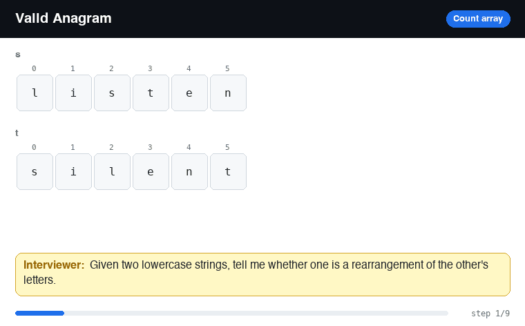

# Walkthrough: Valid Anagram

**Module:** [02 · Arrays & Hashing](../README.md) · **Difficulty:** Easy · **Solution:** [`p02_valid_anagram.go`](../p02_valid_anagram.go)



## The problem in plain words

Two words are anagrams if you can rearrange the letters of one to get the other. Given two lowercase words, say whether they are anagrams.

```
s = "listen", t = "silent"  →  true
s = "rat",    t = "car"     →  false
```

## Mock interview

**Interviewer:** Given `s` and `t` made of lowercase English letters, report whether they are anagrams.

**Candidate:** Only `a` to `z`? No spaces, capitals or Unicode?

**Interviewer:** Only `a` to `z`. We can talk about Unicode afterwards.

**Candidate:** "listen" and "silent" use the same six letters, so true. "rat" and "car" differ in one letter, so false. Two empty strings are anagrams. Strings of different lengths never are.

**Candidate:** A simple solution sorts both strings and compares them. Anagrams become the same string after sorting: both become "eilnst". That's `IsAnagramSort`, **O(n log n) time** and O(n) space for the byte slices.

**Interviewer:** Can you avoid sorting?

**Candidate:** Order doesn't matter, only how many of each letter. So I count. With 26 possible letters, a `[26]int` array works better than a map: index `ch - 'a'` is a direct array access, with no hashing. I count `s` into one array and `t` into another.

**Interviewer:** Then how do you compare them?

**Candidate:** Go arrays are comparable, so `letterCounts(s) == letterCounts(t)` compares all 26 counters in one expression. Slices can't do that, but arrays can.

**Candidate:** I also check the lengths first. If they differ, I return false without counting anything.

**Candidate:** Testing: both lengths are 6. Counting "listen" gives one each of e, i, l, n, s and t. Counting "silent" gives the same. The arrays are equal, so the answer is true.

**Interviewer:** What if the input could be any Unicode text?

**Candidate:** Then 26 counters aren't enough, and I can't count bytes, because "é" is two bytes but one letter. `IsAnagramUnicode` ranges over runes into a `map[rune]int`. It adds one for each rune in `s` and subtracts one for each rune in `t`. If any count goes below zero, or any is left non-zero at the end, they're not anagrams.

**Interviewer:** Complexity?

**Candidate:** `IsAnagram` is **O(n) time and O(1) space**, since 26 counters is a constant. The Unicode version is O(n) time and O(k) space for k distinct runes.

## What the animation shows

| Step | What happens |
|---|---|
| 1 | Interviewer gives `s = "listen"`, `t = "silent"` |
| 2 | Sorting both gives "eilnst" twice; works, but O(n log n) |
| 3 | Length check: 6 and 6, so continue |
| 4 | `s[0] = 'l'`: counter for `l` becomes 1 |
| 5 | `s[1] = 'i'`: counter for `i` becomes 1 |
| 6 | After `s[5] = 'n'`: the `s` row holds all of s's letter counts |
| 7 | The same pass over `t` fills the second row |
| 8 | `letterCounts(s) == letterCounts(t)` is true |
| 9 | Answer true and the complexity of all three versions |

## Detailed explanation

Two strings are anagrams exactly when every letter appears the same number of times in both. Rearranging letters never changes those counts, and if the counts match you can rearrange one string into the other. So comparing count arrays is a complete test.

`letterCounts` walks the string byte by byte and increments `c[ch-'a']` for bytes in `'a'..'z'`. It ignores anything else, which is safe because the problem promises lowercase input. The comparison `==` on two `[26]int` values compares element by element, which is 26 comparisons: constant work.

The length check is not needed for correctness, since different lengths always give different counts. It's a cheap early exit.

`IsAnagramUnicode` uses a single map. After the first loop, `counts[r]` is how many times `r` appears in `s`. The second loop subtracts. A negative count means `t` has more of that rune than `s`, so it returns false right away. If every count ends at zero, the multisets match.

Edge cases: two empty strings return true. "a" and "aa" return false at the length check.

## Complexity

| Approach | Time | Space |
|---|---|---|
| Sort and compare (`IsAnagramSort`) | O(n log n) | O(n) |
| Count array (`IsAnagram`) | O(n) | O(1), 26 counters |
| Rune map (`IsAnagramUnicode`) | O(n) | O(k) distinct runes |

## Common mistakes

- Using a map for 26 letters. It works, but an array is faster and can be compared with `==`.
- Indexing with `ch` instead of `ch - 'a'`, which goes out of range.
- Counting bytes in Unicode text, so multi-byte letters are split.
- Comparing only the set of letters, not the counts. "aab" and "abb" have the same letters but aren't anagrams.

## Try it yourself

```sh
go test ./course/02-arrays-hashing/ -run TestIsAnagram -v
```
