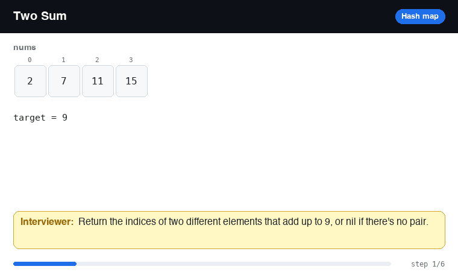

# Walkthrough: Two Sum

**Module:** [02 · Arrays & Hashing](../README.md) · **Difficulty:** Easy · **Solution:** [`p03_two_sum.go`](../p03_two_sum.go)



## The problem in plain words

You get a list of numbers, not sorted, and a target. Find two different positions whose numbers add up to the target.

```
nums = [2, 7, 11, 15], target = 9  →  [0, 1]   because 2 + 7 = 9
nums = [3, 3],         target = 6  →  [0, 1]
```

## Mock interview

**Interviewer:** Given `nums` and a target, return indices `[i, j]` with `i < j` of two different elements that add up to the target, or `nil` if there's no pair.

**Candidate:** The slice isn't sorted? And can the same value appear twice, like `[3, 3]`?

**Interviewer:** Not sorted, and yes, duplicates are allowed. Two equal values at different indices are a valid pair.

**Candidate:** For `[2, 7, 11, 15]` and 9 the answer is `[0, 1]`. For `[3, 3]` and 6 it's `[0, 1]`. For a single element there's no pair, so `nil`.

**Candidate:** The brute force tries every pair with two loops. That's **O(n²) time and O(1) space**.

**Interviewer:** Where's the time going?

**Candidate:** For each `x`, the inner loop searches for one specific value: `target - x`, the complement. Searching is what a hash map is for. If I keep a map from each value I've seen to its index, finding the complement is an O(1) lookup.

**Candidate:** So I walk the slice once. At index `j` with value `x`, I look up `target - x` in the map. If it's there at index `i`, I return `[i, j]`. If not, I store `x → j` and move on.

**Interviewer:** Why look up before inserting?

**Candidate:** So an element can't pair with itself. With target 6 and `x = 3`, inserting first would find the 3 I just added and return `[j, j]`. Looking up first means every match comes from an earlier index, which also guarantees `i < j`.

**Candidate:** In code: `indexOf := make(map[int]int, len(nums))`, then `for j, x := range nums`, then the lookup with comma-ok, then the insert. After the loop, return `nil`.

**Candidate:** Testing on the example: `x = 2`, I need 7, the map is empty, so I store `2 → 0`. `x = 7`, I need 2, and 2 is in the map at index 0. I return `[0, 1]`.

**Interviewer:** And `[3, 3]`?

**Candidate:** The first 3 needs 3, the map is empty, so I store `3 → 0`. The second 3 needs 3, finds index 0, and returns `[0, 1]`. Storing the later index over an earlier equal value doesn't matter, because I'd already have returned.

**Interviewer:** Complexity?

**Candidate:** One pass with O(1) average lookups: **O(n) time**. The map can hold up to n entries: **O(n) space**.

## What the animation shows

| Step | `j` | `x` | Need | Map before | Decision |
|---|---|---|---|---|---|
| 1 | | | | | Interviewer states the problem |
| 2 | | | | | Brute force: every pair, O(n²) |
| 3 | | | | `{}` | Plan: look up, then insert |
| 4 | 0 | 2 | 7 | `{}` | not found → store `2: 0` |
| 5 | 1 | 7 | 2 | `{2: 0}` | found at 0 → return `[0, 1]` |
| 6 | | | | | Answer `[0, 1]` and the complexity |

## Detailed explanation

The loop keeps this invariant: *before processing index j, `indexOf` maps every value in `nums[0..j-1]` to an index where it appears.*

If a valid pair `(i, j)` exists with `i < j`, then when the loop reaches `j`, `nums[i]` is already in the map, and `target - nums[j] = nums[i]`. So the lookup succeeds at the latest at index `j`. The function returns the first `j` that has a partner, which is a correct answer.

If the loop finishes, no index found its complement among the earlier values. Any pair would have been found when the loop reached its larger index, so there's no pair, and `nil` is correct.

This is the main idea of the whole module: **replace a search with a lookup**. The brute force's inner loop is an O(n) search; the map turns it into O(1), and the price is O(n) memory.

If the slice were sorted, two pointers would solve it in O(n) time and O(1) space. That's Two Sum II in module 03.

## Complexity

| Approach | Time | Space |
|---|---|---|
| Brute force (`TwoSumBrute`) | O(n²) | O(1) |
| One-pass hash map (`TwoSum`) | O(n) average | O(n) |

## Common mistakes

- Inserting before looking up, which lets an element pair with itself.
- Filling the whole map first and then looking up. It works only if you also check that the found index isn't `j`, and it's an extra pass.
- Returning values instead of indices.
- Sorting first to use two pointers. Sorting loses the original indices unless you carry them along.

## Try it yourself

```sh
go test ./course/02-arrays-hashing/ -run TestTwoSum -v
```
