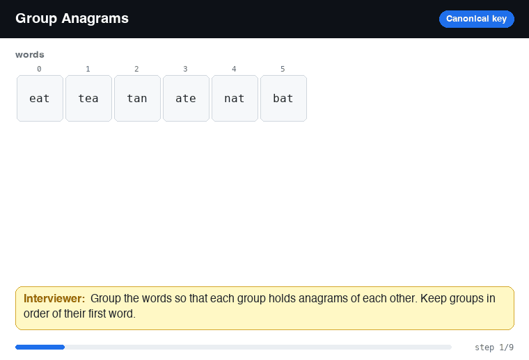

# Walkthrough: Group Anagrams

**Module:** [02 · Arrays & Hashing](../README.md) · **Difficulty:** Medium · **Solution:** [`p04_group_anagrams.go`](../p04_group_anagrams.go)



## The problem in plain words

You get a list of lowercase words. Put words that are anagrams of each other into the same group. Groups come out in the order their first word appears, and words keep their order inside a group.

```
["eat","tea","tan","ate","nat","bat"]  →  [["eat","tea","ate"], ["tan","nat"], ["bat"]]
[""]                                   →  [[""]]
```

## Mock interview

**Interviewer:** Partition the words into groups of anagrams. Groups appear in the order of their first word, and words keep their input order inside a group.

**Candidate:** All lowercase `a` to `z`? Can a word be empty?

**Interviewer:** Lowercase only, and yes, the empty string is a valid word.

**Candidate:** On the example, "eat", "tea" and "ate" share the letters a, e, t. "tan" and "nat" share a, n, t. "bat" is alone. An empty string forms its own group.

**Candidate:** A brute force takes each word and compares it with the first word of every existing group using an anagram check. With n words of length k that's O(n²·k).

**Interviewer:** How do you avoid comparing against every group?

**Candidate:** I give each word a **canonical key** that is the same for all its anagrams and different otherwise. Then I group by key in a map, so finding the right group is one lookup.

**Interviewer:** What key?

**Candidate:** Two options. The sorted word works: "eat", "tea" and "ate" all become "aet". That costs O(k log k) per word; it's `GroupAnagramsSorted`. Or the letter-count array: `[26]int`. Counting costs O(k). In Go an array is comparable, so the array itself can be a map key. A slice can't be.

**Interviewer:** Go map iteration is random. How do you keep the output order?

**Candidate:** I don't iterate the map. The map goes from key to a *group index*, and the groups live in a slice. When a key is new, I append an empty group and remember its index. Then I append the word to `groups[i]`. The slice keeps first-appearance order.

**Candidate:** Testing: "eat" has counts a1 e1 t1, which is new, so it opens group 0. "tea" has the same key, so it joins group 0. "tan" is a1 n1 t1, new, so group 1. "ate" joins group 0. "nat" joins group 1. "bat" is a1 b1 t1, new, so group 2. The result is `[[eat tea ate] [tan nat] [bat]]`.

**Interviewer:** Complexity?

**Candidate:** Each word costs O(k) to count and O(1) to look up (the key is a fixed 26 ints). So **O(n·k) time**. The groups hold every word, and the map holds up to n keys: **O(n·k) space**.

## What the animation shows

| Step | Word | Key (non-zero counts) | Group |
|---|---|---|---|
| 1 | | | Interviewer states the problem |
| 2 | | | Brute force: compare with every group, O(n²·k) |
| 3 | eat | a1 e1 t1 | new group 0 |
| 4 | tea | a1 e1 t1 | group 0 |
| 5 | tan | a1 n1 t1 | new group 1 |
| 6 | ate | a1 e1 t1 | group 0 |
| 7 | nat | a1 n1 t1 | group 1 |
| 8 | bat | a1 b1 t1 | new group 2 |
| 9 | | | Answer and complexity |

The animation prints each `[26]int` key as just its non-zero counters to keep it readable.

## Detailed explanation

The key works because two words are anagrams exactly when their letter counts are equal (see Valid Anagram). So equal keys mean same group, and different keys mean different groups. Grouping by key is therefore exactly grouping by "is an anagram of".

The code uses two structures:

- `groupIdx map[[26]int]int` maps a key to the position of its group.
- `groups [][]string` holds the groups in the order they were created.

For each word, the comma-ok lookup either finds the group index or creates a new group at index `len(groups)`. Then the word is appended. Since words are processed in input order, both the order of groups and the order within each group follow the input.

The sorted-word key is simpler to explain and works for any alphabet, but costs O(k log k) per word. The count key is O(k) but only works for a fixed alphabet. For Unicode you'd use the sorted runes as the key.

Edge cases: `[""]` gives one group `[""]`, because the empty word's key is all zeros. An empty input gives an empty (non-nil) result.

## Complexity

| Approach | Time | Space |
|---|---|---|
| Sorted-word key (`GroupAnagramsSorted`) | O(n·k log k) | O(n·k) |
| Count-array key (`GroupAnagrams`) | O(n·k) | O(n·k) |

Here n is the number of words and k is the length of the longest word.

## Common mistakes

- Using a `[]int` as a map key. Slices aren't comparable, so it won't compile. Use `[26]int`.
- Building the output by ranging over the map, which gives a random group order.
- Joining counts into a string like `"1,0,0,…"` as the key. It works but allocates for every word; the array key doesn't.
- Forgetting that the empty string is a valid word with its own group.

## Try it yourself

```sh
go test ./course/02-arrays-hashing/ -run TestGroupAnagrams -v
```
