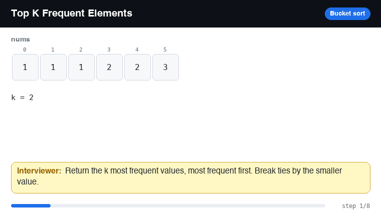

# Walkthrough: Top K Frequent Elements

**Module:** [02 · Arrays & Hashing](../README.md) · **Difficulty:** Medium · **Solution:** [`p05_top_k_frequent.go`](../p05_top_k_frequent.go)



## The problem in plain words

You get a list of numbers and a number k. Return the k values that appear most often, most frequent first. If two values appear equally often, the smaller value comes first.

```
nums = [1,1,1,2,2,3], k = 2  →  [1, 2]
nums = [4],           k = 1  →  [4]
```

## Mock interview

**Interviewer:** Return the k values that occur most often in `nums`, most frequent first. Break ties by the smaller value.

**Candidate:** Is k always at most the number of distinct values? And can k be 0?

**Interviewer:** 0 ≤ k ≤ number of distinct values.

**Candidate:** In `[1,1,1,2,2,3]`, 1 appears 3 times, 2 twice and 3 once. With k = 2 the answer is `[1, 2]`. With k = 0 it's an empty slice.

**Candidate:** First I count with a map: one pass gives `{1: 3, 2: 2, 3: 1}`. The straightforward next step sorts the distinct values by count, descending, then by value. That's `TopKFrequentSort`: **O(n + d log d)** where d is the number of distinct values.

**Interviewer:** Can you avoid the sort?

**Candidate:** Yes. A count can't be more than n. So I make n + 1 buckets, where `buckets[f]` holds every value that appears exactly f times. Putting each value into its bucket needs no comparisons. Then I walk the buckets from f = n down to 1 and collect values until I have k. That's bucket sort, and it's **O(n)**.

**Interviewer:** What about ties inside a bucket?

**Candidate:** Map iteration in Go is random, so values land in a bucket in random order. I sort each bucket before reading it, so ties come out smallest first. Buckets are usually tiny, and I stop as soon as I have k values.

**Candidate:** In code: `counts := Counter(nums)`, `buckets := make([][]int, len(nums)+1)`, a loop that appends each value to `buckets[c]`, then a loop `for f := len(buckets)-1; f > 0 && len(res) < k; f--` that sorts the bucket and appends values until `len(res) == k`.

**Candidate:** Testing: n = 6, so 7 buckets, 0 to 6. 1 goes into bucket 3, 2 into bucket 2, 3 into bucket 1. Walking down, buckets 6, 5 and 4 are empty. Bucket 3 gives 1. Bucket 2 gives 2. Now I have two values, so I stop with `[1, 2]`.

**Interviewer:** Complexity?

**Candidate:** Counting is O(n). Filling buckets is O(d). Walking n + 1 buckets is O(n). So **O(n) time**, plus the cost of sorting tied values in the buckets I read. Space is **O(n)** for the map and the buckets.

## What the animation shows

| Step | What happens |
|---|---|
| 1 | Interviewer gives `[1,1,1,2,2,3]`, k = 2 |
| 2 | Count with a map: `{1: 3, 2: 2, 3: 1}`; sorting would work but isn't needed |
| 3 | Make 7 empty buckets, index = frequency |
| 4 | 1 → bucket 3, 2 → bucket 2, 3 → bucket 1 |
| 5 | Walk from the top: buckets 6, 5, 4 are empty, skip |
| 6 | Bucket 3 gives 1: `res = [1]` |
| 7 | Bucket 2 gives 2: `res = [1, 2]`, which has k values, so stop |
| 8 | Answer `[1, 2]` and the complexity |

## Detailed explanation

**Why n + 1 buckets is enough.** A value can appear at most n times, and at least once if it's in the map. So every count is in `1..n`, and indices `0..n` cover them all. Bucket 0 stays empty, which is why the loop condition is `f > 0`.

**Why reading top-down is correct.** Every value in bucket f appears more often than every value in a lower bucket. Reading from the highest f down therefore produces values in order of decreasing frequency. Sorting each bucket handles the tie rule: equal frequency, smaller value first.

**Why it's O(n).** Building the counter touches each element once. Each distinct value is placed in exactly one bucket. The outer loop visits at most n + 1 buckets. The only extra cost is sorting the buckets that are actually read; in the worst case, where all values tie, that's O(d log d), the same as the sort-based version.

`TopKFrequentSort` is simpler and fine when d is small. It sorts with `cmp.Or(cmp.Compare(counts[b], counts[a]), cmp.Compare(a, b))`: count descending, then value ascending.

Edge cases: k = 0 returns an empty slice because the loop condition `len(res) < k` is false from the start. A single-element input returns that element.

## Complexity

| Approach | Time | Space |
|---|---|---|
| Count then sort (`TopKFrequentSort`) | O(n + d log d) | O(n) |
| Count then bucket (`TopKFrequent`) | O(n), plus sorting tied buckets | O(n) |

Here d is the number of distinct values.

## Common mistakes

- Making `len(counts)` buckets instead of `len(nums) + 1`. A count can be as large as n.
- Reading buckets from low to high, which gives the least frequent values.
- Not stopping inside a bucket when `len(res) == k`, so you return more than k values.
- Forgetting that map iteration order is random, so ties come out in a different order each run.

## Try it yourself

```sh
go test ./course/02-arrays-hashing/ -run TestTopKFrequent -v
```
