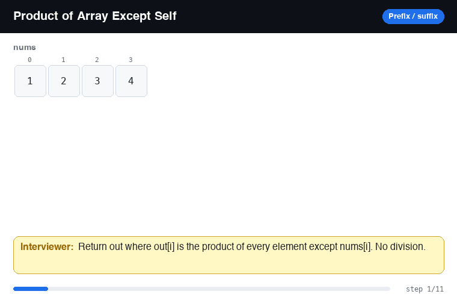

# Walkthrough: Product of Array Except Self

**Module:** [02 · Arrays & Hashing](../README.md) · **Difficulty:** Medium · **Solution:** [`p06_product_except_self.go`](../p06_product_except_self.go)



## The problem in plain words

For each position in a list, multiply together every *other* number. Return those products as a new list. You may not use division.

```
[1, 2, 3, 4]    →  [24, 12, 8, 6]
[-1, 1, 0, -3]  →  [0, 0, 3, 0]
```

## Mock interview

**Interviewer:** Return `out` where `out[i]` is the product of every element except `nums[i]`. No division. Assume the products fit in an int.

**Candidate:** Can the input contain zeros or negatives?

**Interviewer:** Both.

**Candidate:** For `[1, 2, 3, 4]`: out[0] = 2·3·4 = 24, out[1] = 1·3·4 = 12, out[2] = 8, out[3] = 6. With one zero, like `[-1, 1, 0, -3]`, every position except the zero's gets 0, and the zero's position gets the product of the rest, 3. Zeros are also why division is a bad idea: you can't divide by zero.

**Candidate:** The brute force multiplies the other n − 1 values for each i. That's **O(n²) time**.

**Interviewer:** How do you do better without dividing?

**Candidate:** Split the product at i into two parts: everything **left** of i times everything **right** of i. Both parts are running products. A left-to-right pass gives every prefix product, and a right-to-left pass gives every suffix product.

**Interviewer:** That sounds like two extra arrays.

**Candidate:** I can avoid them. In the first pass I write the prefix products straight into `out`: `out[i] = left`, then `left *= nums[i]`. In the second pass I keep the suffix product in one variable: `out[i] *= right`, then `right *= nums[i]`. The order matters in both passes: I use the running product *before* including `nums[i]`, so `nums[i]` itself is left out.

**Candidate:** Testing on `[1, 2, 3, 4]`. Pass 1 writes `out = [1, 1, 2, 6]`; those are the products of everything to the left. Pass 2 goes right to left with `right` = 1, 4, 12, 24: out[3] = 6·1 = 6, out[2] = 2·4 = 8, out[1] = 1·12 = 12, out[0] = 1·24 = 24. The result is `[24, 12, 8, 6]`.

**Interviewer:** Why does this handle zeros?

**Candidate:** It never divides. A zero just makes every running product that includes it 0, which is exactly right for the positions that should include it. The position of the zero itself never multiplies by it.

**Interviewer:** Complexity?

**Candidate:** Two passes: **O(n) time**. Apart from the output, only `left` and `right`: **O(1) extra space**.

## What the animation shows

| Step | Pass | `i` | Update | `out` after |
|---|---|---|---|---|
| 1 | | | Interviewer states the problem | |
| 2 | | | Brute force O(n²); division not allowed | |
| 3 | left → right | 0 | out[0] = 1, left = 1 | `[1, _, _, _]` |
| 4 | left → right | 1 | out[1] = 1, left = 2 | `[1, 1, _, _]` |
| 5 | left → right | 2 | out[2] = 2, left = 6 | `[1, 1, 2, _]` |
| 6 | left → right | 3 | out[3] = 6, left = 24 | `[1, 1, 2, 6]` |
| 7 | right → left | 3 | out[3] = 6 × 1, right = 4 | `[1, 1, 2, 6]` |
| 8 | right → left | 2 | out[2] = 2 × 4, right = 12 | `[1, 1, 8, 6]` |
| 9 | right → left | 1 | out[1] = 1 × 12, right = 24 | `[1, 12, 8, 6]` |
| 10 | right → left | 0 | out[0] = 1 × 24, right = 24 | `[24, 12, 8, 6]` |
| 11 | | | Answer and complexity | |

## Detailed explanation

After the first loop, `out[i]` equals the product of `nums[0..i-1]`. That's because `left` starts at 1 (the empty product) and, at each step, is assigned to `out[i]` *before* it absorbs `nums[i]`.

The second loop keeps this invariant: *when the loop reaches index i, `right` equals the product of `nums[i+1..n-1]`.* It starts at 1 for i = n − 1, where nothing is to the right. Multiplying `out[i]` by `right` gives (product left of i) × (product right of i), which is the product of everything except `nums[i]`. Then `right` absorbs `nums[i]` for the next index.

The output slice doesn't count toward extra space, by the usual convention, because the problem requires it. So the extra space is two ints.

Edge cases:

- One zero: only its own position gets a non-zero product.
- Two or more zeros: every position includes at least one zero, so everything is 0.
- One element: `out = [1]`, the empty product.
- Empty input: returns an empty slice.

## Complexity

| Approach | Time | Space |
|---|---|---|
| Brute force (`ProductExceptSelfBrute`) | O(n²) | O(1) extra |
| Prefix × suffix (`ProductExceptSelf`) | O(n) | O(1) extra (output not counted) |

## Common mistakes

- Multiplying `left` by `nums[i]` *before* writing `out[i]`, which includes `nums[i]` in its own product.
- Starting `left` or `right` at 0 instead of 1.
- Computing the total product and dividing. It breaks on zeros and the problem forbids it.
- Allocating separate prefix and suffix arrays. It works, but uses O(n) extra space you don't need.

## Try it yourself

```sh
go test ./course/02-arrays-hashing/ -run TestProductExceptSelf -v
```
