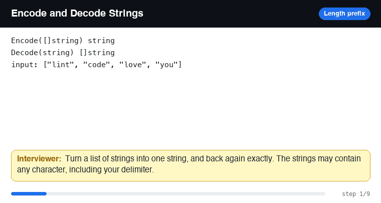

# Walkthrough: Encode and Decode Strings

**Module:** [02 · Arrays & Hashing](../README.md) · **Difficulty:** Medium · **Solution:** [`p07_encode_decode.go`](../p07_encode_decode.go)



## The problem in plain words

Write two functions. `Encode` packs a list of strings into one string. `Decode` unpacks it back into exactly the same list. The strings can contain any character, including whatever separator you pick, and they can be empty.

```
["lint","code","love","you"]  →  "4#lint4#code4#love3#you"  →  back again
["", "#"]                     →  "0#1##"                     →  back again
```

## Mock interview

**Interviewer:** Design `Encode`, which turns a list of strings into one string, and `Decode`, which recovers the exact list. Strings may contain any character, including your delimiter, and may be empty.

**Candidate:** Any byte at all, including digits and `#`? And should `Decode` report bad input?

**Interviewer:** Any byte. Return an error for input `Encode` couldn't have produced.

**Candidate:** So `["lint", "code", "love", "you"]` must round-trip, and so must tricky ones like `["", "#"]` or `["a#b"]`.

**Candidate:** The obvious idea is to join with a delimiter like `#`. But then `["a#b"]` and `["a", "b"]` both encode to `"a#b"`, and the decoder can't tell them apart. Escaping the delimiter fixes it, but it's fiddly to get right.

**Interviewer:** What would you do instead?

**Candidate:** Length-prefix framing, the same trick network protocols use. For each string I write its byte length, then a `#`, then the bytes. `"lint"` becomes `4#lint`. The decoder reads the number, skips the `#`, and takes exactly that many bytes. It never looks inside the payload, so a `#` or digits inside a string can't confuse it.

**Interviewer:** How does the decoder find the end of the number?

**Candidate:** It searches for the first `#` starting at the current position. The length is made only of digits, so the first `#` it meets is the separator, never a `#` from a payload.

**Candidate:** In code, `Encode` uses a `strings.Builder`: `strconv.Itoa(len(s))`, then `'#'`, then `s`. `Decode` loops while `i < len(encoded)`: find `hash` with `strings.IndexByte(encoded[i:], '#')`, parse the digits with `strconv.Atoi`, compute `start = i + hash + 1`, check that `start + n` is in range, append `encoded[start:start+n]`, and set `i = start + n`. If the `#` is missing, the digits are bad, or the length runs past the end, it returns `ErrMalformed`.

**Candidate:** Testing: encoding gives `4#lint4#code4#love3#you`. Decoding: at i = 0 the digits are `4`, so I take bytes 2 to 6, `"lint"`, and jump to 6. At 6 the digits are `4`, so `"code"`, and I jump to 12. Then `"love"`, then `3` gives `"you"`, and i reaches the end. I get the original list back.

**Interviewer:** What about `["", "#"]`?

**Candidate:** That encodes to `0#1##`. The decoder reads 0 and takes an empty string, then reads 1 and takes the single byte `#`. It works because the payload is sliced by length, not searched.

**Interviewer:** Complexity?

**Candidate:** Each byte is written once and read once: **O(total length) time and space** for both functions.

## What the animation shows

| Step | What happens |
|---|---|
| 1 | Interviewer states the problem with `["lint","code","love","you"]` |
| 2 | Joining with `#` is ambiguous: `["a#b"]` and `["a","b"]` both give `"a#b"` |
| 3 | Encode `"lint"` as `4#lint` (length purple, `#` orange, payload green) |
| 4 | `"code"` and `"love"` go the same way, then `"you"` as `3#you` |
| 5 | Decode at i = 0: digits `4`, slice [2:6] = `"lint"` |
| 6 | Decode at i = 6: digits `4`, slice [8:12] = `"code"` |
| 7 | Decode at i = 12: digits `4`, slice [14:18] = `"love"` |
| 8 | Decode at i = 18: digits `3`, slice [20:23] = `"you"` |
| 9 | Decoded list equals the input; `["", "#"]` → `"0#1##"` also round-trips |

## Detailed explanation

The encoding is a sequence of frames, each `<length>#<payload>`. Decoding works because at every frame boundary the decoder knows exactly what comes next: a run of digits, then a `#`. The digits can't contain `#`, so `IndexByte` finds the right separator. The length then tells the decoder exactly where the payload ends, so the next frame starts at a known position. By induction over the frames, every string is recovered exactly.

Lengths are in **bytes**, because Go strings are sliced by byte. A string with multi-byte UTF-8 characters still round-trips, since `len(s)` and `encoded[start:start+n]` both count bytes.

`Decode` rejects input that couldn't come from `Encode`:

- No `#` after position i, or a `#` right at i (`hash <= 0`): no length.
- Digits that don't parse, or a negative length.
- A length that runs past the end of the input.

An empty list encodes to `""`, and decoding `""` gives an empty, non-nil slice.

Another option is a fixed-width length, for example 4 bytes per string. That avoids the `#` search but makes the format less readable and limits string size.

## Complexity

| Function | Time | Space |
|---|---|---|
| `Encode` | O(total length) | O(total length) |
| `Decode` | O(total length) | O(total length) |

## Common mistakes

- Using a delimiter alone, without escaping or lengths. It breaks as soon as a string contains the delimiter.
- Searching for `#` from the start of the whole string instead of from the current position.
- Counting runes instead of bytes for the length, then slicing by bytes.
- Building the result with `+=` in a loop, which is O(n²). Use `strings.Builder`.
- Trusting the length without a bounds check, which panics on malformed input.

## Try it yourself

```sh
go test ./course/02-arrays-hashing/ -run TestEncodeDecodeRoundTrip -v
```
