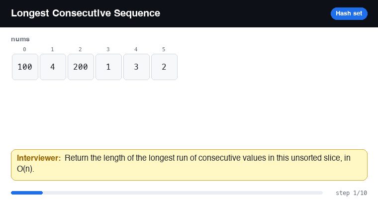

# Walkthrough: Longest Consecutive Sequence

**Module:** [02 · Arrays & Hashing](../README.md) · **Difficulty:** Medium · **Solution:** [`p08_longest_consecutive.go`](../p08_longest_consecutive.go)



## The problem in plain words

You get an unsorted list of whole numbers. Find the longest run of numbers that follow each other, like 1, 2, 3, 4, where every number in the run is somewhere in the list. Return how long that run is. Position in the list doesn't matter, and repeated numbers count once.

```
[100, 4, 200, 1, 3, 2]          →  4   (1, 2, 3, 4)
[0, 3, 7, 2, 5, 8, 4, 6, 0, 1]  →  9   (0 … 8)
```

## Mock interview

**Interviewer:** Given an unsorted slice of integers, return the length of the longest run of consecutive values that all appear in it. Aim for O(n).

**Candidate:** Duplicates count once? And an empty slice gives 0?

**Interviewer:** Yes to both.

**Candidate:** In `[100, 4, 200, 1, 3, 2]`, the values 1, 2, 3, 4 are all there, so the answer is 4. 100 and 200 are runs of length 1.

**Candidate:** One approach is to sort a copy and scan for neighbours that differ by 1, skipping equal neighbours. That's `LongestConsecutiveSort`, **O(n log n)**. It's simple, but you asked for O(n).

**Interviewer:** How would you get O(n)?

**Candidate:** The question "is x + 1 there?" is a set lookup. So I put every value in a set. Then for each x I could count up: x + 1, x + 2, and so on. But if I do that from every value, a run of length L gets counted from each of its members, and that's O(n²) in the worst case.

**Interviewer:** So how do you avoid recounting?

**Candidate:** I only start counting at the **beginning** of a run: a value x where x − 1 is *not* in the set. If x − 1 is there, x is in the middle of a run that will be counted from its start, so I skip it.

**Candidate:** In code: `set := NewSet(nums)`, then `for x := range set`. If `set.Has(x - 1)`, continue. Otherwise `length := 1`, and while `set.Has(x + length)`, increment `length`. Keep `best = max(best, length)`. I range over the set, not `nums`, so a duplicate start isn't expanded twice.

**Candidate:** Testing on the example. Go's map order is random, but the result doesn't depend on it; I'll go in input order. 100: 99 is missing, so it starts a run, and 101 is missing, so length 1. 4: 3 is present, skip. 200: start, length 1. 1: 0 is missing, so start; 2, 3 and 4 are there and 5 isn't, so length 4. 3 and 2: their predecessors are present, skip. The best is 4.

**Interviewer:** There's a loop inside a loop. Why is it O(n)?

**Candidate:** The inner loop only runs from a run's start, and it walks through that run once. Every value belongs to exactly one run, so across all starts the inner loop visits each value once. The outer loop also visits each value once. So each value is touched at most twice: **O(n) time**. The set is **O(n) space**.

## What the animation shows

| Step | `x` | `x − 1` in set? | Action | `best` |
|---|---|---|---|---|
| 1 | | | Interviewer states the problem | |
| 2 | | | Sorting works but is O(n log n) | |
| 3 | | | Build the set; only count from run starts | 0 |
| 4 | 100 | no | start; run is just 100, length 1 | 1 |
| 5 | 4 | yes (3) | skip | 1 |
| 6 | 200 | no | start; length 1 | 1 |
| 7 | 1 | no | start; count 1 → 2 → 3 → 4, length 4 | 4 |
| 8 | 3 | yes (2) | skip | 4 |
| 9 | 2 | yes (1) | skip | 4 |
| 10 | | | Answer 4 and the complexity | |

The animation visits the set in input order. Go's real map order is random, but every order gives the same answer.

## Detailed explanation

**Correctness.** Every maximal run of consecutive values has exactly one smallest element s, and s − 1 is not in the set (otherwise the run would extend lower). So the outer loop treats s as a start, and the inner loop counts s, s + 1, … until the first missing value. That count is exactly the run's length. Every run is measured once, and `best` ends as the longest.

**Running time.** Values that aren't starts cost one lookup each. A start s with run length L costs L lookups that succeed plus one that fails. The runs don't overlap, so the sum of all L is at most the number of distinct values. In total that's O(n) set operations.

**Why range over the set.** If you range over `nums` and a run start appears many times, say `[1, 1, 1, …, 1, 2, 3, …]`, you would expand the same run once per copy. That can be O(n²). Ranging over the set visits each distinct value once.

Edge cases: an empty slice gives 0 because the loop never runs. All-equal values give 1. Negative numbers work the same way.

## Complexity

| Approach | Time | Space |
|---|---|---|
| Sort and scan (`LongestConsecutiveSort`) | O(n log n) | O(n) for the copy |
| Set with run starts (`LongestConsecutive`) | O(n) average | O(n) |

## Common mistakes

- Counting up from every value instead of only from run starts, which is O(n²) on a long run.
- Ranging over `nums` instead of the set, so duplicate starts are expanded again.
- In the sorted version, resetting the run on duplicates. Equal neighbours should leave the run unchanged.
- Returning 1 for an empty input.

## Try it yourself

```sh
go test ./course/02-arrays-hashing/ -run TestLongestConsecutive -v
```
