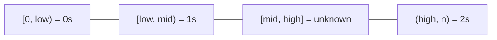

# 03 · Two Pointers

> Two indices walking through the same slice can replace a nested loop. When
> the data is sorted (or can be), each step rules out a whole row of pairs.

## What you'll learn

- The two flavours: **opposite ends** (squeeze inwards) and **same direction** (read/write, slow/fast).
- *Why* moving a pointer is safe — the "discard argument" interviewers want to hear.
- In-place compaction and partitioning with O(1) extra space.
- How sorting + two pointers turns k-Sum from O(nᵏ) into O(nᵏ⁻¹).

## Recognize the pattern

- The input is **sorted**, or sorting it doesn't break the problem.
- "Find a pair / triplet with sum (or difference) X."
- "**In place**", "O(1) extra space", "return the new length".
- Palindromes, reversing, comparing from both ends.
- "Partition into groups" (evens/odds, <pivot/=pivot/>pivot, 0/1/2).
- A brute force that considers all pairs `(i, j)` where some ordering lets you prune.

## The idea

**Opposite ends.** On sorted data, start with `l = 0`, `r = n-1`. If
`nums[l] + nums[r]` is too small, *no pair using `nums[l]`* can work (every other
partner is smaller than `nums[r]`), so discard it with `l++`. Symmetric for too big.

```
target = 9
[ 2,  7, 11, 15 ]
  l          r     17 > 9 → r--     (15 can't pair with anything)
  l      r         13 > 9 → r--
  l  r              9 ✓
```

**Same direction (read/write).** `read` scans every element; `write` marks the
end of the "kept" prefix. Elements before `write` are final.

```
remove duplicates (sorted):
[0, 0, 1, 1, 2]       kept = nums[:w]
 w  r                 0 == nums[w-1] → skip
    w  r              1 new → nums[1] = 1, w = 2
       w     r        2 new → nums[2] = 2, w = 3       result [0, 1, 2]
```

**Partition (Dutch flag).** Three pointers carve the slice into regions:



## Go template

```go
// Opposite ends on sorted input
l, r := 0, len(nums)-1
for l < r {
    switch sum := nums[l] + nums[r]; {
    case sum == target:
        return []int{l, r}
    case sum < target:
        l++
    default:
        r--
    }
}

// Same direction: keep elements that satisfy keep(x), in place
w := 0
for _, x := range nums {
    if keep(x) {
        nums[w] = x
        w++
    }
}
nums = nums[:w]
```

## Complexity

| Variant | Time | Space |
|---|---|---|
| Opposite ends / read-write | O(n) — each pointer moves at most n times | O(1) |
| Sort + two pointers | O(n log n) | O(1)–O(n) depending on sort / copy |
| k-Sum (sort + fix k−2, two pointers) | O(nᵏ⁻¹) | O(1) beyond output |

## Common pitfalls

- **`l < r` vs `l <= r`.** Pairs need two distinct indices (`<`). Trapping rain water processes every bar, so it uses `<=`.
- **Duplicate answers.** In 3Sum, skip equal values for the first element *and* after recording a triplet. Forgetting either produces repeats.
- **Mutating the caller's slice.** Sorting in place changes the input. Clone first (`slices.Clone`) or ask whether mutation is allowed.
- **Advancing `mid` after swapping with `high`** in the Dutch flag — the swapped-in value hasn't been examined yet.
- **Byte vs rune.** `IsPalindrome` works on bytes because it only considers ASCII letters/digits. For Unicode palindromes convert to `[]rune` first.
- **Overflow.** `nums[l] + nums[r]` can overflow near `math.MaxInt`; compare `nums[l] < target - nums[r]` if values can be extreme.
- **Sub-slice aliasing.** `nums[:k]` after compaction still shares memory with `nums` — fine, but don't append to it expecting a fresh slice.

## Problems

| # | Problem | Difficulty | Key idea |
|---|---|---|---|
| 01 | [Valid Palindrome](p01_valid_palindrome.go) | Easy | Opposite ends, skip non-alphanumerics |
| 02 | [Remove Duplicates from Sorted Array](p02_remove_duplicates.go) | Easy | Read/write pointers compact in place |
| 03 | [Two Sum II (sorted)](p03_two_sum_sorted.go) | Medium | Too small → `l++`, too big → `r--` |
| 04 | [Sort Colors](p04_sort_colors.go) | Medium | Dutch flag: low / mid / high regions |
| 05 | [3Sum](p05_three_sum.go) | Medium | Sort, fix one, two-pointer the rest; skip dups |
| 06 | [Container With Most Water](p06_container_most_water.go) | Medium | Move the shorter wall — it can't do better |
| 07 | [Trapping Rain Water](p07_trapping_rain_water.go) | Hard | Smaller running max decides; settle that side |

## Practice tip

For every opposite-ends problem, practise saying the discard argument in one
sentence ("the shorter wall limits every narrower container, so drop it")
before coding. Then hide the solution and run:

```sh
go test ./course/03-two-pointers/ -run TestTrap -v
```

Implement the brute force first when you're stuck — the randomized tests compare
the optimal version against it, so you can trust it as an oracle.

## Next

[04 · Sliding Window →](../04-sliding-window/README.md)
