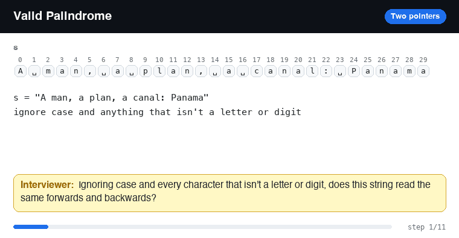

# Walkthrough: Valid Palindrome

**Module:** [03 · Two Pointers](../README.md) · **Difficulty:** Easy · **Solution:** [`p01_valid_palindrome.go`](../p01_valid_palindrome.go)



## The problem in plain words

Ignore upper and lower case, and ignore everything that isn't a letter or a digit. Does what's left read the same forwards and backwards?

```
"A man, a plan, a canal: Panama"  →  true    ("amanaplanacanalpanama")
"race a car"                      →  false
```

## Mock interview

**Interviewer:** Given a string, report whether it's a palindrome if you ignore case and every character that isn't an ASCII letter or digit.

**Candidate:** A few questions first. Do digits count? Is an empty string a palindrome? And can I treat the string as bytes, or do I need Unicode?

**Interviewer:** Digits count. An empty string, or one with no letters at all, is a palindrome. ASCII is enough, so bytes are fine.

**Candidate:** Checking the examples: "A man, a plan, a canal: Panama" cleans to "amanaplanacanalpanama", which is the same reversed, so `true`. "race a car" cleans to "raceacar", and reversed that's "racaecar", so `false`. Edge cases: `""` and `".,"` are both `true`.

**Candidate:** The simplest solution builds a cleaned, lower-cased copy, then compares it with its reverse. That's O(n) time, but it uses O(n) extra memory for the copy.

**Interviewer:** Can you avoid the copy?

**Candidate:** Yes. I put `l` at the start and `r` at the end. If `s[l]` doesn't count, I move `l` right. If `s[r]` doesn't count, I move `r` left. Otherwise I compare the two lower-cased bytes. If they differ, it's not a palindrome. If they match, I move both inward.

**Interviewer:** Why is it safe to move both pointers after a match?

**Candidate:** A palindrome needs the first kept character to equal the last, the second to equal the second-last, and so on. Skipping non-alphanumerics on each side lines up exactly those pairs. Once a pair matches, it never needs checking again.

**Candidate:** In code it's a `for l < r` loop. Two `continue` branches skip ignored bytes, then I compare `toLower(s[l])` with `toLower(s[r])`. The helpers `isAlphaNum` and `toLower` live in `twopointers.go`.

**Candidate:** Testing on the example: `'A'` and `'a'` match. `s[1]` is a space, so `l` moves. `'m'` and `'m'` match, then `'a'`/`'a'`, then `'n'`/`'n'`. The comma and space at 5 and 6 are skipped. It carries on like that until the pointers meet at the `'c'` in the middle, so the answer is `true`.

**Interviewer:** Complexity?

**Candidate:** Every step moves at least one pointer inward, so it's **O(n) time and O(1) extra space**.

## What the animation shows

| Step | What happens |
|---|---|
| 1 | Interviewer states the problem on `"A man, a plan, a canal: Panama"` |
| 2 | Brute force: cleaned copy compared with its reverse, O(n) extra space |
| 3 | `l = 0`, `r = 29`: `'A'` vs `'a'` match → both move |
| 4 | `s[1]` is a space → `l++` |
| 5 | `'m'` vs `'m'` match |
| 6 | `'a'` vs `'a'` match |
| 7 | `'n'` vs `'n'` match |
| 8 | `s[5]` is a comma → `l++` |
| 9 | `s[6]` is a space → `l++` |
| 10 | Summary: 6 more matching pairs and 6 more skips; the pointers meet at index 17 |
| 11 | Answer `true`, O(n) time, O(1) space |

## Detailed explanation

Think of the cleaned string as a sequence of kept characters `c[0..m-1]`. It's a palindrome when `c[i] == c[m-1-i]` for every `i`. The two pointers walk this sequence from both ends without building it. `l` always rests on the next kept character from the left, and `r` on the next from the right, so each comparison is one of those `c[i]`/`c[m-1-i]` pairs.

The loop keeps this invariant: *every kept character before `l` matched its partner after `r`.* A mismatch ends the loop with `false`. If the pointers meet or cross, every pair has been checked, and the answer is `true`.

Each loop iteration does one thing: skip on the left, skip on the right, or compare and move both. That keeps the code simple and makes it easy to see that `l < r` holds at every comparison.

Edge cases:

- **Empty string:** `r = -1`, the loop never runs, the answer is `true`.
- **Only punctuation:** the pointers skip until they meet, and the answer is `true`.
- **Single kept character in the middle:** it pairs with itself. The loop stops before comparing it, which is correct.
- **Digits vs letters:** `'0'` and `'O'` are different characters. Only letters are lower-cased.

## Complexity

| Approach | Time | Space |
|---|---|---|
| Cleaned copy + reverse (`IsPalindromeBrute`) | O(n) | O(n) |
| Two pointers in place (`IsPalindrome`) | O(n) | O(1) |

## Common mistakes

- Forgetting to skip non-alphanumerics on **both** sides.
- Comparing without lower-casing, so `'A'` and `'a'` look different.
- Using `unicode.IsLetter` on bytes. It accepts non-ASCII letters, and multi-byte characters get split.
- Writing the skip as an inner `for` without re-checking `l < r`, which can run past the other pointer.

## Try it yourself

```sh
go test ./course/03-two-pointers/ -run TestIsPalindrome -v
```
