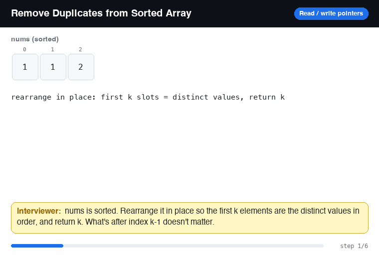

# Walkthrough: Remove Duplicates from Sorted Array

**Module:** [03 · Two Pointers](../README.md) · **Difficulty:** Easy · **Solution:** [`p02_remove_duplicates.go`](../p02_remove_duplicates.go)



## The problem in plain words

You get a sorted list that may contain repeats. Rearrange it in place so the distinct values come first, in order, and return how many there are. Whatever sits after them doesn't matter.

```
[1, 1, 2]                       →  k = 2, nums[:2] = [1, 2]
[0, 0, 1, 1, 1, 2, 2, 3, 3, 4]  →  k = 5, nums[:5] = [0, 1, 2, 3, 4]
```

## Mock interview

**Interviewer:** `nums` is sorted in non-decreasing order. Rearrange it in place so the first k elements are the distinct values in their original order, and return k.

**Candidate:** Can I use extra memory? And what should happen with an empty slice?

**Interviewer:** Aim for O(1) extra space. An empty slice returns 0.

**Candidate:** For `[1, 1, 2]` the answer is k = 2 with `[1, 2]` at the front. For `[0, 0, 1, 1, 1, 2, 2, 3, 3, 4]` it's k = 5. Edge cases: empty gives 0, one element gives 1, all equal gives 1.

**Candidate:** The simple version copies each distinct value into a new slice, then copies that back. It's O(n) time but O(n) extra space.

**Interviewer:** And without the extra slice?

**Candidate:** I use two pointers moving the same way. `write` marks the end of the clean prefix, and `read` scans every element. `nums[0]` is always kept, so both start at 1. Because the array is sorted, equal values sit next to each other, so a value is new exactly when it differs from the last value I kept, `nums[write-1]`. If it's new, I copy it to `nums[write]` and move `write`. If not, I skip it.

**Interviewer:** Why compare with `nums[write-1]` and not `nums[read-1]`?

**Candidate:** Both work here, because the array is sorted. Comparing with the last kept value states the rule directly: "is this different from what I've kept?" It also generalises to "keep at most two copies", where you compare with `nums[write-2]`.

**Candidate:** In code: return 0 for an empty slice, set `write := 1`, then `for read := 1; read < len(nums); read++`. Inside, one `if` does the copy and increments `write`. Return `write`.

**Candidate:** Testing on `[1, 1, 2]`: `read = 1` sees 1, the same as `nums[0]`, so I skip it. `read = 2` sees 2, which is new, so `nums[1] = 2` and `write = 2`. The prefix is `[1, 2]` and I return 2.

**Interviewer:** Complexity?

**Candidate:** One pass, so **O(n) time**, and only two indices, so **O(1) extra space**.

## What the animation shows

| Step | `read` | `write` | Decision |
|---|---|---|---|
| 1 | | | Interviewer states the problem on `[1, 1, 2]` |
| 2 | | | Brute force: copy to a new slice, O(n) space |
| 3 | | 1 | `nums[0]` is kept; the clean prefix is `[1]` |
| 4 | 1 | 1 | `1 == nums[0]` → duplicate, skip |
| 5 | 2 | 1 → 2 | `2 != 1` → copy to slot 1 |
| 6 | | 2 | Answer k = 2, prefix `[1, 2]`, O(n) time, O(1) space |

## Detailed explanation

The invariant is: *`nums[:write]` holds the distinct values of `nums[:read]`, in order.* It's true at the start, because `nums[:1]` is just the first value. Each step keeps it true. If `nums[read]` equals `nums[write-1]`, it's a repeat of the last kept value, so nothing changes. If it differs, sortedness means it's larger than every kept value, so it's new, and appending it keeps the prefix correct.

`write` never passes `read`, so the copy never overwrites a value that `read` hasn't looked at yet. That's what makes the in-place version safe.

The same read/write shape solves many "filter in place" problems: remove a value, move zeros to the end, keep at most k copies. Only the `keep` test changes.

## Complexity

| Approach | Time | Space |
|---|---|---|
| Copy distinct values out and back (`RemoveDuplicatesBrute`) | O(n) | O(n) |
| Read/write pointers (`RemoveDuplicates`) | O(n) | O(1) |

## Common mistakes

- Starting `write` at 0 and comparing with `nums[write-1]`, which reads index -1.
- Forgetting the empty-slice check before using `nums[0]`.
- Returning `write - 1` or `write + 1`: `write` is already the count.
- Assuming the tail beyond `k` is cleared. It isn't, and it doesn't need to be.

## Try it yourself

```sh
go test ./course/03-two-pointers/ -run TestRemoveDuplicates -v
```
