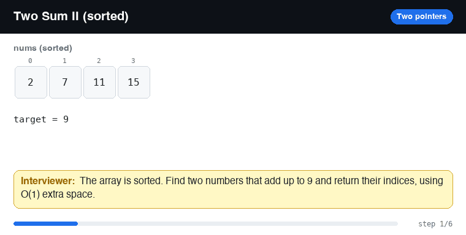

# Walkthrough: Two Sum II (sorted)

**Module:** [03 · Two Pointers](../README.md) · **Difficulty:** Medium · **Solution:** [`p03_two_sum_sorted.go`](../p03_two_sum_sorted.go)



## The problem in plain words

You get a list of numbers sorted from smallest to largest, and a target. Find the two positions whose numbers add up to the target, without using extra memory.

```
nums = [2, 7, 11, 15], target = 9  →  [0, 1]   because 2 + 7 = 9
```

## Mock interview

**Interviewer:** The array is sorted in ascending order. Return the indices of two numbers that add up to the target, using O(1) extra space.

**Candidate:** Before I start: are the indices 0-based, can the same element be used twice, and what should I return if there's no answer?

**Interviewer:** 0-based, two different positions, and return `nil` if no pair exists.

**Candidate:** Let me try the example by hand. With `[2, 7, 11, 15]` and target 9, the answer is `[0, 1]`. An edge case worth remembering is an array with fewer than two elements, where the answer is `nil`.

**Candidate:** The simplest solution tries every pair with two nested loops. That's O(n²) time and O(1) space. It's correct, but it ignores the fact that the array is sorted.

**Interviewer:** How can you use the sorting?

**Candidate:** I'll put one pointer at each end: `l` on the smallest value and `r` on the largest, then look at their sum.

- If the sum is **too big**, the value at `r` is useless. Even paired with the smallest value it overshoots, and every other partner is bigger still. So I move `r` left.
- If the sum is **too small**, the value at `l` is useless for the same reason in reverse, so I move `l` right.
- If the sum is **equal**, I return `[l, r]`.

**Interviewer:** Why can't that skip over the answer?

**Candidate:** Each move only throws away a value that can't be part of any answer, so the true pair is always still between `l` and `r`. The pointers close in on it.

**Candidate:** In code, it's a `for l < r` loop with a `switch` on the sum. Using `l < r` rather than `l <= r` stops me pairing an element with itself.

**Candidate:** Testing on the example: 2 + 15 = 17 is too big, so `r` moves left. 2 + 11 = 13 is still too big, so `r` moves left again. 2 + 7 = 9, so I return `[0, 1]`.

**Interviewer:** Complexity?

**Candidate:** Each step moves one pointer inward, so there are at most n − 1 steps. That's **O(n) time and O(1) space**.

## What the animation shows

| Step | `l` | `r` | Sum | Decision |
|---|---|---|---|---|
| 1 | 0 (2) | 3 (15) | 17 | too big → `r--` |
| 2 | 0 (2) | 2 (11) | 13 | too big → `r--` |
| 3 | 0 (2) | 1 (7) | 9 | equal → return `[0, 1]` |

## Detailed explanation

The key fact is the **discard argument**. Suppose `nums[l] + nums[r] > target`. Every index `i` between `l` and `r` has `nums[i] >= nums[l]`, so `nums[i] + nums[r] >= nums[l] + nums[r] > target`. No pair that uses `r` can ever work, so dropping `r` is safe. The case where the sum is too small mirrors this.

The loop keeps this invariant: *if an answer exists, both of its indices lie in `[l, r]`.* It's true at the start, and every move preserves it. So when the pointers meet without finding a match, there is no answer.

This is why two pointers beats a hash map here. A hash map also gives O(n) time, but needs O(n) extra space. The sorted order lets two pointers do the same job in O(1) space.

## Complexity

| Approach | Time | Space |
|---|---|---|
| Brute force (`TwoSumSortedBrute`) | O(n²) | O(1) |
| Two pointers (`TwoSumSorted`) | O(n) | O(1) |

## Common mistakes

- Writing `l <= r`, which lets an element pair with itself.
- Moving the wrong pointer: too big means `r--`, too small means `l++`.
- With values near `math.MaxInt`, `nums[l] + nums[r]` can overflow. Compare `nums[l] < target - nums[r]` instead.

## Try it yourself

```sh
go test ./course/03-two-pointers/ -run TestTwoSumSorted -v
```
