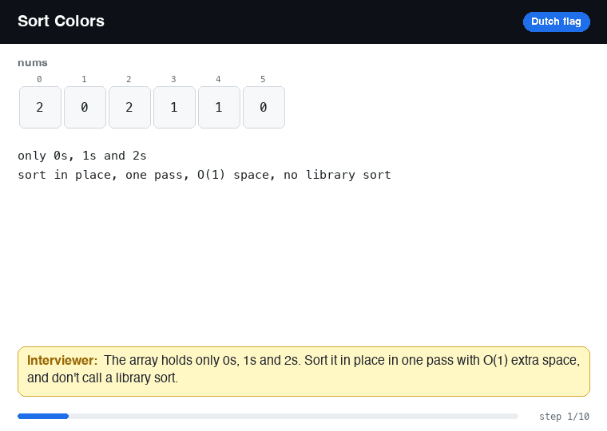

# Walkthrough: Sort Colors

**Module:** [03 · Two Pointers](../README.md) · **Difficulty:** Medium · **Solution:** [`p04_sort_colors.go`](../p04_sort_colors.go)



## The problem in plain words

The list holds only 0s, 1s and 2s (think red, white and blue balls). Sort it in place, in one pass, using only a few extra variables and no library sort.

```
[2, 0, 2, 1, 1, 0]  →  [0, 0, 1, 1, 2, 2]
[2, 0, 1]           →  [0, 1, 2]
```

## Mock interview

**Interviewer:** `nums` contains only 0, 1 and 2. Sort it in place in a single pass with O(1) extra space. No library sort.

**Candidate:** Can the slice be empty, and is it guaranteed that no other values appear?

**Interviewer:** It can be empty. Only 0, 1 and 2 appear.

**Candidate:** For `[2, 0, 2, 1, 1, 0]` the output is `[0, 0, 1, 1, 2, 2]`. Edge cases: empty, a single element, and all the same colour. None of those should need special code.

**Candidate:** A general sort is O(n log n). A better baseline counts each colour, then rewrites the slice: three 0s, then the 1s, then the 2s. That's O(n), but it reads the data twice.

**Interviewer:** Can you do it in one pass?

**Candidate:** Yes, with three pointers that split the slice into four regions: `[0, low)` holds 0s, `[low, mid)` holds 1s, `[mid, high]` is still unknown, and `(high, n)` holds 2s. I look at `nums[mid]`:

- **0:** swap it with `nums[low]`, then move `low` and `mid` right.
- **1:** it's already in the middle region, so just move `mid` right.
- **2:** swap it with `nums[high]` and move `high` left. I **don't** move `mid`, because the value that came back from `high` hasn't been examined.

**Interviewer:** Why is it fine to move `mid` after swapping with `low`, but not after swapping with `high`?

**Candidate:** The value at `low` is either a 1 from the middle region, or `low == mid` and it's the 0 itself. Either way I've already classified it. The value at `high` comes from the unknown region, so I have to look at it next.

**Candidate:** In code: `low, mid, high := 0, 0, len(nums)-1`, then `for mid <= high` with a `switch nums[mid]` and the three cases above.

**Candidate:** Testing on the example: `nums[0] = 2`, swap with index 5, giving `[0, 0, 2, 1, 1, 2]` and `high = 4`. Now `nums[0] = 0` and `low == mid`, so both move. Same at index 1. `nums[2] = 2`, swap with index 4, giving `[0, 0, 1, 1, 2, 2]` and `high = 3`. Then two 1s move `mid` to 4, which passes `high`, so I stop.

**Interviewer:** Complexity?

**Candidate:** Every step either moves `mid` right or `high` left, so the unknown region shrinks by one each time. That's **one pass, O(n) time, and O(1) space**.

## What the animation shows

| Step | `nums[mid]` | Action | Array after |
|---|---|---|---|
| 1 | | Interviewer states the problem | `[2, 0, 2, 1, 1, 0]` |
| 2 | | Baselines: O(n log n) sort, or two-pass counting | |
| 3 | | `low = mid = 0`, `high = 5`, regions explained | |
| 4 | 2 | swap with `high`, `high--` | `[0, 0, 2, 1, 1, 2]` |
| 5 | 0 | swap with `low` (same cell), `low++`, `mid++` | `[0, 0, 2, 1, 1, 2]` |
| 6 | 0 | swap with `low` (same cell), `low++`, `mid++` | `[0, 0, 2, 1, 1, 2]` |
| 7 | 2 | swap with `high`, `high--` | `[0, 0, 1, 1, 2, 2]` |
| 8 | 1 | `mid++` | `[0, 0, 1, 1, 2, 2]` |
| 9 | 1 | `mid++` | `[0, 0, 1, 1, 2, 2]` |
| 10 | | `mid > high`: done, O(n) time, O(1) space | `[0, 0, 1, 1, 2, 2]` |

## Detailed explanation

The invariant is the four-region picture:

```
[0 … low)    all 0s
[low … mid)  all 1s
[mid … high] unknown
(high … n)   all 2s
```

At the start, `low = mid = 0` and `high = n-1`, so everything is unknown and the invariant holds. Each case keeps it:

- A 0 at `mid` is swapped with `nums[low]`, which is a 1 (or the same cell). The 0 joins the 0s region, the 1 moves to the end of the 1s region, and both boundaries move right.
- A 1 at `mid` just extends the 1s region.
- A 2 at `mid` is swapped to `high`, extending the 2s region. The incoming value is unknown, so `mid` stays.

The loop ends when the unknown region is empty (`mid > high`). Then the slice is 0s, 1s, 2s, which is sorted. This is Dijkstra's Dutch national flag algorithm. The same three-way partition is used in quicksort to handle many equal keys.

## Complexity

| Approach | Time | Space |
|---|---|---|
| Counting, two passes (`SortColorsCounting`) | O(n) | O(1) |
| Dutch flag, one pass (`SortColors`) | O(n) | O(1) |

## Common mistakes

- Advancing `mid` after swapping with `high`. The swapped-in value might be a 0 or a 2 and gets skipped.
- Looping with `mid < high`, which leaves the last unknown element unexamined.
- Starting `high` at `len(nums)` instead of `len(nums)-1`.
- Mixing up which region `low` points into: `low` is the first slot **after** the 0s.

## Try it yourself

```sh
go test ./course/03-two-pointers/ -run TestSortColors -v
```
