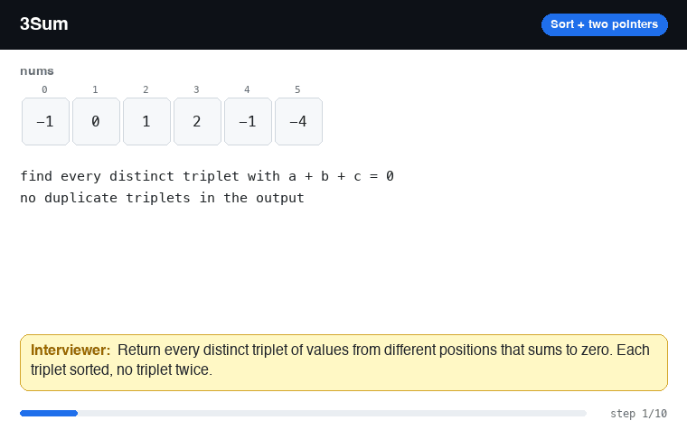

# Walkthrough: 3Sum

**Module:** [03 · Two Pointers](../README.md) · **Difficulty:** Medium · **Solution:** [`p05_three_sum.go`](../p05_three_sum.go)



## The problem in plain words

Find every group of three numbers, taken from three different positions, that adds up to zero. List each group once, smallest number first.

```
[-1, 0, 1, 2, -1, -4]  →  [[-1, -1, 2], [-1, 0, 1]]
[0, 0, 0, 0]           →  [[0, 0, 0]]
```

## Mock interview

**Interviewer:** Return every distinct triplet of values from `nums`, at three different positions, with `a + b + c == 0`. Each triplet sorted, the list in lexicographic order, no duplicates.

**Candidate:** Can I reorder the input? And what if there are fewer than three numbers?

**Interviewer:** Don't change the caller's slice. Fewer than three numbers means an empty result.

**Candidate:** For `[-1, 0, 1, 2, -1, -4]` the triplets are `[-1, -1, 2]` and `[-1, 0, 1]`. The two `-1`s can both be used in one triplet because they're at different positions, but `[-1, 0, 1]` must appear only once even though either `-1` would work. For `[0, 0, 0, 0]` it's just `[[0, 0, 0]]`.

**Candidate:** Brute force is three nested loops, with a set of sorted triplets to drop repeats. That's O(n³).

**Interviewer:** How would you speed it up?

**Candidate:** If I fix the first value `s[i]`, I need two more values that sum to `-s[i]`. That's Two Sum on a sorted array, which two pointers solve in O(n). So I sort a copy, then for each `i` run `l = i+1`, `r = n-1`: too small moves `l` right, too big moves `r` left, zero records a triplet.

**Interviewer:** How do you avoid duplicates without a set?

**Candidate:** Sorting puts equal values side by side. I skip `i` when `s[i] == s[i-1]`, because that first value has already produced all its triplets. And after recording a triplet, I move `l` past any value equal to the one I just used. I can also stop early when `s[i] > 0`: three values that are all at least `s[i]` can't sum to zero.

**Candidate:** In code: `s := slices.Clone(nums)`, `slices.Sort(s)`, an outer loop over `i`, the two checks, then the inner `for l < r` with a `switch` on the sum.

**Candidate:** Testing on the example: sorted, it's `[-4, -1, -1, 0, 1, 2]`. With `i = -4` I need 4, but the largest pair is 1 + 2 = 3, so every sum is negative and `l` walks up to `r`. With `i = -1` (index 1): -1 + -1 + 2 = 0, recorded. Then -1 + 0 + 1 = 0, recorded. Index 2 is another `-1`, so I skip it. With `i = 0`: 0 + 1 + 2 = 3 is too big, `r` moves, and the pointers meet.

**Interviewer:** Complexity?

**Candidate:** Sorting is O(n log n). Then there are n values of `i`, each with an O(n) scan, so **O(n²) time overall**. Beyond the output, the only extra memory is the sorted copy, which is O(n).

## What the animation shows

| Step | `i` (value) | What happens |
|---|---|---|
| 1 | | Interviewer states the problem |
| 2 | | Brute force: three nested loops, O(n³) |
| 3 | | Sort a copy: `[-4, -1, -1, 0, 1, 2]` |
| 4 | 0 (-4) | -4 + -1 + 2 = -3 < 0 → `l++` |
| 5 | 0 (-4) | Next sums -3, -2, -1 are all negative; `l` meets `r`, no triplet |
| 6 | 1 (-1) | -1 + -1 + 2 = 0 → record `[-1, -1, 2]` |
| 7 | 1 (-1) | -1 + 0 + 1 = 0 → record `[-1, 0, 1]` |
| 8 | 2 (-1) | Same value as `s[1]` → skip |
| 9 | 3 (0) | 0 + 1 + 2 = 3 > 0 → `r--`, pointers meet |
| 10 | | Answer `[[-1, -1, 2], [-1, 0, 1]]`, O(n²) time |

## Detailed explanation

**Why two pointers find every pair.** For a fixed `i`, the inner loop is Two Sum II on the sorted range `s[i+1..n-1]`. If the sum is too small, `s[l]` can't be in any pair with this `i`, because every partner left of `r` is no bigger than `s[r]`. If it's too big, `s[r]` can't be in any pair for the mirror reason. So no valid pair is ever skipped.

**Why the output has no repeats.** A triplet is identified by its sorted values `(a, b, c)`. Skipping equal `s[i]` values means each `a` is tried once. Within one `a`, after recording `(a, b, c)`, skipping equal `s[l]` values means each `b` is used once, and `c = -a - b` is then fixed. So each distinct triplet appears exactly once. Because `i` and `l` both move left to right over sorted data, the triplets also come out in lexicographic order, with no final sort needed.

**Why the early `break` is safe.** If `s[i] > 0`, then `s[l]` and `s[r]` are at least `s[i]`, so the sum is positive.

Edge cases: fewer than three elements (the loop doesn't run), all zeros (one triplet), and all positive or all negative (empty result).

## Complexity

| Approach | Time | Space |
|---|---|---|
| Three loops + set (`ThreeSumBrute`) | O(n³) | O(answers) |
| Sort + two pointers (`ThreeSum`) | O(n²) | O(n) for the sorted copy, O(1) beyond that |

## Common mistakes

- Skipping duplicates of `s[i]` by comparing with `s[i+1]` instead of `s[i-1]`. That drops `[-1, -1, 2]`.
- Forgetting to skip repeated `s[l]` values after a match, which produces repeated triplets.
- Sorting `nums` in place when the caller's slice must not change (`TestThreeSumDoesNotMutate` checks this).
- Breaking on `s[i] >= 0` instead of `s[i] > 0`, which loses `[0, 0, 0]`.

## Try it yourself

```sh
go test ./course/03-two-pointers/ -run TestThreeSum -v
```
