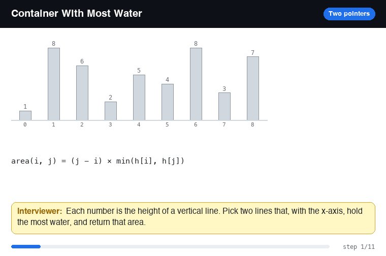

# Walkthrough: Container With Most Water

**Module:** [03 · Two Pointers](../README.md) · **Difficulty:** Medium · **Solution:** [`p06_container_most_water.go`](../p06_container_most_water.go)



## The problem in plain words

Each number is the height of a vertical line, one unit apart. Pick two lines. Together with the floor they make a container. The water it holds is the distance between the lines times the shorter line. Find the most water any pair can hold.

```
[1, 8, 6, 2, 5, 4, 8, 3, 7]  →  49   (lines 1 and 8: width 7 × height min(8, 7) = 7)
[1, 1]                       →  1
```

## Mock interview

**Interviewer:** `heights[i]` is the height of a line at x = i. Choose two lines that hold the most water with the x-axis and return the area, `(j - i) × min(heights[i], heights[j])`.

**Candidate:** Can heights be zero? And what if there are fewer than two lines?

**Interviewer:** Heights are non-negative. With fewer than two lines, return 0.

**Candidate:** On the example, lines 1 and 8 give `7 × min(8, 7) = 49`. Lines 1 and 6 are both 8 tall, but they're only 5 apart, so that's 40. Width and height trade off against each other.

**Candidate:** Brute force tries every pair, which is O(n²) and fine for small inputs.

**Interviewer:** Can you do it in one pass?

**Candidate:** I start with the widest container, `l = 0` and `r = n-1`, and record its area. Then I move the **shorter** line inward, record again, and repeat until the pointers meet.

**Interviewer:** Why is it safe to throw the shorter line away?

**Candidate:** Say `heights[l]` is the shorter one. Any other container that uses `l` has its other end strictly inside `(l, r)`, so it's narrower. Its height is still capped by `heights[l]`, because the height is the minimum of the two ends. Narrower and no taller means it can't beat the area I just recorded. So line `l` has nothing more to offer. On a tie, both lines are capped the same way, so either can go. The code moves `r`.

**Candidate:** In code: `best, l, r := 0, 0, len(heights)-1`, then `for l < r` I update `best` with `(r-l)*min(heights[l], heights[r])`, and move `l++` if `heights[l] < heights[r]`, else `r--`.

**Candidate:** Testing on the example: `l = 0, r = 8` gives `8 × 1 = 8`, and line 0 is shorter, so `l` moves. `l = 1, r = 8` gives `7 × 7 = 49`, the best. Now `r` is shorter, and from there `r` keeps moving left: 18, 40, 16, 15, 4 and 6 are all smaller. When the pointers meet, the answer is 49.

**Interviewer:** Complexity?

**Candidate:** Each step moves one pointer, so there are n − 1 steps: **O(n) time, O(1) space**.

## What the animation shows

| Step | `l` | `r` | Area | Best | Move |
|---|---|---|---|---|---|
| 1 | | | | | Interviewer states the problem |
| 2 | | | | | Brute force: 36 pairs, O(n²) |
| 3 | 0 | 8 | 8 × 1 = 8 | 8 | `l++` (1 < 7) |
| 4 | 1 | 8 | 7 × 7 = 49 | 49 | `r--` (7 < 8) |
| 5 | 1 | 7 | 6 × 3 = 18 | 49 | `r--` |
| 6 | 1 | 6 | 5 × 8 = 40 | 49 | `r--` (tie) |
| 7 | 1 | 5 | 4 × 4 = 16 | 49 | `r--` |
| 8 | 1 | 4 | 3 × 5 = 15 | 49 | `r--` |
| 9 | 1 | 3 | 2 × 2 = 4 | 49 | `r--` |
| 10 | 1 | 2 | 1 × 6 = 6 | 49 | `r--` |
| 11 | | | | 49 | Answer 49 (lines 1 and 8), O(n) time |

## Detailed explanation

The argument is a **discard argument**, like Two Sum II. Look at the pair `(l, r)` and suppose `heights[l] <= heights[r]`. For every `k` with `l < k < r`:

```
area(l, k) = (k - l) × min(heights[l], heights[k])
          <= (k - l) × heights[l]
           < (r - l) × heights[l]
           = area(l, r)
```

So no pair that uses `l` with a partner inside the window can beat the pair we just measured. Dropping `l` loses nothing. The loop therefore keeps an invariant: *the best container is either already recorded in `best`, or has both ends in `[l, r]`.* When `l` meets `r`, the second option is empty, so `best` is the answer.

Note what the argument does **not** say. It doesn't say the taller line is in the answer. It only says the shorter line has been fully used.

Edge cases: fewer than two lines returns 0 because the loop never runs, and zero-height lines give area 0 and are dropped right away.

## Complexity

| Approach | Time | Space |
|---|---|---|
| Every pair (`ContainerBrute`) | O(n²) | O(1) |
| Two pointers (`MaxArea`) | O(n) | O(1) |

## Common mistakes

- Moving the **taller** line. That can skip the best pair.
- Using `max` instead of `min` for the height.
- Measuring width as `r - l + 1`. Lines are points on the x-axis, so the width is `r - l`.
- Updating `best` after moving the pointer, which skips the first container.

## Try it yourself

```sh
go test ./course/03-two-pointers/ -run TestMaxArea -v
```
