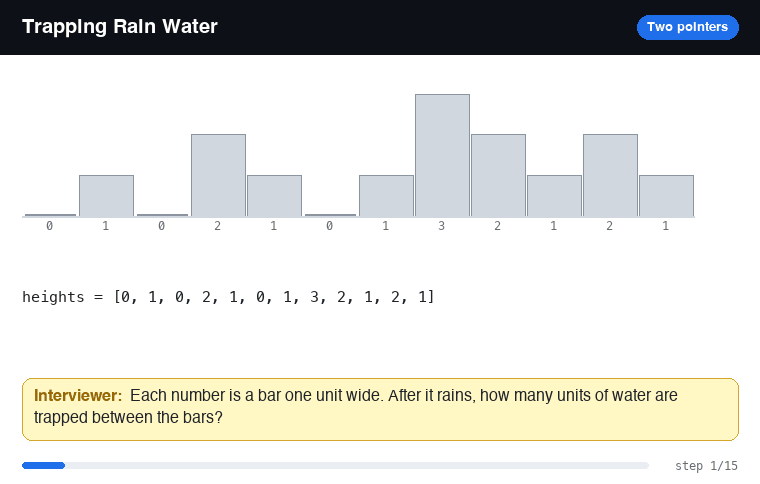

# Walkthrough: Trapping Rain Water

**Module:** [03 · Two Pointers](../README.md) · **Difficulty:** Hard · **Solution:** [`p07_trapping_rain_water.go`](../p07_trapping_rain_water.go)



## The problem in plain words

The numbers are bars of an elevation map, each one unit wide. Rain falls and collects in the dips between bars. Count how many units of water stay trapped.

```
[0, 1, 0, 2, 1, 0, 1, 3, 2, 1, 2, 1]  →  6
[4, 2, 0, 3, 2, 5]                    →  9
```

## Mock interview

**Interviewer:** `heights` describes bars of width 1. Return how many units of rain water are trapped after it rains.

**Candidate:** Are heights non-negative integers? And does water spill off both ends?

**Interviewer:** Yes to both. There are no walls beyond the first and last bar.

**Candidate:** The key fact is per bar: water above bar `i` equals `min(tallest bar on its left, tallest bar on its right) − heights[i]`, counting bar `i` itself in both maxima so it's never negative. In the first example, bar 5 has height 0, the tallest to its left is 2 and to its right is 3, so it holds 2. Summing over all bars gives 6. Edge cases: fewer than three bars, or bars that only rise, hold nothing.

**Candidate:** Brute force computes both maxima for every bar by scanning left and right. That's O(n²).

**Interviewer:** Can you do better?

**Candidate:** I can precompute `leftMax[i]` and `rightMax[i]` in two passes, then sum. That's O(n) time but O(n) space. To get O(1) space I use two pointers, `l` and `r`, with running maxima `leftMax` and `rightMax`.

At each step I update both maxima. If `leftMax <= rightMax`, I settle bar `l`: it holds `leftMax − heights[l]`, and I move `l` right. Otherwise I settle bar `r` with `rightMax` and move `r` left.

**Interviewer:** Why can you settle bar `l` knowing only the left max? You don't know its true right max.

**Candidate:** I don't need the exact value. `rightMax` is the tallest bar seen so far from the right, and all those bars are to the right of `l`. So the true right max of `l` is at least `rightMax`, which is at least `leftMax`. The minimum of the two sides is therefore exactly `leftMax`. The smaller running max is the bottleneck, so that side's bar is decided.

**Candidate:** In code: `for l <= r`, update both maxima, then the `if leftMax <= rightMax` branch adds water and moves `l`, the `else` branch does the same on the right. I use `<=` so the last bar where the pointers meet is also settled.

**Candidate:** Testing on the example: the left side settles bars 0 to 2 first, and bar 2 holds 1 unit. Once `leftMax` is 2 and `rightMax` is 1, the right side settles bar 11. Then with both at 2, bars 4, 5 and 6 hold 1, 2 and 1. When `leftMax` becomes 3, the right side settles bars 10, 9 and 8, and bar 9 holds 1. Bar 7 is last. The total is 6.

**Interviewer:** Complexity?

**Candidate:** Each bar is settled once, so **O(n) time**, and I only keep four integers, so **O(1) space**.

## What the animation shows

| Step | `leftMax` | `rightMax` | Settled bar | Water | Total |
|---|---|---|---|---|---|
| 1 | | | | Interviewer states the problem | |
| 2 | | | | Formula and O(n²) brute force | |
| 3 | 0 | 1 | 0 (left) | 0 | 0 |
| 4 | 1 | 1 | 1 (left) | 0 | 0 |
| 5 | 1 | 1 | 2 (left) | 1 | 1 |
| 6 | 2 | 1 | 11 (right) | 0 | 1 |
| 7 | 2 | 2 | 3 (left) | 0 | 1 |
| 8 | 2 | 2 | 4 (left) | 1 | 2 |
| 9 | 2 | 2 | 5 (left) | 2 | 4 |
| 10 | 2 | 2 | 6 (left) | 1 | 5 |
| 11 | 3 | 2 | 10 (right) | 0 | 5 |
| 12 | 3 | 2 | 9 (right) | 1 | 6 |
| 13 | 3 | 2 | 8 (right) | 0 | 6 |
| 14 | 3 | 3 | 7 (left) | 0 | 6 |
| 15 | | | | Answer 6, O(n) time, O(1) space | |

## Detailed explanation

Start from the per-bar formula, `water[i] = min(L[i], R[i]) − heights[i]`, where `L[i]` and `R[i]` are the tallest bars in `heights[0..i]` and `heights[i..n-1]`.

`TrapPrefixMax` stores `L` and `R` in arrays. `Trap` notices that at any moment it only needs one of them exactly. While the loop runs, `leftMax = L[l]` (the max of everything up to `l`), and `rightMax` is the max of `heights[r..n-1]`, which is at most `R[l]` because `l <= r`.

- If `leftMax <= rightMax`, then `L[l] <= rightMax <= R[l]`, so `min(L[l], R[l]) = L[l] = leftMax`. Bar `l` is settled exactly.
- Otherwise the mirror argument settles bar `r` with `rightMax`.

Each iteration settles one bar and moves one pointer, so after n iterations every bar has been counted once.

Edge cases: an empty slice (`r = -1`, loop doesn't run, answer 0), a single bar (it is its own max, holds 0), and strictly rising or falling heights (every bar equals its bottleneck max, so 0).

## Complexity

| Approach | Time | Space |
|---|---|---|
| Rescan both sides per bar (`TrapBrute`) | O(n²) | O(1) |
| Prefix and suffix maxima (`TrapPrefixMax`) | O(n) | O(n) |
| Two pointers (`Trap`) | O(n) | O(1) |

## Common mistakes

- Updating the max **after** adding water, which can make the water negative.
- Settling a bar with the **larger** running max. Only the smaller one is guaranteed to be the bottleneck.
- Changing the loop to `l < r` without thinking it through. This version uses `<=` so every bar is settled exactly once, which is what the argument assumes.
- Thinking water depends on the nearest taller bar. It depends on the tallest bar on each side.

## Try it yourself

```sh
go test ./course/03-two-pointers/ -run TestTrap -v
```
