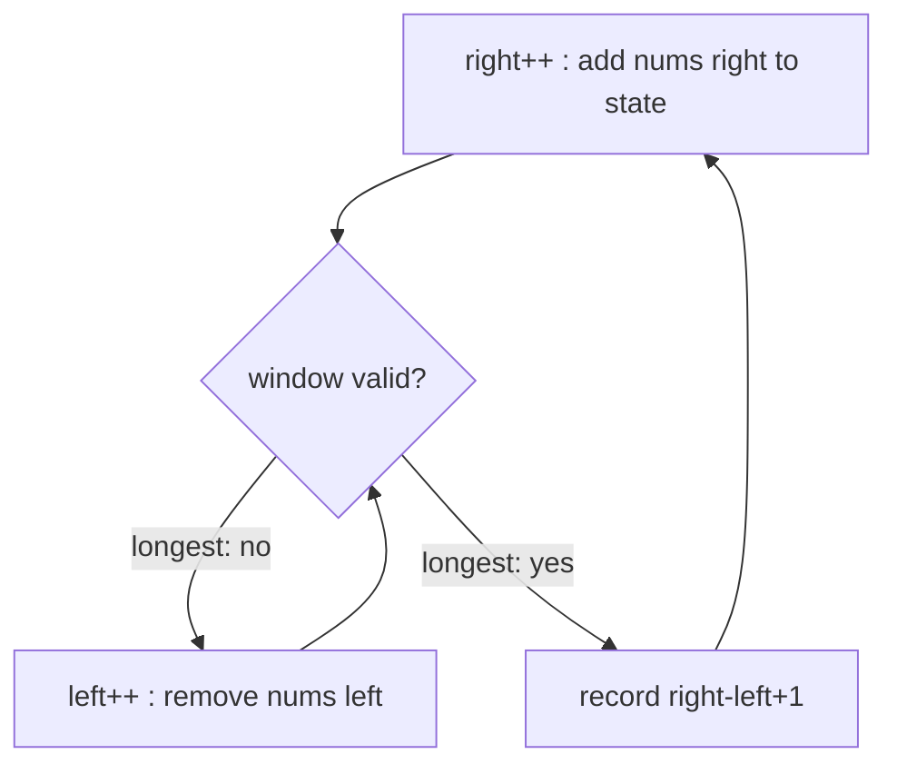

# 04 · Sliding Window

> A special case of same-direction two pointers: `[left, right]` frames a
> contiguous subarray, and you update its state in O(1) as the edges move
> instead of recomputing every window.

## What you'll learn

- **Fixed-size** windows (size k) and **variable-size** windows (grow/shrink on a condition).
- What "window state" to keep: a sum, a count array, a "last seen" table, a monotonic deque.
- Why variable windows need a *monotone* condition (e.g. positive numbers) — and what to do when you don't have one.
- The "expand until valid, shrink while valid" template that solves the Hard problems.

## Recognize the pattern

- The answer is a **contiguous** subarray or substring ("subarray", "substring", "consecutive", "window").
- "Longest / shortest / maximum / minimum … such that <condition>".
- "Every window of size k" or "of length k".
- A brute force that enumerates all `(i, j)` pairs and recomputes something about `nums[i..j]`.
- The condition is monotone: if a window is valid, every larger (or every smaller) window containing it is too.

> Not contiguous? It's not a window — think hashing, DP or backtracking.
> Contiguous but with negative numbers and a sum condition? Use
> [prefix sums](../05-prefix-sums/README.md).

## The idea

**Fixed size:** slide by adding the entering element and removing the leaving one.

```
k = 3   [2, 1, 5, 1, 3, 2]
        [2  1  5]            sum 8
           [1  5  1]         +1 −2 = 7
              [5  1  3]      +3 −1 = 9   ← max
                 [1  3  2]   +2 −5 = 6
```

**Variable size:** the right edge always advances; the left edge advances
only when the window breaks (or, for "shortest", while it stays valid).



```
Minimum window covering "ABC" in ADOBECODEBANC

ADOBEC ODEBANC     expand until valid           → "ADOBEC" (6)
 DOBECODEBA NC     shrink, lose A, expand to A  → "CODEBA" (6)
         BANC      shrink while valid           → "BANC"   (4) ✓
```

Every index enters once (`right`) and leaves at most once (`left`), so even with
the inner `for` loop the total work is O(n).

## Go template

```go
// Variable window: longest valid
left, best := 0, 0
for right := 0; right < len(s); right++ {
    add(s[right])
    for !valid() {
        remove(s[left])
        left++
    }
    best = max(best, right-left+1)
}

// Variable window: shortest valid
for right := range nums {
    add(nums[right])
    for valid() {
        best = min(best, right-left+1)
        remove(nums[left])
        left++
    }
}

// Fixed window of size k
for right := range nums {
    add(nums[right])
    if right >= k {
        remove(nums[right-k])
    }
    if right >= k-1 {
        record()
    }
}
```

## Complexity

| Problem shape | Time | Space |
|---|---|---|
| Fixed window, O(1) state update | O(n) | O(1) |
| Variable window with count array | O(n) | O(σ) — alphabet size (26 or 256) |
| Window max/min with monotonic deque | O(n) amortized | O(k) |

## Common pitfalls

- **Seeding with 0.** For maximum sums seed with the first window, not `0` — all values may be negative.
- **Moving `left` backwards.** With a "last seen" table, use `left = max(left, last[c])`; `"abba"` catches this.
- **Negative numbers break shrinking.** "Shrink while sum ≥ target" assumes removing an element decreases the sum. With negatives use prefix sums + hash map.
- **Off-by-one window length** is `right - left + 1`; the first full fixed window ends at `right == k-1`.
- **Bytes vs runes.** `[256]int` tables index bytes. A multi-byte UTF-8 character counts as several bytes; convert with `[]rune(s)` if the problem means Unicode characters.
- **`[26]int` assumes lowercase.** `s[i]-'a'` on an uppercase letter underflows the `byte` to a large index and panics.
- **Deque by slicing.** `items = items[1:]` is O(1) but keeps the old backing array until the next reallocation; fine here, use a ring buffer for long-lived queues.
- **Map iteration** isn't needed — and is slow — for window state; prefer fixed arrays when the alphabet is small.

## Problems

| # | Problem | Difficulty | Key idea |
|---|---|---|---|
| 01 | [Maximum Sum Subarray of Size K](p01_max_sum_subarray_k.go) | Easy | Fixed window: add entering, subtract leaving |
| 02 | [Best Time to Buy and Sell Stock](p02_best_time_stock.go) | Easy | Left edge = cheapest day so far |
| 03 | [Minimum Size Subarray Sum](p03_min_size_subarray_sum.go) | Medium | Shrink while valid (positives only) |
| 04 | [Longest Substring Without Repeating Characters](p04_longest_substring_no_repeat.go) | Medium | Jump `left` past last occurrence |
| 05 | [Longest Repeating Character Replacement](p05_char_replacement.go) | Medium | `len − maxFreq ≤ k`; slide, never shrink |
| 06 | [Permutation in String](p06_permutation_in_string.go) | Medium | Fixed window + count of matching letters |
| 07 | [Minimum Window Substring](p07_min_window_substring.go) | Hard | Need counts + `missing`; expand then shrink |
| 08 | [Sliding Window Maximum](p08_sliding_window_max.go) | Hard | Monotonic decreasing deque of indices |

## Practice tip

For each problem, answer three questions before coding: *What is the window
state? When is the window valid? Do I want the longest or the shortest?* Then
hide the solution and run:

```sh
go test ./course/04-sliding-window/ -run TestMinWindow -v
```

When a randomized test fails, it prints the failing input (kept small on purpose) — trace
your window by hand on that input.

## Next

[05 · Prefix Sums →](../05-prefix-sums/README.md)
