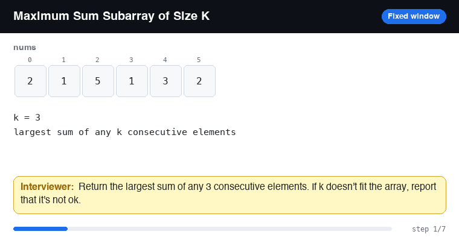

# Walkthrough: Maximum Sum Subarray of Size K

**Module:** [04 · Sliding Window](../README.md) · **Difficulty:** Easy · **Solution:** [`p01_max_sum_subarray_k.go`](../p01_max_sum_subarray_k.go)



## The problem in plain words

Look at every run of k neighbouring numbers. Return the biggest total any of those runs has. If k is too small or bigger than the list, say so.

```
nums = [2, 1, 5, 1, 3, 2], k = 3  →  9    (5 + 1 + 3)
nums = [-1, -2, -3],       k = 2  →  -3   (-1 + -2)
```

## Mock interview

**Interviewer:** Return the largest sum of any k consecutive elements of `nums`. If k isn't in `1..len(nums)`, report `ok = false`.

**Candidate:** Can the numbers be negative? And is the answer just the sum, not the position?

**Interviewer:** Negatives are allowed. Just the sum and the `ok` flag.

**Candidate:** For `[2, 1, 5, 1, 3, 2]` with k = 3, the windows sum to 8, 7, 9 and 6, so the answer is 9. With `[-1, -2, -3]` and k = 2 it's -3, which tells me I can't start `best` at 0. Edge cases: k = 0, k > n, and k = n (one window).

**Candidate:** Brute force sums each of the n − k + 1 windows from scratch, which is O(n·k).

**Interviewer:** Can you avoid re-adding?

**Candidate:** Two neighbouring windows share k − 1 elements. When the window slides right by one, exactly one element enters and one leaves. So `sum += nums[right] − nums[right−k]` is O(1) per step.

**Interviewer:** Why seed `best` with the first window and not with 0?

**Candidate:** If every value is negative, every window sum is negative, and a `best` of 0 would never be beaten. It would return 0, which isn't the sum of any window.

**Candidate:** In code: validate k, sum the first k elements, set `best = sum`, then `for right := k; right < len(nums); right++` update the sum and take the max. Return `best, true`.

**Candidate:** Testing: the first window `[2, 1, 5]` is 8. Slide: +1 −2 = 7. Slide: +3 −1 = 9, a new best. Slide: +2 −5 = 6. The answer is 9.

**Interviewer:** Complexity?

**Candidate:** One add and one subtract per element: **O(n) time, O(1) space**.

## What the animation shows

| Step | Window | Sum | Best |
|---|---|---|---|
| 1 | | | Interviewer states the problem, k = 3 |
| 2 | | | Brute force: 4 windows × 3 additions, O(n·k) |
| 3 | `[2, 1, 5]` | 8 | 8 |
| 4 | `[1, 5, 1]` | 8 + 1 − 2 = 7 | 8 |
| 5 | `[5, 1, 3]` | 7 + 3 − 1 = 9 | 9 (new best) |
| 6 | `[1, 3, 2]` | 9 + 2 − 5 = 6 | 9 |
| 7 | | | Answer 9 (5 + 1 + 3), O(n) time, O(1) space |

## Detailed explanation

The invariant is: *after processing index `right`, `sum` equals `nums[right−k+1] + … + nums[right]`.* It's true after the first k elements. Each step adds the element that enters on the right and subtracts the one that falls off on the left, so it stays true. `best` is the max over every window seen so far, so at the end it's the max over all windows.

This is the simplest sliding window: a **fixed size** window with an O(1) state update. Many problems reuse it with different state: an average, a count of vowels, a set of distinct values.

Edge cases: `k <= 0` or `k > len(nums)` return `(0, false)` before touching the slice. `k == len(nums)` runs the loop zero times and returns the whole-slice sum.

## Complexity

| Approach | Time | Space |
|---|---|---|
| Re-sum every window (`MaxSumSubarrayBrute`) | O(n·k) | O(1) |
| Sliding window (`MaxSumSubarray`) | O(n) | O(1) |

## Common mistakes

- Seeding `best` with 0, which fails when all values are negative.
- Subtracting `nums[right−k+1]` instead of `nums[right−k]`. The element leaving is the one just before the new window.
- Not validating k, which panics on `nums[:k]` when k is too large.
- Recording the first window twice, or skipping it.

## Try it yourself

```sh
go test ./course/04-sliding-window/ -run TestMaxSumSubarray -v
```
