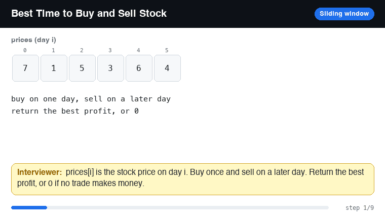

# Walkthrough: Best Time to Buy and Sell Stock

**Module:** [04 · Sliding Window](../README.md) · **Difficulty:** Easy · **Solution:** [`p02_best_time_stock.go`](../p02_best_time_stock.go)



## The problem in plain words

You see a stock's price for each day. Buy once, then sell on a later day. What's the most money you can make? If every trade loses money, the answer is 0.

```
[7, 1, 5, 3, 6, 4]  →  5   (buy at 1, sell at 6)
[7, 6, 4, 3, 1]     →  0   (prices only fall)
```

## Mock interview

**Interviewer:** `prices[i]` is the price on day i. Buy on one day and sell on a later day. Return the best profit, or 0 if no trade makes money.

**Candidate:** Only one buy and one sell? And can I sell on the same day I buy?

**Interviewer:** One of each, and the sale must be on a later day. Same-day trades would make 0 anyway.

**Candidate:** For `[7, 1, 5, 3, 6, 4]`, buying at 1 on day 1 and selling at 6 on day 4 gives 5. Selling at 7 isn't possible, because day 0 comes before the buy. For falling prices the answer is 0. Edge cases: an empty list or a single day gives 0.

**Candidate:** Brute force tries every buy day with every later sell day: O(n²).

**Interviewer:** How can you do it in one pass?

**Candidate:** Fix the sell day. The best buy day for it is simply the cheapest day before it. So I scan left to right and keep `minPrice`, the cheapest price so far. That's the left edge of my window. Each day, if the price is lower than `minPrice`, it becomes the new buy day. Otherwise I check `price − minPrice` against `best`.

**Interviewer:** Why is it safe to forget the old minimum when you find a cheaper day?

**Candidate:** Any future sale makes more money buying at the cheaper price. The old buy day can never be the better choice again, so the window's left edge jumps to today.

**Candidate:** In code: return 0 for an empty slice, set `best, minPrice := 0, prices[0]`, then loop over `prices[1:]` with one `if p < minPrice` / `else` branch.

**Candidate:** Testing: `minPrice` starts at 7. Day 1 is 1, cheaper, so it becomes the buy day. Day 2 gives 5 − 1 = 4, a new best. Day 3 gives 2. Day 4 gives 5, a new best. Day 5 gives 3. The answer is 5.

**Interviewer:** Complexity?

**Candidate:** One pass with two variables: **O(n) time, O(1) space**.

## What the animation shows

| Step | Day | Price | `minPrice` | Profit | Best |
|---|---|---|---|---|---|
| 1 | | | | | Interviewer states the problem |
| 2 | | | | | Brute force: every pair, O(n²) |
| 3 | 0 | 7 | 7 | | 0 |
| 4 | 1 | 1 | 1 (cheaper, left edge jumps) | | 0 |
| 5 | 2 | 5 | 1 | 4 | 4 |
| 6 | 3 | 3 | 1 | 2 | 4 |
| 7 | 4 | 6 | 1 | 5 | 5 |
| 8 | 5 | 4 | 1 | 3 | 5 |
| 9 | | | | | Answer 5 (buy 1, sell 6), O(n) time |

## Detailed explanation

The invariant is: *before looking at day `d`, `minPrice` is the lowest price on days `0..d−1`, and `best` is the best profit from any sale on those days.* The best sale on day `d` buys at `minPrice`, so comparing `prices[d] − minPrice` with `best` covers every pair that ends on day `d`. Then `minPrice` is updated to include day `d`. After the last day, `best` covers every pair.

Viewed as a window: the left edge is the buy day, the right edge is the sell day. The right edge always moves forward. The left edge only jumps forward, and only to a cheaper day. That's why this sits in the sliding window module, even though the window never needs its inside.

The Go code uses `if p < minPrice { … } else { … }`. On a day that sets a new minimum, the profit would be negative anyway, so skipping the profit check loses nothing.

Edge cases: an empty slice returns 0 before reading `prices[0]`, and strictly falling prices never enter the `else` branch with a positive profit, so `best` stays 0.

## Complexity

| Approach | Time | Space |
|---|---|---|
| Every (buy, sell) pair (`MaxProfitBrute`) | O(n²) | O(1) |
| Running minimum (`MaxProfit`) | O(n) | O(1) |

## Common mistakes

- Taking the global min and global max. The max may come before the min.
- Allowing negative answers: `best` must start at 0, not at `prices[1] − prices[0]`.
- Reading `prices[0]` without checking for an empty slice.
- Updating `minPrice` before computing today's profit in a way that lets you buy and sell on the same day. Harmless here (profit 0), but wrong in variants with fees.

## Try it yourself

```sh
go test ./course/04-sliding-window/ -run TestMaxProfit -v
```
