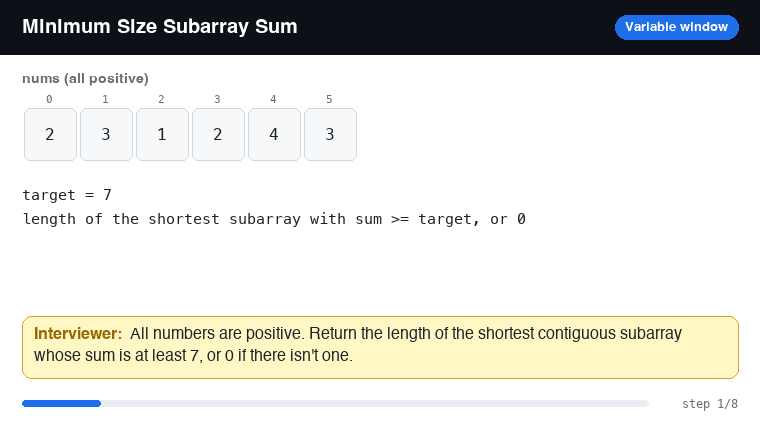

# Walkthrough: Minimum Size Subarray Sum

**Module:** [04 · Sliding Window](../README.md) · **Difficulty:** Medium · **Solution:** [`p03_min_size_subarray_sum.go`](../p03_min_size_subarray_sum.go)



## The problem in plain words

All the numbers are positive. Find the shortest run of neighbouring numbers whose total is at least the target, and return its length. If no run reaches the target, return 0.

```
target = 7,  nums = [2, 3, 1, 2, 4, 3]  →  2   ([4, 3])
target = 11, nums = [1, 1, 1, 1]        →  0
```

## Mock interview

**Interviewer:** `nums` holds positive integers. Return the length of the shortest contiguous subarray whose sum is at least `target`, or 0 if none exists.

**Candidate:** Are all values strictly positive? That matters for the approach I have in mind.

**Interviewer:** Yes, strictly positive.

**Candidate:** For target 7 and `[2, 3, 1, 2, 4, 3]`, `[4, 3]` sums to 7 with length 2, and nothing of length 1 reaches 7. For `[1, 1, 1, 1]` and 11 the total is only 4, so the answer is 0. Edge cases: a single element already at least the target gives 1, and an empty slice gives 0.

**Candidate:** Brute force starts at every index and extends until the sum reaches the target. That's O(n²).

**Interviewer:** Can you do it in linear time?

**Candidate:** Because values are positive, growing a window only raises its sum, and shrinking it only lowers it. So I use a variable window. I move `right` forward and add each value. Whenever the sum is at least the target, the window is valid: I record its length, then remove `nums[left]` and move `left` right, and repeat while it stays valid.

**Interviewer:** Why is it safe to move `left` past a start and never come back?

**Candidate:** When I drop `nums[left]`, I've already recorded the shortest valid window starting at `left` that ends at or before `right`. Any window starting at `left` that ends later is longer, so it can't beat that. So `left` is done.

**Interviewer:** What if the numbers could be negative?

**Candidate:** Then removing an element could raise the sum, and shrinking stops being safe. I'd switch to prefix sums with a monotonic deque instead.

**Candidate:** In code: `for right, x := range nums`, add `x`, then `for sum >= target` update `best`, subtract `nums[left]`, and `left++`. `best` starts at 0 and I treat 0 as "nothing found yet".

**Candidate:** Testing: adding 2, 3, 1, 2 gives 8, so `[2, 3, 1, 2]` has length 4. Dropping 2 leaves 6, invalid. Adding 4 gives 10, length 4 again. Dropping 3 leaves 7, still valid, length 3. Dropping 1 leaves 6. Adding 3 gives 9, length 3. Dropping 2 leaves 7, valid, length 2. Dropping 4 leaves 3. The answer is 2.

**Interviewer:** Complexity?

**Candidate:** Each index enters the window once and leaves at most once, so even with the inner loop it's **O(n) time and O(1) space**.

## What the animation shows

| Step | Window | Sum | Length | Best |
|---|---|---|---|---|
| 1 | | | | Interviewer states the problem, target 7 |
| 2 | | | | Brute force from every start, O(n²) |
| 3 | `[2, 3, 1, 2]` | 8 | 4 | 4, then drop 2 |
| 4 | `[3, 1, 2, 4]` | 10 | 4 | 4, then drop 3 |
| 5 | `[1, 2, 4]` | 7 | 3 | 3, then drop 1 |
| 6 | `[2, 4, 3]` | 9 | 3 | 3, then drop 2 |
| 7 | `[4, 3]` | 7 | 2 | 2, then drop 4 |
| 8 | | | | Answer 2 (`[4, 3]`), O(n) time |

## Detailed explanation

This is the "shortest valid window" template: **expand until valid, then shrink while valid.**

The argument relies on monotonicity. With positive values, if `nums[left..right]` is valid, so is every window that contains it. If it's invalid, so is every window inside it. When the inner loop stops, `nums[left..right]` is invalid but `nums[left−1..right]` was valid. So the shortest valid window ending at `right` has been recorded. Every right end is processed, so the overall shortest window is found.

The `for` inside the `for` looks quadratic, but `left` only ever increases and never passes `right + 1`. Across the whole run, the inner loop body runs at most n times in total. That's the amortised O(n) argument.

Edge cases: if the total never reaches the target, the inner loop never runs and `best` stays 0, which is the required "none" answer.

## Complexity

| Approach | Time | Space |
|---|---|---|
| Extend from every start (`MinSubArrayLenBrute`) | O(n²) | O(1) |
| Variable sliding window (`MinSubArrayLen`) | O(n) | O(1) |

## Common mistakes

- Using `if` instead of `for` for the shrink step. One removal may still leave the window valid.
- Recording the length after removing `nums[left]`, which measures a window that may be invalid.
- Using this approach with negative numbers. Shrinking is no longer guaranteed to lower the sum.
- Initialising `best` to 0 and then using `min(best, …)`, which always returns 0. Treat 0 as "not set", or start from `n + 1`.

## Try it yourself

```sh
go test ./course/04-sliding-window/ -run TestMinSubArrayLen -v
```
