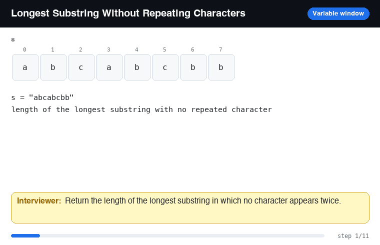

# Walkthrough: Longest Substring Without Repeating Characters

**Module:** [04 · Sliding Window](../README.md) · **Difficulty:** Medium · **Solution:** [`p04_longest_substring_no_repeat.go`](../p04_longest_substring_no_repeat.go)



## The problem in plain words

Find the longest stretch of the string in which no character appears twice, and return its length.

```
"abcabcbb"  →  3   ("abc")
"pwwkew"    →  3   ("wke")
```

## Mock interview

**Interviewer:** Return the length of the longest substring of `s` with no repeated byte.

**Candidate:** Substring means contiguous, right? And can I treat the string as bytes?

**Interviewer:** Contiguous, and bytes are fine. Convert to runes only if you need Unicode.

**Candidate:** For `"abcabcbb"` the answer is 3, from `"abc"` (or `"bca"`, `"cab"`). For `"pwwkew"` it's 3 from `"wke"`; `"pwke"` doesn't count because it isn't contiguous. Edge cases: `""` gives 0, and a string of one repeated character gives 1.

**Candidate:** Brute force starts at every index and extends until a repeat appears. That's O(n²) with a 256-entry seen table per start.

**Interviewer:** How would you make it linear?

**Candidate:** I keep a window `[left, right]` with no repeats. When `s[right]` is already inside the window, I could shrink one step at a time, but there's a faster way: I remember where each byte was last seen, and jump `left` straight to just past that position.

I store `nextAfter[c] = last index of c + 1`, so a fresh `[256]int` of zeros means "never seen", with no initialisation needed. For each `right`: `left = max(left, nextAfter[c])`, then `nextAfter[c] = right + 1`, then update `best` with `right − left + 1`.

**Interviewer:** Why the `max`? Why not just set `left = nextAfter[c]`?

**Candidate:** The last occurrence might be **left** of the window already. In `"abba"`, when I reach the final `a`, its last occurrence is index 0, but `left` is already 2 because of the `b`s. Setting `left = 1` would move the window backwards and include the repeated `b`. Taking the max means `left` only moves forward.

**Candidate:** Testing on `"abcabcbb"`: `a`, `b`, `c` are new, so the window grows to 3. The second `a` was last at 0, so `left` jumps to 1, still length 3. The same happens for `b` (left 2) and `c` (left 3). The `b` at 6 was last at 4, so `left` goes to 5, length 2. The last `b` was at 6, so `left` goes to 7, length 1. The best is 3.

**Interviewer:** Complexity?

**Candidate:** One pass, and `left` never moves backwards: **O(n) time**. The table has 256 entries, so **O(σ) space** for the alphabet size.

## What the animation shows

| Step | `right` (char) | `left` | Length | Best |
|---|---|---|---|---|
| 1 | | | | Interviewer states the problem |
| 2 | | | | Brute force, O(n²) |
| 3 | 0 (`a`) | 0 | 1 | 1 |
| 4 | 1 (`b`) | 0 | 2 | 2 |
| 5 | 2 (`c`) | 0 | 3 | 3 |
| 6 | 3 (`a`) | 0 → 1 | 3 | 3 |
| 7 | 4 (`b`) | 1 → 2 | 3 | 3 |
| 8 | 5 (`c`) | 2 → 3 | 3 | 3 |
| 9 | 6 (`b`) | 3 → 5 | 2 | 3 |
| 10 | 7 (`b`) | 5 → 7 | 1 | 3 |
| 11 | | | | Answer 3 (`"abc"`), O(n) time, O(σ) space |

## Detailed explanation

The invariant is: *`s[left..right]` has no repeated byte, and it's the longest such window ending at `right`.*

When `s[right] = c` arrives, the only possible repeat is `c` itself, because the old window had none. If `c` last appeared at index `p` with `p >= left`, any window ending at `right` must start after `p`, so the longest valid one starts at `p + 1 = nextAfter[c]`. If `p < left`, the old occurrence is outside the window and `left` stays. `max(left, nextAfter[c])` covers both cases in one line.

Because the window is the longest valid one for every `right`, taking the max of its length over all `right` gives the answer.

The "one past the index" trick is worth noticing. It lets a zero-valued Go array mean "never seen" with no `-1` fill loop.

Edge cases: an empty string never enters the loop and returns 0. `"abba"` is the classic test for the `max`.

## Complexity

| Approach | Time | Space |
|---|---|---|
| Extend from every start (`LengthOfLongestSubstringBrute`) | O(n²) | O(σ) |
| Last-seen table, jumping `left` (`LengthOfLongestSubstring`) | O(n) | O(σ) |

## Common mistakes

- Setting `left = nextAfter[c]` without the `max`, which moves `left` backwards on inputs like `"abba"`.
- Storing the index itself and using 0 as "never seen", which confuses "never seen" with "seen at index 0".
- Updating `nextAfter[c]` before reading it.
- Using a `[26]int` table when the input can contain spaces, digits or capitals.

## Try it yourself

```sh
go test ./course/04-sliding-window/ -run TestLengthOfLongestSubstring -v
```
