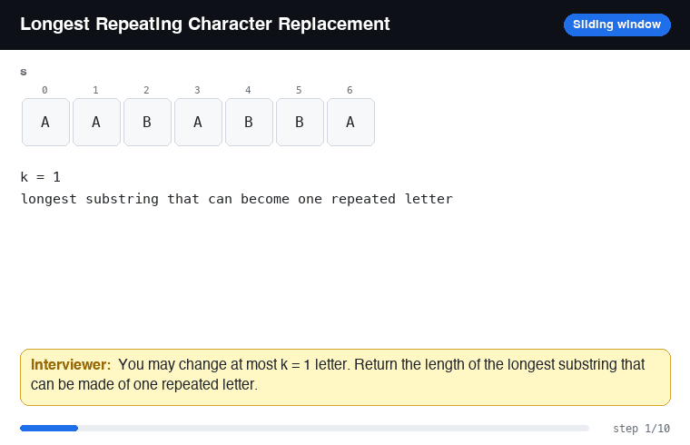

# Walkthrough: Longest Repeating Character Replacement

**Module:** [04 · Sliding Window](../README.md) · **Difficulty:** Medium · **Solution:** [`p05_char_replacement.go`](../p05_char_replacement.go)



## The problem in plain words

The string has only capital letters. You may change at most k letters to any other letter. What's the longest stretch you can turn into one letter repeated?

```
s = "ABAB",    k = 2  →  4   (change both B's → "AAAA")
s = "AABABBA", k = 1  →  4   ("AABA" → "AAAA")
```

The animation uses the second example. In the first one the window never needs to slide, so the main trick wouldn't show.

## Mock interview

**Interviewer:** `s` contains only uppercase letters. You can change at most `k` characters. Return the length of the longest substring that can be made of one repeated letter.

**Candidate:** Is k allowed to be 0? And can k be larger than the string?

**Interviewer:** Both are allowed.

**Candidate:** For `"AABABBA"` with k = 1, `"AABA"` becomes `"AAAA"` with one change, so 4 works. Length 5 would need two changes in every window, so the answer is 4. With k = 0 the answer is the longest run of one letter. If k is at least the length, the answer is the whole string.

**Candidate:** The key check: a window can be fixed when `length − maxFreq <= k`, where `maxFreq` is the count of its most common letter. I replace everything else. Brute force tries every start and extends, keeping counts, which is O(n²).

**Interviewer:** How do you get to O(n)?

**Candidate:** A sliding window with 26 counters. I move `right`, increase `count[s[right]]` and update `maxFreq`. If the window needs more than k changes, I don't shrink it in a loop. I **slide** it: remove `s[left]` and move `left` by one. So the window's length never goes down. It stays at the best length found so far, and it only grows when a longer valid window exists. At the end, the answer is `len(s) − left`.

**Interviewer:** You never decrease `maxFreq`, even when the letter that set it leaves. Isn't that wrong?

**Candidate:** It can be stale, but it does no harm. The window only grows when `length − maxFreq <= k`. A stale `maxFreq` is a value we really reached in some earlier window of the current length. For the window to grow beyond that length, some letter's count has to beat the old `maxFreq`, and then `maxFreq` is accurate again. A stale value only keeps the window sliding at the best size; it never makes it grow when it shouldn't.

**Candidate:** In code: `var count [26]int`, `maxFreq, left := 0, 0`, one `for right` loop with a single `if` that slides, then `return len(s) - left`.

**Candidate:** Testing on `"AABABBA"`: the window grows through `A`, `AA`, `AAB` and `AABA`, needing at most one change. Adding the next `B` makes `5 − 3 = 2 > 1`, so I slide and drop the first `A`. The same happens for the next two letters. By then `maxFreq` is 3 though no letter has 3 in the window, but that only keeps it sliding. The answer is `7 − 3 = 4`.

**Interviewer:** Complexity?

**Candidate:** One pass with 26 counters: **O(n) time, O(1) space**.

## What the animation shows

| Step | `right` (char) | Window | `maxFreq` | `len − maxFreq` | Action |
|---|---|---|---|---|---|
| 1 | | | | | Interviewer states the problem, k = 1 |
| 2 | | | | | Fixable test and O(n²) brute force |
| 3 | 0 (`A`) | `A` | 1 | 0 | grow to 1 |
| 4 | 1 (`A`) | `AA` | 2 | 0 | grow to 2 |
| 5 | 2 (`B`) | `AAB` | 2 | 1 | grow to 3 |
| 6 | 3 (`A`) | `AABA` | 3 | 1 | grow to 4 |
| 7 | 4 (`B`) | `AABAB` | 3 | 2 | slide: drop `A`, length stays 4 |
| 8 | 5 (`B`) | `ABABB` | 3 | 2 | slide: drop `A` |
| 9 | 6 (`A`) | `BABBA` | 3 (stale) | 2 | slide: drop `B` |
| 10 | | | | | Answer `7 − 3 = 4`, earned by `"AABA"` |

## Detailed explanation

Two facts make this work.

1. **The window length only goes up.** Each step adds one character on the right. At most one is removed on the left. So after each step the length is either one more than before (grow) or the same (slide). It records the best length so far without a separate `best` variable.

2. **The window grows only when a longer valid window exists.** Growing requires `length − maxFreq <= k` with the new length. `maxFreq` never exceeds a real count that some window of this or smaller length actually had. If it's stale, the check is just harder to pass, so it can only cause an extra slide, never a wrong grow. When a real count rises above the old `maxFreq`, the value becomes exact again, and the window grows because a longer fixable window really ends at `right`.

Together: the final length, `len(s) − left`, is the length of the longest fixable window.

If you find the never-shrinking version hard to explain, a safe alternative is to shrink with a `for` loop and recompute `maxFreq` from the 26 counters. That's still O(26·n).

## Complexity

| Approach | Time | Space |
|---|---|---|
| Every start with running counts (`CharacterReplacementBrute`) | O(n²) | O(1) |
| Sliding window that never shrinks (`CharacterReplacement`) | O(n) | O(1) |

## Common mistakes

- Using `right − left` as the window length instead of `right − left + 1`.
- Returning `maxFreq + k`, which can exceed the string length.
- Trying to keep `maxFreq` exact by decreasing it on removal without rescanning, which gives wrong values.
- Using `s[i] − 'a'` on uppercase input, which underflows the byte and panics.

## Try it yourself

```sh
go test ./course/04-sliding-window/ -run TestCharacterReplacement -v
```
