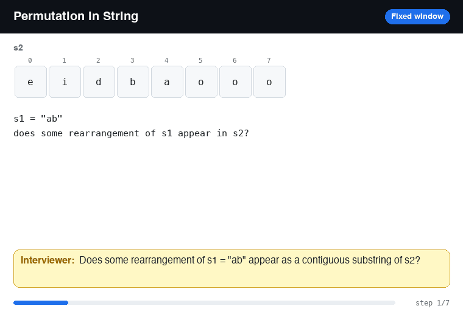

# Walkthrough: Permutation in String

**Module:** [04 · Sliding Window](../README.md) · **Difficulty:** Medium · **Solution:** [`p06_permutation_in_string.go`](../p06_permutation_in_string.go)



## The problem in plain words

Can you shuffle the letters of `s1` and find the result somewhere inside `s2` as one unbroken piece? Both strings are lowercase.

```
s1 = "ab", s2 = "eidbaooo"  →  true    ("ba" is in s2)
s1 = "ab", s2 = "eidboaoo"  →  false
```

## Mock interview

**Interviewer:** `s1` and `s2` are lowercase English strings. Report whether some rearrangement of `s1` appears as a contiguous substring of `s2`.

**Candidate:** Lowercase `a` to `z` only? And what if `s1` is longer than `s2`?

**Interviewer:** Lowercase only. If `s1` is longer, the answer is `false`.

**Candidate:** A substring is a rearrangement of `s1` exactly when it has the same length and the same letter counts. In `"eidbaooo"`, the window `"ba"` has one `a` and one `b`, so the answer is `true`. In `"eidboaoo"` the `b` and `a` are separated by an `o`, so `false`.

**Candidate:** Brute force recounts every window of length m = `len(s1)` and compares the two count arrays: O(n·m).

**Interviewer:** How do you avoid recounting?

**Candidate:** The window has a fixed size m. Sliding it one step adds one letter and removes one, so I update two counters instead of recounting. Comparing all 26 counters each step would still be O(26) per step. Instead, I keep `matches`: how many of the 26 letters have `have[i] == need[i]`. The window is a permutation exactly when `matches == 26`.

**Interviewer:** How do you keep `matches` correct?

**Candidate:** In an `update(c, delta)` helper. Before changing `have[c]`, if it equalled `need[c]`, that letter stops matching, so `matches--`. After the change, if it now equals `need[c]`, `matches++`. Every other letter is untouched, so their status doesn't change.

**Candidate:** In code: return `false` if m > `len(s2)`. Count `s1` into `need` and the first m letters of `s2` into `have`, and count the matches. Then for `right := m; right < len(s2); right++`: if `matches == 26`, return `true`; else `update(s2[right], +1)` and `update(s2[right-m], -1)`. After the loop, return `matches == 26` for the last window.

**Candidate:** Testing: the first window `"ei"` matches 22 letters; `a`, `b`, `e`, `i` don't. Sliding adds `d` (stops matching) and removes `e` (starts matching), so it stays 22. Next, `b` enters and `i` leaves, both start matching: 24. Then `a` enters and `d` leaves: 26. At the next check `matches` is 26, so I return `true` for `"ba"`.

**Interviewer:** What if `s1` could contain any Unicode character?

**Candidate:** I'd use maps instead of `[26]int`, and track how many distinct characters match instead of 26.

**Interviewer:** Complexity?

**Candidate:** O(m) to count `s1` and the first window, then O(1) per slide: **O(n + m) time**. Two arrays of 26 counters: **O(1) space**.

## What the animation shows

| Step | Window | Change | `matches` |
|---|---|---|---|
| 1 | | Interviewer states the problem | |
| 2 | | Same counts means permutation; brute force O(n·m) | |
| 3 | `"ei"` | First window counted | 22 |
| 4 | `"id"` | `d` enters (−1), `e` leaves (+1) | 22 |
| 5 | `"db"` | `b` enters (+1), `i` leaves (+1) | 24 |
| 6 | `"ba"` | `a` enters (+1), `d` leaves (+1) | 26 |
| 7 | `"ba"` | Check finds 26 → `true`, O(n + m) time | 26 |

## Detailed explanation

Two windows with the same counts are permutations of each other, and vice versa. So the question becomes: does any length-m window of `s2` have the same 26 counts as `s1`?

The `matches` counter turns "are 26 numbers equal?" into "is one number 26?". It stays correct because each slide changes exactly two counters, and `update` re-checks only those two. If the entering and leaving letters are the same, the two updates cancel and `matches` ends where it started.

Note the order in the loop: the check comes **before** the slide. That's why the last window is checked separately with `return matches == 26` after the loop.

Edge cases: `len(s1) > len(s2)` returns `false` up front. `len(s1) == len(s2)` never enters the loop and compares the whole strings' counts.

## Complexity

| Approach | Time | Space |
|---|---|---|
| Recount every window (`CheckInclusionBrute`) | O(n·m) | O(1) |
| Sliding counts + `matches` (`CheckInclusion`) | O(n + m) | O(1) |

## Common mistakes

- Forgetting to check the final window after the loop.
- Updating `matches` only when a count becomes equal, and not when it stops being equal.
- Sliding before checking, which skips the first window.
- Comparing sorted substrings, which is O(n·m log m).

## Try it yourself

```sh
go test ./course/04-sliding-window/ -run TestCheckInclusion -v
```
