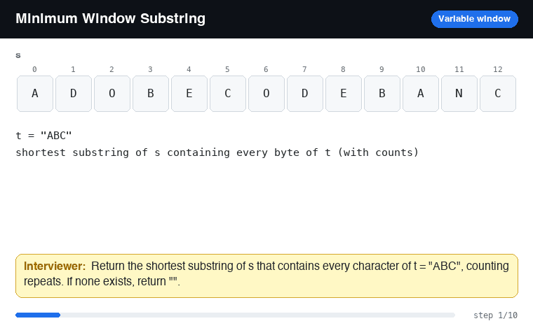

# Walkthrough: Minimum Window Substring

**Module:** [04 · Sliding Window](../README.md) · **Difficulty:** Hard · **Solution:** [`p07_min_window_substring.go`](../p07_min_window_substring.go)



## The problem in plain words

Find the shortest piece of `s` that contains every character of `t`, including repeats. If several are equally short, return the leftmost. If none exists, return an empty string.

```
s = "ADOBECODEBANC", t = "ABC"  →  "BANC"
s = "a",             t = "aa"   →  ""
```

## Mock interview

**Interviewer:** Return the shortest substring of `s` that contains every byte of `t`, counting multiplicity. Ties go to the leftmost. Return `""` if there's none or `t` is empty.

**Candidate:** So if `t` is `"aa"`, the window needs two `a`s? And it's case-sensitive?

**Interviewer:** Yes and yes.

**Candidate:** For `"ADOBECODEBANC"` and `"ABC"`, `"ADOBEC"` covers t with length 6, `"CODEBA"` also has 6, and `"BANC"` has 4, which is the answer. For `s = "a"`, `t = "aa"` there's only one `a`, so `""`.

**Candidate:** Brute force starts at every index and extends until the window covers t, checking coverage over 256 counters. That's O(n²·σ).

**Interviewer:** How would you do it in linear time?

**Candidate:** A variable window: expand right until it's valid, then shrink left while it stays valid, recording the best each time. The trick is checking validity in O(1). I keep `need[c]`: how many more of `c` the window still requires. It starts at the counts in t, and it goes negative when the window has a surplus. I also keep `missing`: the total number of required bytes not yet covered. The window is valid exactly when `missing == 0`.

- Adding `c` on the right: if `need[c] > 0`, it was still required, so `missing--`. Then `need[c]--`.
- Removing `d` on the left: `need[d]++`. If `need[d] > 0` now, I just gave up a required byte, so `missing++`.

**Interviewer:** Why is a surplus allowed to go negative?

**Candidate:** It records extras. If the window has two `B`s and t needs one, `need['B']` is -1. Dropping one `B` brings it to 0, still covered, so `missing` doesn't change. Only the drop that takes it above 0 breaks the window.

**Candidate:** In code: fill `need`, set `missing = len(t)`, then `for right` add `s[right]`, and `for missing == 0` record `(left, right−left+1)` if shorter, then remove `s[left]` and `left++`. Return the best slice, or `""` if `bestLen` is still -1. Using a strict `<` keeps the leftmost window on ties.

**Candidate:** Testing: expanding to `"ADOBEC"` covers t, length 6, best so far. Dropping `A` breaks it. Expanding to the `A` at index 10 makes `"DOBECODEBA"` valid. Shrinking past `D`, `O`, `B`, `E` keeps it valid, but none is shorter than 6. Dropping `C` breaks it. Expanding to the last `C` makes `"ODEBANC"` valid. Shrinking past `O` and `D` gives `"EBANC"`, length 5, then `"BANC"`, length 4. Dropping `B` breaks it, and `right` is at the end. The answer is `"BANC"`.

**Interviewer:** Complexity?

**Candidate:** `right` and `left` each move forward at most n times, plus O(m) to count t: **O(n + m) time**. The `need` table has 256 entries: **O(σ) space**.

## What the animation shows

| Step | Window | Event | Best |
|---|---|---|---|
| 1 | | Interviewer states the problem | |
| 2 | | Brute force, O(n²·σ) | |
| 3 | `ADOBEC` | Expand until `missing = 0` | none yet |
| 4 | `ADOBEC` | Length 6, new best; drop `A` → invalid | `ADOBEC` |
| 5 | `DOBECODEBA` | Expand over `ODEBA` until valid | `ADOBEC` |
| 6 | `CODEBA` | Shrank past `D`, `O`, `B`, `E` (none shorter); drop `C` → invalid | `ADOBEC` |
| 7 | `ODEBANC` | Expand over `NC` until valid | `ADOBEC` |
| 8 | `EBANC` | Shrank past `O`, `D`; length 5, new best; drop `E`, still valid | `EBANC` |
| 9 | `BANC` | Length 4, new best; drop `B` → invalid | `BANC` |
| 10 | | Answer `"BANC"`, O(n + m) time | `BANC` |

## Detailed explanation

This is the "shortest valid window" template applied to coverage.

**Why `missing` is enough.** `missing` equals the sum over all bytes of `max(need[c], 0)`. The two update rules keep that true: `missing` changes only when `need[c]` crosses between positive and non-positive. So `missing == 0` means no byte is still required, which is exactly "the window covers t".

**Why shrinking finds the best window for each right end.** Coverage is monotone: a window that covers t still covers it after growing. So for a fixed `right`, the valid windows are `[left', right]` for every `left'` up to some limit. The inner loop walks `left` to that limit, recording each length, and stops at the first invalid window. The shortest valid window ending at `right` is recorded before it stops.

**Why it's linear.** `left` never moves backwards and never passes `right + 1`, so the inner loop runs at most n times in total.

Edge cases: an empty `t` returns `""` at once. If `s` never covers `t`, `missing` never reaches 0, `bestLen` stays -1, and the result is `""`.

## Complexity

| Approach | Time | Space |
|---|---|---|
| Extend from every start (`MinWindowBrute`) | O(n²·σ) | O(σ) |
| Expand then shrink with `need` and `missing` (`MinWindow`) | O(n + m) | O(σ) |

## Common mistakes

- Decreasing `missing` for every byte added, including surplus ones, instead of only when `need[c] > 0`.
- Counting distinct characters instead of total characters, which breaks when t has repeats like `"AA"`.
- Recording the window after removing `s[left]`, which records an invalid window.
- Using `<=` when comparing lengths, which returns the rightmost of two equal windows instead of the leftmost.

## Try it yourself

```sh
go test ./course/04-sliding-window/ -run TestMinWindow -v
```
