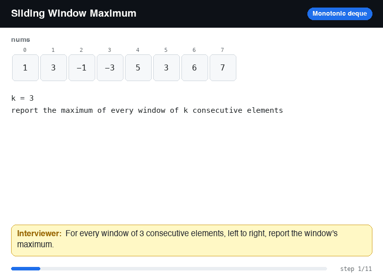

# Walkthrough: Sliding Window Maximum

**Module:** [04 · Sliding Window](../README.md) · **Difficulty:** Hard · **Solution:** [`p08_sliding_window_max.go`](../p08_sliding_window_max.go)



## The problem in plain words

Slide a window of k neighbouring numbers from left to right, one step at a time. For each position, write down the biggest number in the window.

```
nums = [1, 3, -1, -3, 5, 3, 6, 7], k = 3  →  [3, 3, 5, 5, 6, 7]
nums = [9, 8, 7],                  k = 1  →  [9, 8, 7]
```

## Mock interview

**Interviewer:** For every window of k consecutive elements, left to right, report the window's maximum. Return `nil` if k isn't in `1..len(nums)`.

**Candidate:** So there are n − k + 1 outputs. Can values repeat or be negative?

**Interviewer:** Both.

**Candidate:** For the example, the windows are `[1, 3, -1]`, `[3, -1, -3]`, `[-1, -3, 5]`, `[-3, 5, 3]`, `[5, 3, 6]`, `[3, 6, 7]`, with maxima `[3, 3, 5, 5, 6, 7]`. With k = 1 the output is the input. With k = n it's a single value.

**Candidate:** Brute force scans each window: O(n·k). A max-heap with lazy deletion gives O(n log n). I can get O(n) with a monotonic deque.

**Interviewer:** Go on.

**Candidate:** The deque holds indices, and their values strictly decrease from front to back. The front is always the current window's maximum. For each new index `i` with value `x`:

1. If the front index is `<= i − k`, it has slid out of the window, so I pop it from the front.
2. While the back value is `<= x`, I pop it from the back. Those elements are older than `x` and not bigger, so they can never be a window maximum again: any window that contains them also contains `x`.
3. I push `i` at the back.
4. Once `i >= k − 1`, the window is full and I output `nums[front]`.

**Interviewer:** Why does only one pop from the front per step suffice?

**Candidate:** The window moves by one each step, so at most one index can expire per step. And the deque's indices increase from front to back, so the expired one, if any, is at the front.

**Candidate:** In code I use the module's `Deque` type: `dq.Front()`, `dq.PopFront()`, `dq.Back()`, `dq.PopBack()`, `dq.PushBack(i)`.

**Candidate:** Testing: 1 joins. 3 pops 1, because 1 can never win again. -1 joins behind 3; the first window is full and its max is 3. -3 joins; max 3. At 5, index 1 (the 3) has expired, and -3 and -1 are popped; max 5. 3 joins behind 5; max 5. 6 pops 3 and 5; max 6. 7 pops 6; max 7. The output is `[3, 3, 5, 5, 6, 7]`.

**Interviewer:** Complexity?

**Candidate:** Each index is pushed once and popped at most once, so the total work is **O(n) amortised**. The deque never holds more than k indices: **O(k) extra space**, plus the output.

## What the animation shows

| Step | `i` | `x` | Pops | Deque (values) | Output |
|---|---|---|---|---|---|
| 1 | | | | Interviewer states the problem, k = 3 | |
| 2 | | | | Brute force O(n·k); idea of a decreasing deque | |
| 3 | 0 | 1 | | `[1]` | |
| 4 | 1 | 3 | back: 1 | `[3]` | |
| 5 | 2 | -1 | | `[3, -1]` | 3 |
| 6 | 3 | -3 | | `[3, -1, -3]` | 3 |
| 7 | 4 | 5 | front: index 1; back: -3, -1 | `[5]` | 5 |
| 8 | 5 | 3 | | `[5, 3]` | 5 |
| 9 | 6 | 6 | back: 3, 5 | `[6]` | 6 |
| 10 | 7 | 7 | back: 6 | `[7]` | 7 |
| 11 | | | | Answer `[3, 3, 5, 5, 6, 7]`, O(n) time, O(k) space | |

## Detailed explanation

The deque keeps two invariants:

- **Indices increase** from front to back, because they're pushed in order.
- **Values strictly decrease** from front to back, because before pushing `x` every value `<= x` is popped from the back.

Together with expiring old indices at the front, this means the deque holds exactly the window's "candidates": elements with no larger-or-equal element after them inside the window. The largest candidate is the window maximum, and it's at the front.

Why is popping safe? If `nums[j] <= nums[i]` and `j < i`, then every window that contains `j` and is still to come also contains `i`, and `i` is at least as big. So `j` will never be reported. Popping equal values too (`<=`, not `<`) keeps the deque smaller and still correct, because the newer equal value lives longer.

Why is it O(n)? The `for` loop of back pops looks nested, but each index is pushed exactly once and can be popped at most once, so the total number of pops over the whole run is at most n.

Edge cases: `k <= 0` or `k > len(nums)` return `nil`. `k == 1` outputs every element. A strictly decreasing input keeps up to k indices in the deque, and expiry from the front does the work.

## Complexity

| Approach | Time | Space |
|---|---|---|
| Scan each window (`MaxSlidingWindowBrute`) | O(n·k) | O(1) extra |
| Monotonic deque (`MaxSlidingWindow`) | O(n) amortised | O(k) |

## Common mistakes

- Storing values instead of indices, which makes it impossible to tell when the front has expired.
- Checking expiry with `< i − k` instead of `<= i − k`, which keeps a window of k + 1 elements.
- Popping only strictly smaller values. It's still correct, but equal values pile up.
- Starting output at `i >= k` instead of `i >= k − 1`, which skips the first window.

## Try it yourself

```sh
go test ./course/04-sliding-window/ -run TestMaxSlidingWindow -v
```
