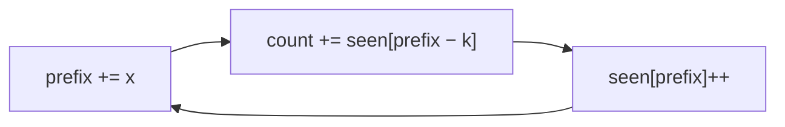

# 05 · Prefix Sums

> Precompute running totals once, and any range sum becomes a single
> subtraction. Pair it with a hash map and you can count subarrays with a given
> sum in O(n) — even with negative numbers, where sliding windows fail.

## What you'll learn

- 1-D prefix sums with a leading zero, and the `P[r+1] − P[l]` range formula.
- Prefix + hash map: "how many earlier prefixes equal `P[j] − k`?"
- Transforming a problem so it becomes a prefix-sum problem (0 → −1, sums mod k).
- Difference arrays — the inverse operation — for batches of range updates.
- 2-D prefix sums and inclusion–exclusion.

## Recognize the pattern

- "Sum of elements between i and j", **many** range queries on static data.
- "Number of subarrays whose sum equals / is divisible by k."
- "Longest subarray with sum k / equal 0s and 1s / balanced …" — prefix + first-index map.
- Contiguous subarrays **with negative numbers** (a sliding window can't shrink correctly).
- "Apply many range increments, then report the final array" — difference array.
- Rectangle sums in a grid.
- "Left sum vs right sum" at every index — prefix and total.

## The idea

```
index:      0   1   2   3   4
nums:       3   1   4   1   5
P:      0   3   4   8   9  14        P[i] = sum(nums[0..i-1])

sum(nums[1..3]) = P[4] − P[1] = 9 − 3 = 6   (1 + 4 + 1)
```

**Prefix + hash map.** A subarray `(i, j]` sums to k ⇔ `P[j] − P[i] = k` ⇔
`P[i] = P[j] − k`. So as you walk left to right, the question "how many
subarrays ending here sum to k?" is "how many earlier prefixes equal `P[j] − k`?"
— a map lookup.



Which map you keep depends on the question:

| Question | Map stores | Seed |
|---|---|---|
| *How many* subarrays sum to k | prefix → count | `{0: 1}` |
| *Longest* subarray with sum k | prefix → first index | `{0: -1}` |
| Sum divisible by k | (prefix mod k) → first index / count | `{0: -1}` / `{0: 1}` |

**Difference array.** To add `d` to `nums[l..r]`, write `+d` at `l` and `−d` at
`r+1`; a prefix sum at the end spreads it:

```
diff:   0  +2   0   0  −2
prefix: 0   2   2   2   0
```

**2-D.** `P[i][j]` = sum of the rectangle above-left of `(i, j)`:

```
region = P[r2+1][c2+1] − P[r1][c2+1] − P[r2+1][c1] + P[r1][c1]
         (whole)         (strip above)  (strip left)  (corner, removed twice)
```

## Go template

```go
// Range sums
p := make([]int, len(nums)+1)
for i, x := range nums {
    p[i+1] = p[i] + x
}
sum := p[r+1] - p[l] // nums[l..r]

// Count subarrays with sum k (works with negatives)
seen := map[int]int{0: 1}
count, prefix := 0, 0
for _, x := range nums {
    prefix += x
    count += seen[prefix-k]
    seen[prefix]++
}
```

Helpers live in [`prefixsums.go`](prefixsums.go): `BuildPrefix`, `RangeSum`, and
a sign-safe `mod`.

## Complexity

| Technique | Build | Query / total | Space |
|---|---|---|---|
| 1-D prefix sums | O(n) | O(1) per query | O(n) |
| Prefix + hash map | — | O(n) total | O(n) |
| Difference array, q updates | O(n + q) | — | O(n) |
| 2-D prefix sums | O(R·C) | O(1) per query | O(R·C) |

## Common pitfalls

- **Off-by-one.** With the leading zero, `sum(l..r) = P[r+1] − P[l]`. Without it you need a special case for `l == 0`.
- **Forgetting the seed.** `{0: 1}` (or `{0: -1}`) represents the empty prefix; without it you miss subarrays that start at index 0.
- **Insert after lookup** in the counting loop, otherwise k = 0 counts empty subarrays.
- **First vs latest index.** For the *longest* span keep the *first* occurrence; don't overwrite it.
- **Go's `%` keeps the sign.** `-7 % 6 == -1`. Normalise with `((x % k) + k) % k` before using a remainder as a key.
- **Overflow.** Prefix sums grow; with values near 10¹⁸ the running total overflows `int`. Reducing mod k as you go (p07) avoids it.
- **2-D slice aliasing.** Allocate each row with its own `make`; carving rows out of one shared slice and then appending to one row can corrupt its neighbour.
- **Mutable inputs.** A prefix array is a snapshot. If the data changes, you need a Fenwick / segment tree (not covered here).

## Problems

| # | Problem | Difficulty | Key idea |
|---|---|---|---|
| 01 | [Range Sum Query — Immutable](p01_range_sum_query.go) | Easy | `P[r+1] − P[l]` |
| 02 | [Find Pivot Index](p02_pivot_index.go) | Easy | right = total − left − self |
| 03 | [Left and Right Sum Differences](p03_left_right_difference.go) | Easy | Prefix and suffix from one running sum |
| 04 | [Range Addition (difference array)](p04_difference_array.go) | Medium | +d at l, −d at r+1, prefix once |
| 05 | [Subarray Sum Equals K](p05_subarray_sum_k.go) | Medium | Count earlier prefixes equal to `P − k` |
| 06 | [Contiguous Array](p06_contiguous_array.go) | Medium | 0 → −1; first index of each balance |
| 07 | [Continuous Subarray Sum](p07_continuous_subarray_sum.go) | Medium | Equal remainders mod k, span ≥ 2 |
| 08 | [Range Sum Query 2D — Immutable](p08_range_sum_2d.go) | Medium | Padded 2-D prefix + inclusion–exclusion |

## Practice tip

Write out the prefix array by hand for the first example of each problem
before coding — most bugs here are off-by-one. Then hide the solution and run:

```sh
go test ./course/05-prefix-sums/ -run TestSubarraySum -v
```

Finally, revisit [04-sliding-window/p03](../04-sliding-window/p03_min_size_subarray_sum.go)
and explain why the window works there (positive numbers) but prefix + map is
needed in p05 here.

## Next

[06 · Stacks & Monotonic Stacks →](../06-stacks-monotonic/README.md)
