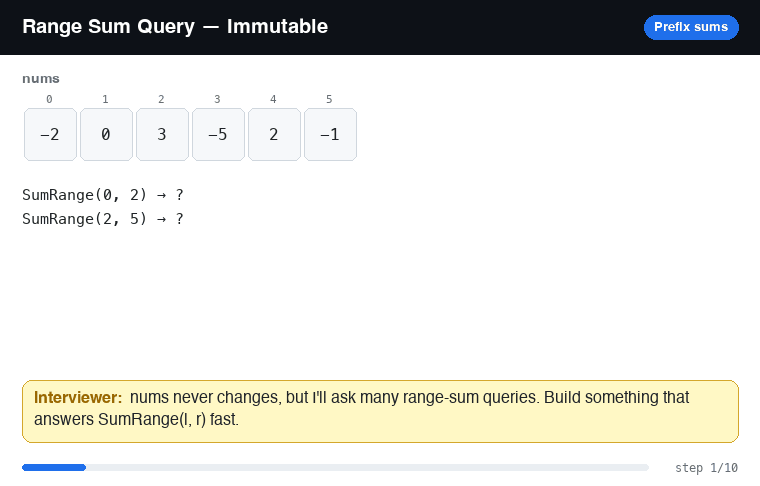

# Walkthrough: Range Sum Query — Immutable

**Module:** [05 · Prefix Sums](../README.md) · **Difficulty:** Easy · **Solution:** [`p01_range_sum_query.go`](../p01_range_sum_query.go)



## The problem in plain words

You get a list of numbers that never changes. Then you get many questions of the form "what is the sum from position `l` to position `r`?" Answer each one quickly.

```
nums = [-2, 0, 3, -5, 2, -1]
SumRange(0, 2) → 1     (-2 + 0 + 3)
SumRange(2, 5) → -1    (3 - 5 + 2 - 1)
```

## Mock interview

**Interviewer:** Build a structure over a fixed slice that answers many queries "sum of `nums[l..r]`, inclusive".

**Candidate:** A few questions first. Are `l` and `r` always valid, with `0 ≤ l ≤ r < n`? Can the numbers be negative? And roughly how many queries compared with the array length?

**Interviewer:** Indices are always valid. Values can be negative. Assume many queries, possibly more than n.

**Candidate:** On the example, `SumRange(0, 2)` is −2 + 0 + 3 = 1, and `SumRange(2, 5)` is 3 − 5 + 2 − 1 = −1. Edge cases: a single-element range, and a range that starts at index 0.

**Candidate:** The simplest version adds up `nums[l..r]` on every query. That's O(n) per query and O(n·q) in total. The problem is that the same additions happen again and again.

**Interviewer:** So how do you avoid that?

**Candidate:** I pay once up front. I build a prefix array `P` with one extra slot, where `P[i]` is the sum of `nums[0..i-1]`. `P[0]` is 0, the sum of nothing. Then the sum of `nums[l..r]` is `P[r+1] − P[l]`: the first `r+1` numbers minus the first `l` numbers.

**Interviewer:** Why the extra slot? You could store `P[i]` as the sum up to and including `i`.

**Candidate:** Then a range starting at 0 would need `P[r] − P[-1]`, which is a special case. With the leading zero the same formula works for every `l`, including 0.

**Candidate:** In code, `NewNumArray` calls `BuildPrefix`: `p[i+1] = p[i] + x` in one loop. `SumRange` returns `p[r+1] - p[l]`. I store the prefix in its own slice, so later changes to the caller's `nums` don't leak in.

**Candidate:** Testing it: `P = [0, -2, -2, 1, -4, -2, -3]`. `SumRange(0, 2) = P[3] − P[0] = 1 − 0 = 1`. `SumRange(2, 5) = P[6] − P[2] = −3 − (−2) = −1`. Both match.

**Interviewer:** Complexity?

**Candidate:** Building is **O(n) time and O(n) space**. Each query is **O(1)**.

**Interviewer:** What if the array could change between queries?

**Candidate:** Then one update could change O(n) prefix entries. I'd switch to a Fenwick tree or segment tree, which give O(log n) for both updates and queries.

## What the animation shows

| Step | What happens |
|---|---|
| 1 | The interviewer states the problem and the two queries. |
| 2 | Brute force: add the range on every query, O(n) each. |
| 3 | `P[0] = 0`, the empty prefix. |
| 4 | `P[1] = 0 + (−2) = −2`. |
| 5 | `P[2] = −2 + 0 = −2`. |
| 6 | `P[3] = 1`, `P[4] = −4`, `P[5] = −2` (same rule, shown together). |
| 7 | `P[6] = −2 + (−1) = −3`, the total. |
| 8 | `SumRange(0, 2) = P[3] − P[0] = 1`. |
| 9 | `SumRange(2, 5) = P[6] − P[2] = −1`. |
| 10 | Both answers and the complexity. |

## Detailed explanation

`P[i]` holds the sum of the first `i` numbers. The sum of `nums[l..r]` is the sum of the first `r+1` numbers with the first `l` numbers removed. Those first `l` numbers are exactly `P[l]`, so `P[r+1] − P[l]` leaves only the range. Subtraction works with negatives too, so there's no sign restriction.

The leading zero is what keeps the formula uniform. With `l = 0`, the formula reads `P[r+1] − P[0] = P[r+1] − 0`, which is right without any `if`.

This is a trade: O(n) extra memory buys O(1) queries. It pays off as soon as there are more than a handful of queries. It only works because the data is static. `NewNumArray` copies the sums into a new slice, and the test `TestNumArrayIndependentOfInput` checks that changing `nums` afterwards doesn't affect answers.

Edge cases: a single-element range gives `P[i+1] − P[i] = nums[i]`. Prefix totals grow as you go, so very large values can overflow `int`. `TestNumArrayLargeValues` uses values around 2⁶⁰, where the running totals still fit, and checks a range that cancels out to 0.

## Complexity

| Approach | Time | Space |
|---|---|---|
| Brute force (`SumRangeBrute`) | O(n) per query | O(1) |
| Prefix sums (`NewNumArray` + `SumRange`) | O(n) build, O(1) per query | O(n) |

## Common mistakes

- Using `P[r] − P[l]`, which drops `nums[r]`. With the leading zero it's `P[r+1] − P[l]`.
- Building `P` without the leading zero, then needing a special case for `l == 0`.
- Recomputing the prefix inside `SumRange`, which brings back O(n) per query.
- Keeping a reference to the caller's slice and expecting answers to stay fixed.

## Try it yourself

```sh
go test ./course/05-prefix-sums/ -run TestNumArray -v
```
