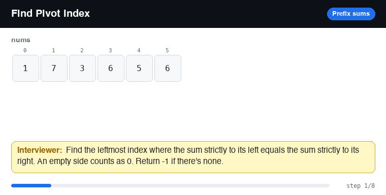

# Walkthrough: Find Pivot Index

**Module:** [05 · Prefix Sums](../README.md) · **Difficulty:** Easy · **Solution:** [`p02_pivot_index.go`](../p02_pivot_index.go)



## The problem in plain words

Find the first position where everything to its left adds up to the same as everything to its right. The number at that position belongs to neither side. If there's no such position, return −1.

```
[1, 7, 3, 6, 5, 6] → 3    because 1 + 7 + 3 = 11 = 5 + 6
[2, 1, -1]         → 0    because the left side is empty (0) and 1 + (-1) = 0
```

## Mock interview

**Interviewer:** Return the leftmost index where the sum strictly to the left equals the sum strictly to the right. An empty side sums to 0. Return −1 if none exists.

**Candidate:** To confirm: the pivot itself isn't counted on either side, index 0 has an empty left side, and the last index has an empty right side. Can values be negative?

**Interviewer:** Yes to all three, and yes, negatives are allowed.

**Candidate:** On `[1, 7, 3, 6, 5, 6]` the answer is 3. The second example, `[2, 1, -1]`, shows that index 0 can be the pivot. An empty array has no pivot, so −1.

**Candidate:** Brute force: for each index, add up the left part and the right part separately. That's O(n) per index, O(n²) total.

**Interviewer:** Can you do it in one pass?

**Candidate:** Almost. If I know the total, I don't need to add the right side. Right equals total minus left minus the current number. So I compute the total once, then walk left to right with a running `left` sum.

**Interviewer:** Why does that return the leftmost pivot?

**Candidate:** I check indices in order and return the first one that matches. Any earlier index was already checked and failed.

**Candidate:** In code, `PivotIndex` sums everything into `total`. Then for each `i, x`: if `left == total - left - x`, return `i`; otherwise `left += x`. After the loop, return −1. The order matters: I compare before adding `x`, because `x` isn't on the left of itself.

**Candidate:** Testing: total is 28. At index 0, left 0, right 27. At index 1, left 1, right 20. At index 2, left 8, right 17. At index 3, left 11, right 28 − 11 − 6 = 11. Equal, so I return 3.

**Interviewer:** Complexity?

**Candidate:** Two passes, so **O(n) time**, and only two integers, so **O(1) space**.

## What the animation shows

| Step | Index | `left` | `right` | Decision |
|---|---|---|---|---|
| 1 | — | — | — | Problem statement |
| 2 | — | — | — | Brute force: sum both sides per index, O(n²) |
| 3 | — | — | — | `total = 28`; right = total − left − nums[i] |
| 4 | 0 | 0 | 27 | not equal, `left += 1` |
| 5 | 1 | 1 | 20 | not equal, `left += 7` |
| 6 | 2 | 8 | 17 | not equal, `left += 3` |
| 7 | 3 | 11 | 11 | equal → return 3 |
| 8 | — | — | — | Answer 3, O(n) time, O(1) space |

## Detailed explanation

Every element is in exactly one of three places relative to index `i`: left of it, at it, or right of it. So `left + nums[i] + right = total`, which gives `right = total − left − nums[i]`. That identity is the whole trick. It turns a two-sided question into a one-sided running sum.

The loop keeps this invariant: at the top of iteration `i`, `left` is the sum of `nums[0..i-1]`. It starts at 0, which is correct for index 0, and adding `x` at the end of each iteration keeps it true.

Negative numbers don't break anything, since the identity is plain arithmetic. That's also why you can't use two pointers here: sums don't move in one direction.

Edge cases: an empty array never enters the loop, so it returns −1. A single element is always a pivot, because both sides are empty. The leftmost rule matters for inputs like `[0, 0]`, where both indices work and the answer is 0.

## Complexity

| Approach | Time | Space |
|---|---|---|
| Brute force (`PivotIndexBrute`) | O(n²) | O(1) |
| Running left sum (`PivotIndex`) | O(n) | O(1) |

## Common mistakes

- Adding `x` to `left` before the comparison, which counts the pivot on its own left side.
- Comparing `left` with `total − left`, which counts the pivot on the right side.
- Returning the last match instead of the first.
- Building a full suffix array. It works, but it costs O(n) space for no gain.

## Try it yourself

```sh
go test ./course/05-prefix-sums/ -run TestPivotIndex -v
```
