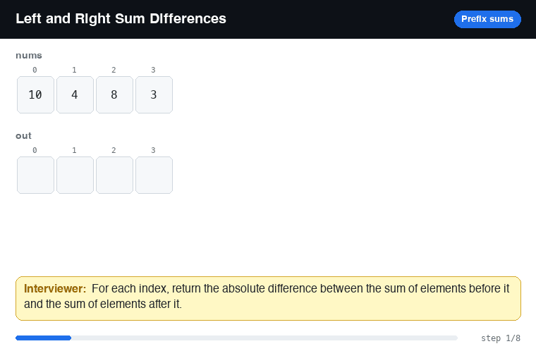

# Walkthrough: Left and Right Sum Differences

**Module:** [05 · Prefix Sums](../README.md) · **Difficulty:** Easy · **Solution:** [`p03_left_right_difference.go`](../p03_left_right_difference.go)



## The problem in plain words

For every position, add up the numbers before it and the numbers after it. Write down how far apart those two sums are (always as a positive number).

```
[10, 4, 8, 3] → [15, 1, 11, 22]
  left sums:  0, 10, 14, 22
  right sums: 15, 11, 3, 0
```

## Mock interview

**Interviewer:** For each index `i`, return `|leftSum(i) − rightSum(i)|`, where the left sum covers elements strictly before `i` and the right sum covers elements strictly after it.

**Candidate:** So the element at `i` is in neither sum, and the output has the same length as the input. Can the input be empty, and are values positive?

**Interviewer:** The input can be empty; return an empty slice. Values are non-negative here, but don't rely on that.

**Candidate:** On `[10, 4, 8, 3]`: index 0 has left 0 and right 15, so 15. Index 3 has left 22 and right 0, so 22. A single element `[1]` gives `[0]`.

**Candidate:** Brute force: for each index, loop over the whole array and add to `left` or `right`. That's O(n²).

**Interviewer:** How do you get it to linear?

**Candidate:** Same idea as the pivot index problem. The left sum only grows by one number per step, so I keep it running. The right sum is the total minus left minus the current number. I don't even need a suffix array.

**Interviewer:** Why does `total − left − x` give the right sum?

**Candidate:** Every element is either before `i`, at `i`, or after `i`. So left plus `x` plus right equals the total. Rearranging gives right.

**Candidate:** In code, `LeftRightDifference` computes `total`, makes `out`, then for each `i, x` sets `right := total - left - x`, `out[i] = abs(left - right)`, and `left += x`.

**Candidate:** Testing: total is 25. Index 0: left 0, right 15, out 15. Index 1: left 10, right 11, out 1. Index 2: left 14, right 3, out 11. Index 3: left 22, right 0, out 22. That's `[15, 1, 11, 22]`.

**Interviewer:** Complexity?

**Candidate:** Two passes, so **O(n) time**, and **O(1) extra space** besides the output.

## What the animation shows

| Step | What happens |
|---|---|
| 1 | Problem statement with an empty `out`. |
| 2 | Brute force: sum both sides for each index, O(n²). |
| 3 | `total = 25`; right = total − left − nums[i]. |
| 4 | i = 0: left 0, right 15 → `out[0] = 15`. |
| 5 | i = 1: left 10, right 11 → `out[1] = 1`. |
| 6 | i = 2: left 14, right 3 → `out[2] = 11`. |
| 7 | i = 3: left 22, right 0 → `out[3] = 22`. |
| 8 | Answer `[15, 1, 11, 22]`, O(n) time, O(1) extra space. |

## Detailed explanation

This is prefix sums without storing the prefix array. The left sum at index `i` is the prefix `P[i]`, and the right sum is a suffix. Because the total is fixed, the suffix is `total − P[i] − nums[i]`, so one running number gives both.

The loop invariant is that `left` equals the sum of `nums[0..i-1]` at the start of iteration `i`. It's 0 at the start and grows by `x` at the end of each step.

The same prefix-and-suffix idea solves "product of array except self" in module 02. There the trick differs, because you can't divide by zero, so you need a real second pass.

Edge cases: the empty slice gives an empty result. The first index always has `left = 0`, and the last always has `right = 0`.

## Complexity

| Approach | Time | Space |
|---|---|---|
| Brute force (`LeftRightDifferenceBrute`) | O(n²) | O(1) extra |
| Running sum + total (`LeftRightDifference`) | O(n) | O(1) extra (output not counted) |

## Common mistakes

- Forgetting the absolute value.
- Updating `left` before computing `right`, which puts `x` on both sides.
- Allocating separate prefix and suffix arrays when one running number is enough.

## Try it yourself

```sh
go test ./course/05-prefix-sums/ -run TestLeftRightDifference -v
```
