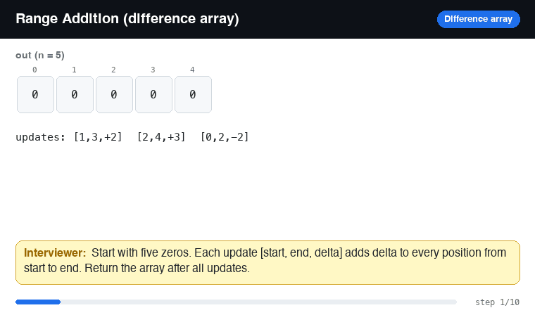

# Walkthrough: Range Addition (difference array)

**Module:** [05 · Prefix Sums](../README.md) · **Difficulty:** Medium · **Solution:** [`p04_difference_array.go`](../p04_difference_array.go)



## The problem in plain words

You start with a row of zeros. Each instruction says "add this amount to every slot from here to there". After all instructions, what does the row look like?

```
n = 5, updates = [[1, 3, 2], [2, 4, 3], [0, 2, -2]]  →  [-2, 0, 3, 5, 3]
```

## Mock interview

**Interviewer:** Start with n zeros. Each update `[start, end, delta]` adds `delta` to every position from `start` to `end` inclusive. Return the final slice.

**Candidate:** Indices are 0-based and inclusive on both ends? Can `delta` be negative, and are the ranges always valid?

**Interviewer:** Yes, yes, and yes.

**Candidate:** Working the example by hand: after `[1,3,+2]` the row is `[0,2,2,2,0]`. After `[2,4,+3]` it's `[0,2,5,5,3]`. After `[0,2,-2]` it's `[-2,0,3,5,3]`.

**Candidate:** Brute force does exactly that: loop over each range and add. That's O(n·q) for q updates, which is slow when ranges are long.

**Interviewer:** Can you make each update O(1)?

**Candidate:** Yes, with a difference array. I don't add to every cell. I only mark where a delta starts and where it stops: `+delta` at `start` and `−delta` at `end+1`. At the end, one prefix-sum pass turns the marks into values. The running total at index `i` is the sum of every delta that has started and not yet stopped.

**Interviewer:** Why `end+1` and not `end`?

**Candidate:** The range includes `end`, so the delta must still apply there. It switches off at the next position. That's also why the array has `n+1` slots: when `end` is the last index, `end+1` is `n`, and the extra slot keeps it in bounds.

**Candidate:** In code, `ApplyUpdates` makes `diff := make([]int, n+1)`, does `diff[start] += delta` and `diff[end+1] -= delta` per update, then runs `running += diff[i]; out[i] = running` for `i` in `0..n-1`.

**Candidate:** Testing: after the three updates, `diff = [-2, 2, 3, 2, -2, -3]`. The running sums over the first five slots are −2, 0, 3, 5, 3. That matches.

**Interviewer:** Complexity?

**Candidate:** **O(n + q) time** and **O(n) space**.

## What the animation shows

| Step | What happens | `diff` / `out` |
|---|---|---|
| 1 | Problem statement | out = `[0,0,0,0,0]` |
| 2 | Brute force: touch every cell of every range, O(n·q) | |
| 3 | Empty difference array with n + 1 slots | diff = `[0,0,0,0,0,0]` |
| 4 | `[1,3,+2]`: diff[1] += 2, diff[4] −= 2 | diff = `[0,2,0,0,-2,0]` |
| 5 | `[2,4,+3]`: diff[2] += 3, diff[5] −= 3 | diff = `[0,2,3,0,-2,-3]` |
| 6 | `[0,2,-2]`: diff[0] += −2, diff[3] −= −2 | diff = `[-2,2,3,2,-2,-3]` |
| 7 | Prefix pass, i = 0 | out[0] = −2 |
| 8 | Prefix pass, i = 1 | out[1] = 0 |
| 9 | Same for i = 2..4 | out[2..4] = 3, 5, 3 |
| 10 | Answer and complexity | `[-2,0,3,5,3]` |

## Detailed explanation

A difference array is the inverse of a prefix sum. If `out` is the final array, then `diff[i] = out[i] − out[i−1]`. A range update changes only two differences: the jump into the range at `start` and the jump out of it at `end+1`. Everything inside the range moves up together, so the differences between neighbours inside it don't change.

Taking the prefix sum of `diff` rebuilds `out`. Updates are additive, so the marks from different updates can simply pile up in the same array, and the order of updates doesn't matter.

The last slot, `diff[n]`, is written to but never read. It exists only so that `end+1` stays in bounds.

This pattern fits any problem shaped like "many range increments, then read the final values", such as flight bookings or car pooling. If you need to read values between updates, you need a Fenwick tree instead.

## Complexity

| Approach | Time | Space |
|---|---|---|
| Brute force (`ApplyUpdatesBrute`) | O(n·q) | O(n) |
| Difference array (`ApplyUpdates`) | O(n + q) | O(n) |

## Common mistakes

- Making `diff` length `n`, which panics when `end == n−1`.
- Putting the `−delta` at `end` instead of `end+1`, which cuts the range short by one.
- Forgetting the final prefix pass and returning `diff` itself.
- Reading `diff[n]` into the output, which produces one value too many.

## Try it yourself

```sh
go test ./course/05-prefix-sums/ -run TestApplyUpdates -v
```
