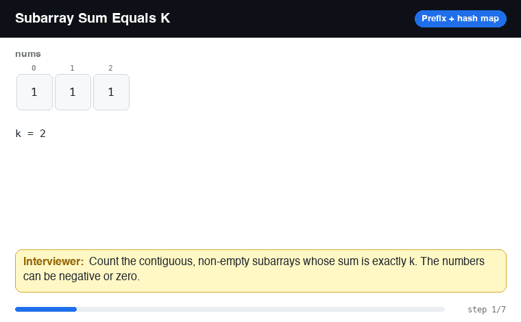

# Walkthrough: Subarray Sum Equals K

**Module:** [05 · Prefix Sums](../README.md) · **Difficulty:** Medium · **Solution:** [`p05_subarray_sum_k.go`](../p05_subarray_sum_k.go)



## The problem in plain words

Count how many unbroken stretches of the list add up to exactly k. Numbers can be negative or zero.

```
nums = [1, 1, 1], k = 2   →  2    ([1,1] at positions 0..1 and 1..2)
nums = [1, -1, 0], k = 0  →  3    ([1,-1], [0], [1,-1,0])
```

## Mock interview

**Interviewer:** Count the contiguous, non-empty subarrays whose sum equals k. The array can contain negatives and zeros.

**Candidate:** Overlapping subarrays count separately, right? And the empty subarray never counts, even when k is 0?

**Interviewer:** Correct on both.

**Candidate:** On `[1, 1, 1]` with k = 2 there are two: positions 0..1 and 1..2. The second example shows zeros and negatives creating extra matches: `[1,-1]`, `[0]` and `[1,-1,0]` all sum to 0.

**Candidate:** Brute force: for each start, extend to the right with a running sum and count every time it equals k. That's O(n²) time, O(1) space.

**Interviewer:** Could you use a sliding window?

**Candidate:** No. A window relies on "growing makes the sum bigger, shrinking makes it smaller". With negatives that's false, so I can't decide which end to move.

**Candidate:** Prefix sums work instead. The subarray between two prefixes sums to k exactly when `P[j] − P[i] = k`, which means `P[i] = P[j] − k`. So as I walk, at each position I ask: how many earlier prefixes equal the current prefix minus k? A hash map from prefix value to count answers that in O(1).

**Interviewer:** What goes in the map at the start?

**Candidate:** `{0: 1}`, for the empty prefix. Without it I'd miss subarrays that start at index 0.

**Candidate:** In code, `SubarraySum` keeps `seen := map[int]int{0: 1}`, `count` and `prefix`. For each `x`: `prefix += x`, `count += seen[prefix-k]`, then `seen[prefix]++`. The lookup comes before the insert. Otherwise, when k is 0, the current prefix would match itself and count an empty subarray.

**Candidate:** Testing: prefix 1 needs −1, not seen, count 0. Prefix 2 needs 0, seen once, count 1. Prefix 3 needs 1, seen once, count 2. Answer 2.

**Interviewer:** Complexity?

**Candidate:** One pass with O(1) map operations: **O(n) time**. The map can hold up to n + 1 prefixes: **O(n) space**.

## What the animation shows

| Step | `prefix` | Need `prefix − k` | Found | `count` |
|---|---|---|---|---|
| 1 | — | — | — | Problem statement |
| 2 | — | — | — | Brute force O(n²); sliding window fails with negatives |
| 3 | — | — | — | Key identity; map seeded with `{0: 1}` |
| 4 | 1 | −1 | 0 | 0 |
| 5 | 2 | 0 | 1 | 1 (subarray 0..1) |
| 6 | 3 | 1 | 1 | 2 (subarray 1..2) |
| 7 | — | — | — | Answer 2, O(n) time, O(n) space |

## Detailed explanation

Every subarray `nums[i..j]` equals `P[j+1] − P[i]`. Fix the right end. The subarrays ending there that sum to k correspond one-to-one with earlier prefixes whose value is `P[j+1] − k`. Counting those prefixes counts those subarrays. Summing over every right end counts every subarray exactly once.

The map stores counts, not indices, because we need *how many* earlier prefixes match. With zeros or negatives the same prefix value can repeat, and each repeat is a different start position.

Two details make it correct:

- **The seed `{0: 1}`** stands for the empty prefix before index 0, so subarrays starting at 0 are found.
- **Lookup before insert** makes sure the current prefix is never paired with itself, which would be an empty subarray.

This is the standard "prefix + hash map" pattern. Compare it with the sliding window in module 04: the window needs all values positive; this approach doesn't care about signs.

## Complexity

| Approach | Time | Space |
|---|---|---|
| Brute force (`SubarraySumBrute`) | O(n²) | O(1) |
| Prefix + hash map (`SubarraySum`) | O(n) | O(n) |

## Common mistakes

- Forgetting the `{0: 1}` seed.
- Inserting the current prefix before the lookup, which over-counts when k = 0.
- Storing only whether a prefix was seen (a set) instead of how many times.
- Reaching for a sliding window, which gives wrong answers with negative numbers.

## Try it yourself

```sh
go test ./course/05-prefix-sums/ -run TestSubarraySum -v
```
