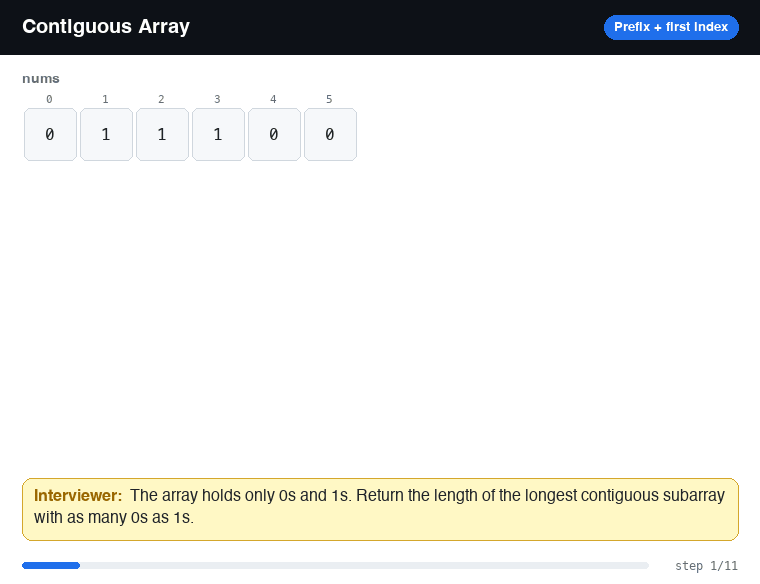

# Walkthrough: Contiguous Array

**Module:** [05 · Prefix Sums](../README.md) · **Difficulty:** Medium · **Solution:** [`p06_contiguous_array.go`](../p06_contiguous_array.go)



## The problem in plain words

The list holds only 0s and 1s. Find the longest unbroken stretch that has as many 0s as 1s, and return its length.

```
[0, 1]             → 2
[0, 1, 1, 1, 0, 0] → 6    (the whole array: three 0s, three 1s)
[0, 0, 0]          → 0
```

The animation uses the second example. The first one is only two steps long and doesn't show a balance repeating in the middle.

## Mock interview

**Interviewer:** Given a binary array, return the length of the longest contiguous subarray with an equal number of 0s and 1s.

**Candidate:** Only 0 and 1 appear? And if no such subarray exists, I return 0?

**Interviewer:** Yes and yes.

**Candidate:** `[0, 0, 0]` has no balanced stretch, so 0. In `[0, 1, 1, 1, 0, 0]` the whole array has three of each, so 6.

**Candidate:** Brute force: fix a start, extend to the right, and keep a balance of ones minus zeros. Whenever the balance is 0, record the length. That's O(n²).

**Interviewer:** How would you speed that up?

**Candidate:** I'll change the problem. If I count each 0 as −1 and each 1 as +1, "equal counts" becomes "sum is 0". A stretch sums to 0 exactly when the running balance is the same at both ends. So I need the two positions furthest apart with the same balance.

**Interviewer:** And how do you find those?

**Candidate:** A map from balance to the *first* index where it appeared. When I see a balance again at index `i`, the stretch from just after the first index to `i` is balanced, with length `i − first`. Using the first index gives the longest stretch. I seed `{0: -1}`, so a balanced stretch can start at index 0.

**Candidate:** In code, `FindMaxLength` keeps `first := map[int]int{0: -1}`, `best` and `balance`. For each `i, x`, add +1 or −1. If the balance is already in the map, `best = max(best, i - j)`. Otherwise store `first[balance] = i`. I never overwrite an existing entry.

**Candidate:** Testing: balances are −1, 0, 1, 2, 1, 0. At index 1, balance 0 was first seen at −1, length 2. At index 4, balance 1 was first at 2, length 2. At index 5, balance 0 was first at −1, length 6. Best is 6.

**Interviewer:** What if you stored the latest index instead?

**Candidate:** Then at index 5, balance 0 would point to index 1, and I'd get length 4 instead of 6. Keeping the first index is what makes the span longest.

**Candidate:** **O(n) time**, and the map holds at most n + 1 balances, so **O(n) space**.

## What the animation shows

| Step | Index | Balance | Map action | `best` |
|---|---|---|---|---|
| 1 | — | — | Problem statement | |
| 2 | — | — | Brute force O(n²) | |
| 3 | — | — | 0 → −1 transform | |
| 4 | — | 0 | seed `first = {0: -1}` | 0 |
| 5 | 0 | −1 | new → `first[-1] = 0` | 0 |
| 6 | 1 | 0 | seen at −1 → length 2 | 2 |
| 7 | 2 | 1 | new → `first[1] = 2` | 2 |
| 8 | 3 | 2 | new → `first[2] = 3` | 2 |
| 9 | 4 | 1 | seen at 2 → length 2 | 2 |
| 10 | 5 | 0 | seen at −1 → length 6 | 6 |
| 11 | — | — | Answer 6, O(n) time and space | |

## Detailed explanation

Let `B[i]` be the balance after reading `nums[0..i]`, with `B[-1] = 0`. The stretch `nums[j+1..i]` has equal counts exactly when `B[i] − B[j] = 0`. So every balanced stretch is a pair of equal balances, and its length is the distance between them.

For a fixed right end `i`, the longest balanced stretch ending at `i` uses the smallest `j` with the same balance. That's why the map keeps only the first occurrence. Later occurrences can only give shorter stretches.

This is the "longest" variant of the prefix + map pattern. Compare it with p05, which counts subarrays and stores counts. Here we want a length, so we store the first index and seed with `{0: -1}` instead of `{0: 1}`.

Edge cases: an all-zero or all-one array never repeats a balance, so the answer stays 0. An empty array returns 0.

## Complexity

| Approach | Time | Space |
|---|---|---|
| Brute force (`FindMaxLengthBrute`) | O(n²) | O(1) |
| Prefix balance + first index (`FindMaxLength`) | O(n) | O(n) |

## Common mistakes

- Overwriting the map entry each time, which keeps the latest index and shortens spans.
- Seeding with `{0: 0}` instead of `{0: -1}`, which makes lengths from index 0 one too short.
- Forgetting to map 0 to −1, so the "sum is 0" idea doesn't apply.

## Try it yourself

```sh
go test ./course/05-prefix-sums/ -run TestFindMaxLength -v
```
