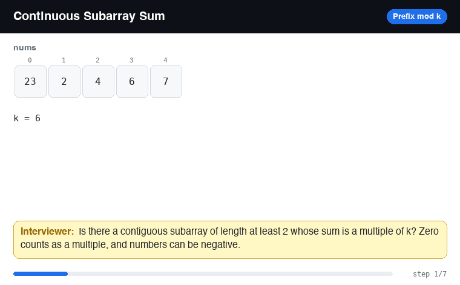

# Walkthrough: Continuous Subarray Sum

**Module:** [05 · Prefix Sums](../README.md) · **Difficulty:** Medium · **Solution:** [`p07_continuous_subarray_sum.go`](../p07_continuous_subarray_sum.go)



## The problem in plain words

Is there an unbroken stretch of at least two numbers whose sum divides evenly by k? A sum of 0 counts.

```
nums = [23, 2, 4, 6, 7], k = 6   → true    (2 + 4 = 6)
nums = [23, 2, 6, 4, 7], k = 13  → false
```

## Mock interview

**Interviewer:** Given `nums` and `k ≥ 1`, report whether some contiguous subarray of length at least 2 sums to a multiple of k. Zero counts as a multiple. Negative numbers are allowed in this version.

**Candidate:** So length 1 never counts, even if the element itself is a multiple of k? And I only need true or false, not the subarray?

**Interviewer:** Right on both.

**Candidate:** In the first example, `[2, 4]` sums to 6, so true. A case to remember is `[0, 0]` with any k: the sum is 0, length 2, so true. `[6]` alone is false because it's too short.

**Candidate:** Brute force: try every start and extend, checking each sum of length at least 2. That's O(n²).

**Interviewer:** And in linear time?

**Candidate:** Prefix sums modulo k. If two prefix sums leave the same remainder, their difference is a multiple of k, and that difference is the subarray between them. So I keep a map from remainder to the first index where it appeared. When a remainder repeats, I check the span is at least 2. I seed `{0: -1}` for the empty prefix.

**Interviewer:** Why the first index and not the latest?

**Candidate:** The first index gives the longest span, which has the best chance of being at least 2. If the span is too short I don't update the entry, so a later index can still pair with the earlier one.

**Interviewer:** Anything Go-specific?

**Candidate:** Go's `%` keeps the sign: `-7 % 6` is −1, not 5. With negatives, two prefixes with the same true remainder would get different keys. So I use the helper `mod`, which returns `((x % k) + k) % k`. I also reduce the running prefix each step, so it never overflows.

**Candidate:** In code, `CheckSubarraySum` does `prefix = mod(prefix+x, k)`. If `first[prefix]` exists and `i - j >= 2`, return true. If it doesn't exist, store `i`. After the loop, return false.

**Candidate:** Testing: index 0, (0 + 23) mod 6 = 5, new. Index 1, (5 + 2) mod 6 = 1, new. Index 2, (1 + 4) mod 6 = 5, first seen at 0, span 2. True.

**Candidate:** **O(n) time**. The map holds at most min(n, k) remainders, so **O(min(n, k)) space**.

## What the animation shows

| Step | Index | Prefix mod 6 | Action |
|---|---|---|---|
| 1 | — | — | Problem statement |
| 2 | — | — | Brute force O(n²) |
| 3 | — | 0 | Key idea; seed `first = {0: -1}` |
| 4 | 0 | 5 | new → `first[5] = 0` |
| 5 | 1 | 1 | new → `first[1] = 1` |
| 6 | 2 | 5 | seen at 0, span 2 ≥ 2 → true |
| 7 | — | — | Answer true, O(n) time, O(min(n, k)) space |

## Detailed explanation

Write `P[i]` for the prefix sum of the first `i` numbers. The subarray `nums[j..i-1]` sums to `P[i] − P[j]`. That's a multiple of k exactly when `P[i] ≡ P[j] (mod k)`. So the question becomes: are there two prefix positions at least two apart with the same remainder?

Storing only the first index per remainder is enough. If any pair works, the pair using the first occurrence is at least as long, so it also works. The `{0: -1}` seed covers subarrays starting at index 0, such as `[2, 4]` in `[2, 4, ...]`.

The length rule matters in a subtle case: a single 0, or any element that's a multiple of k, makes the remainder repeat one step apart. That span is 1, so it doesn't count, and we keep the older index. A `[0, 0]` input then finds remainder 0 at −1 and index 1, span 2, and returns true.

Reducing the prefix with `mod` at each step has two benefits: it keeps map keys in `[0, k)` even with negatives, and it stops the running sum from overflowing.

## Complexity

| Approach | Time | Space |
|---|---|---|
| Brute force (`CheckSubarraySumBrute`) | O(n²) | O(1) |
| Prefix mod k + first index (`CheckSubarraySum`) | O(n) | O(min(n, k)) |

## Common mistakes

- Using Go's `%` directly with negative numbers. Normalise with `((x % k) + k) % k`.
- Overwriting the stored index when the span is too short, which can hide a later valid span.
- Forgetting the `{0: -1}` seed.
- Accepting length-1 subarrays.

## Try it yourself

```sh
go test ./course/05-prefix-sums/ -run TestCheckSubarraySum -v
```
