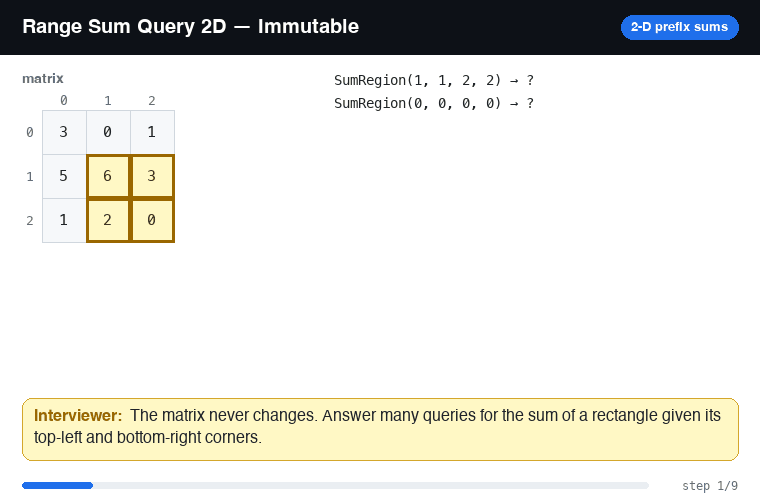

# Walkthrough: Range Sum Query 2D — Immutable

**Module:** [05 · Prefix Sums](../README.md) · **Difficulty:** Medium · **Solution:** [`p08_range_sum_2d.go`](../p08_range_sum_2d.go)



## The problem in plain words

You get a fixed grid of numbers. Then you get many questions of the form "what's the total inside this rectangle?" Answer each one quickly.

```
matrix = [[3, 0, 1],
          [5, 6, 3],
          [1, 2, 0]]
SumRegion(1, 1, 2, 2) → 11    (6 + 3 + 2 + 0)
SumRegion(0, 0, 0, 0) → 3
```

## Mock interview

**Interviewer:** Build a structure over a fixed matrix that answers "sum of the rectangle with top-left `(r1, c1)` and bottom-right `(r2, c2)`, inclusive". There will be many queries.

**Candidate:** Corners are always valid with `r1 ≤ r2` and `c1 ≤ c2`? And the matrix never changes after construction? Could it be empty?

**Interviewer:** Valid corners, never changes, and an empty matrix is allowed. It just has no valid queries.

**Candidate:** The first query covers 6, 3, 2 and 0, so 11. A single cell, like `(0, 0, 0, 0)`, just returns that cell, 3.

**Candidate:** Brute force adds every cell in the rectangle. That's O(rows·cols) per query.

**Interviewer:** You know 1-D prefix sums. How do they carry over?

**Candidate:** I build `P` with an extra row and column of zeros. `P[i][j]` is the sum of the rectangle `matrix[0..i-1][0..j-1]`, everything above and to the left. To fill a cell: take the matrix value, add the box above, add the box to the left, and subtract the top-left corner, because both boxes already include it.

**Interviewer:** And a query?

**Candidate:** Inclusion–exclusion. Take the big box `P[r2+1][c2+1]`, subtract the strip above, `P[r1][c2+1]`, subtract the strip to the left, `P[r2+1][c1]`, then add back the corner `P[r1][c1]`, which I subtracted twice.

**Interviewer:** Why the padding row and column?

**Candidate:** Without them, `r1 = 0` or `c1 = 0` would read index −1. The zeros make every query use the same formula.

**Candidate:** In code, `NewNumMatrix` allocates `rows+1` rows, each with its own `make([]int, cols+1)` so rows don't share a backing array. It fills `p[i][j] = matrix[i-1][j-1] + p[i-1][j] + p[i][j-1] - p[i-1][j-1]`. `SumRegion` returns the four-term formula.

**Candidate:** Testing: `P` ends as rows `[0 0 0 0]`, `[0 3 3 4]`, `[0 8 14 18]`, `[0 9 17 21]`. The first query is 21 − 4 − 9 + 3 = 11. The second is `P[1][1] − P[0][1] − P[1][0] + P[0][0]` = 3 − 0 − 0 + 0 = 3.

**Candidate:** Building is **O(rows·cols) time and space**. Each query is **O(1)**.

## What the animation shows

| Step | What happens |
|---|---|
| 1 | Problem statement: the matrix and the two queries. |
| 2 | Brute force: add every cell, O(rows·cols) per query. |
| 3 | Padded `P` with a zero row and column. |
| 4 | Row 1 filled; example `P[1][2] = 0 + 0 + 3 − 0 = 3`. |
| 5 | Row 2 filled; example `P[2][3] = 3 + 4 + 14 − 3 = 18`. |
| 6 | Row 3 filled; `P[3][3] = 21`, the whole matrix. |
| 7 | `SumRegion(1, 1, 2, 2) = 21 − 4 − 9 + 3 = 11`. |
| 8 | `SumRegion(0, 0, 0, 0) = 3 − 0 − 0 + 0 = 3`. |
| 9 | Both answers and the complexity. |

## Detailed explanation

Think of `P[i][j]` as "the area above and to the left of grid line `(i, j)`". For the build, the area for `(i, j)` is the area for `(i−1, j)` plus the area for `(i, j−1)`, plus the new cell. The region up to `(i−1, j−1)` sits inside both earlier areas, so it was added twice and must be subtracted once.

The query uses the same picture in reverse:

```
+---------+---+
|    D    | B |      wanted X = whole − (D+B) − (D+C) + D
+---------+---+
|    C    | X |
+---------+---+
```

`P[r2+1][c2+1]` is `D + B + C + X`. `P[r1][c2+1]` is `D + B`. `P[r2+1][c1]` is `D + C`. `P[r1][c1]` is `D`. Working it through leaves `X`.

Each row of `P` gets its own allocation. If you carve rows out of one shared slice and later append to one, it can overwrite its neighbour. `TestNumMatrixShapes` checks an empty matrix, a single row and a single column.

## Complexity

| Approach | Time | Space |
|---|---|---|
| Brute force (`SumRegionBrute`) | O(rows·cols) per query | O(1) |
| 2-D prefix sums (`NewNumMatrix` + `SumRegion`) | O(rows·cols) build, O(1) per query | O(rows·cols) |

## Common mistakes

- Forgetting to add back the corner, in the build or in the query.
- Off-by-one: the bottom-right term is `P[r2+1][c2+1]`, not `P[r2][c2]`.
- Skipping the padding, then handling `r1 = 0` and `c1 = 0` as special cases.
- Sharing one backing array across rows of `P`.

## Try it yourself

```sh
go test ./course/05-prefix-sums/ -run TestNumMatrix -v
```
