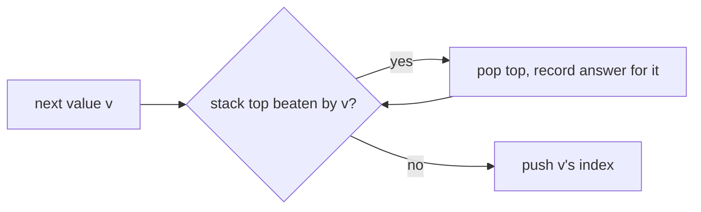

# 06 — Stacks & Monotonic Stacks

A stack answers one question in O(1): *what is the most recent thing I haven't
dealt with yet?* That one question covers bracket matching, expression
evaluation, nested decoding, and, with a monotonic stack, the whole "next
greater / next smaller" family.

## What you'll learn

- A generic `Stack[T]` in Go, and when to just use a raw slice instead.
- Matching and nesting problems: brackets, postfix evaluation, `k[...]` decoding.
- The **monotonic stack**: how to find the next greater or smaller element for
  every index in O(n) total.
- How to turn "for each bar, how far can it stretch?" into one linear pass
  (largest rectangle in a histogram).

## Recognize the pattern

Reach for a stack when you see:

- **Nesting or matching**: brackets, tags, `k[...]`, "undo the last thing".
- **Postfix / expression evaluation**: operands wait for their operator.
- **"Next greater", "next smaller", "days until warmer", "previous smaller"**:
  that's a monotonic stack.
- **"For each element, how far left/right does it extend?"**: histogram,
  stock span, trapping rain water, sum of subarray minimums.
- A brute force with an inner loop that scans forward until some element beats
  the current one. That inner loop is usually a monotonic stack waiting to happen.

## The idea

**Plain stack**: push openers or contexts, and pop when the matching closer
arrives. The top of the stack is always the innermost open context.

**Monotonic stack**: keep indices whose values are in sorted order (say,
decreasing). A new value pops everything it beats. Each popped index has just
found its *next greater element*, and that's the new value. Every index is pushed once
and popped at most once, so the loop is O(n) even though it has a nested `for`.

Walkthrough, Daily Temperatures `[73, 74, 75, 71, 69, 72, 76]`:

```
i  temp  action                          stack (indices:temps)   answers set
0  73    push                            [0:73]
1  74    74>73 pop 0 -> ans[0]=1, push   [1:74]                  ans[0]=1
2  75    pop 1 -> ans[1]=1, push         [2:75]                  ans[1]=1
3  71    71<75 push                      [2:75 3:71]
4  69    push                            [2:75 3:71 4:69]
5  72    pop 4 (ans=1), pop 3 (ans=2)    [2:75 5:72]             ans[4]=1 ans[3]=2
6  76    pop 5 (ans=1), pop 2 (ans=4)    [6:76]                  ans[5]=1 ans[2]=4
end      leftovers never got warmer -> 0
```



## Go template

```go
// Next greater element to the right for every index (-1 if none).
func nextGreater(nums []int) []int {
	ans := make([]int, len(nums))
	for i := range ans {
		ans[i] = -1
	}
	st := []int{} // indices; nums[st[k]] is decreasing
	for i, v := range nums {
		for len(st) > 0 && nums[st[len(st)-1]] < v {
			ans[st[len(st)-1]] = v
			st = st[:len(st)-1]
		}
		st = append(st, i)
	}
	return ans
}
```

Variations: flip `<` to `>` for next *smaller*; iterate right-to-left for
*previous* greater/smaller; loop `2n` with `i % n` for circular arrays.

## Complexity

| Operation | Cost |
|---|---|
| Push / Pop / Peek | O(1) amortised |
| Monotonic-stack pass over n items | O(n) time, O(n) space (each index pushed and popped at most once) |
| Matching / evaluation problems | O(n) time, O(n) worst-case stack depth |

## Common pitfalls

- **Push indices, not values.** You almost always need the distance (`i - j`) or
  a width, and indices let you look the value up anyway.
- **Strict vs non-strict comparison.** `<` vs `<=` decides how equal values
  behave. Daily Temperatures needs *strictly* warmer, so equal temps stay on the stack.
- **Forgetting the leftovers.** Indices still on the stack at the end never
  found an answer, so initialise to the "none" value (`0` or `-1`), or flush with a
  sentinel (histogram uses a final height of `0`).
- **Operand order in RPN.** Pop the *right* operand first: `b, a := pop(), pop()`
  then compute `a - b`.
- **Go: popping a slice-backed stack of pointers.** `st = st[:len(st)-1]` keeps
  the pointer alive in the backing array; zero the slot first if it matters
  (`Stack.Pop` does this).
- **Go: empty-stack panics.** `st[len(st)-1]` on an empty slice panics, so guard with
  `len(st) > 0` in the loop condition (short-circuit `&&` protects you).
- **Go: integer division truncates toward zero** (`-7/2 == -3`), which is what
  most problems want; Python's `//` floors instead.
- **Floats for ratios.** Car Fleet compares times; cross-multiply integers to
  avoid float tie errors.

## Problems

| # | Problem | Difficulty | Key idea |
|---|---|---|---|
| 01 | [Valid Parentheses](p01_valid_parentheses.go) | Easy | Stack of openers; top must match the closer |
| 02 | [Min Stack](p02_min_stack.go) | Medium | Store running min alongside each entry |
| 03 | [Evaluate Reverse Polish Notation](p03_eval_rpn.go) | Medium | Operand stack; pop right operand first |
| 04 | [Daily Temperatures](p04_daily_temperatures.go) | Medium | Monotonic decreasing stack of indices |
| 05 | [Next Greater Element (circular)](p05_next_greater_circular.go) | Medium | Monotonic stack over two passes (`i % n`) |
| 06 | [Car Fleet](p06_car_fleet.go) | Medium | Sort by position; stack of arrival times |
| 07 | [Decode String](p07_decode_string.go) | Medium | Stack of saved (prefix, k) contexts |
| 08 | [Largest Rectangle in Histogram](p08_largest_rectangle.go) | Hard | Monotonic increasing stack; pop gives width between shorter bars |

## Practice tip

Hide the solution: open the problem file, read only the doc comment, and
write your own version in a scratch function. Then run just that problem's
tests, for example:

```sh
go test ./course/06-stacks-monotonic/ -run TestDailyTemperatures -v
```

For the monotonic-stack problems, before you code, say out loud what is on
the stack and which order it's sorted in.

## Next

[07 — Binary Search](../07-binary-search/)
