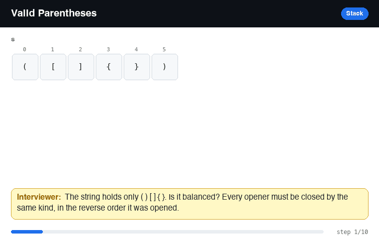

# Walkthrough: Valid Parentheses

**Module:** [06 · Stacks & Monotonic Stacks](../README.md) · **Difficulty:** Easy · **Solution:** [`p01_valid_parentheses.go`](../p01_valid_parentheses.go)



## The problem in plain words

You get a string of brackets: `( ) [ ] { }`. Check that every opening bracket is closed by the same kind, and that brackets close in the reverse order they opened.

```
"([]{})"  → true
"([)]"    → false   (the ] tries to close a ( )
"(("      → false   (openers left over)
```

## Mock interview

**Interviewer:** Decide whether a string of brackets is balanced: every opener closed by the same kind, properly nested. Any other character makes it invalid.

**Candidate:** Is the empty string valid? And should I treat a letter or space as invalid rather than skip it?

**Interviewer:** Empty is valid. Any other character means invalid.

**Candidate:** `"([]{})"` is valid: the `[]` and `{}` sit inside the `()`. `"([)]"` is invalid because `]` arrives while `(` is the most recent opener. `"(("` is invalid because nothing closes.

**Candidate:** A brute-force idea: keep deleting adjacent pairs `()`, `[]`, `{}` until nothing changes, then check the string is empty. Each round is O(n) and there can be n/2 rounds, so O(n²).

**Interviewer:** Can you do it in one pass?

**Candidate:** Yes. The only opener allowed to close next is the most recent one still open. "Most recent" is the top of a stack. So I push openers. On a closer, I pop and check that the popped opener matches. At the end, the stack must be empty.

**Interviewer:** Any quick rejections?

**Candidate:** An odd-length string can never pair up, so I return false immediately.

**Candidate:** In code, `IsValid` checks `len(s)%2 == 1` first. It keeps a map from each closer to its opener and a `Stack[byte]`. Openers are pushed. For a closer, `st.Pop()` must succeed and return `opener[c]`; otherwise return false. Any other character returns false. Finally, return `st.IsEmpty()`.

**Candidate:** Testing `"([]{})"`: push `(`, push `[`, `]` pops `[`, push `{`, `}` pops `{`, `)` pops `(`. The stack is empty, so true.

**Interviewer:** What about `"]"`?

**Candidate:** The odd-length check catches it. For `"])"`, the first `]` finds an empty stack, `Pop` returns `ok == false`, and I return false.

**Candidate:** **O(n) time**, and the stack can hold up to n openers (for input like `"(((("`), so **O(n) space**.

## What the animation shows

| Step | Char | Action | Stack after |
|---|---|---|---|
| 1 | — | Problem statement | |
| 2 | — | Brute force: delete pairs repeatedly, O(n²) | |
| 3 | — | Length 6 is even, keep going | empty |
| 4 | `(` | push | `(` |
| 5 | `[` | push | `( [` |
| 6 | `]` | top `[` matches → pop | `(` |
| 7 | `{` | push | `( {` |
| 8 | `}` | top `{` matches → pop | `(` |
| 9 | `)` | top `(` matches → pop | empty |
| 10 | — | Stack empty → true; O(n) time and space | |

## Detailed explanation

Proper nesting means the last bracket opened is the first one closed. That's exactly the last-in, first-out order of a stack. The stack always holds the openers that are still waiting, in the order they were opened, and the top is the only one that may close next.

There are three ways to fail, and the code checks each one:

1. A closer arrives when the stack is empty: nothing to close.
2. A closer arrives and the top is a different kind: wrong nesting, as in `"([)]"`.
3. The string ends with openers still on the stack: something never closed.

The odd-length check is a shortcut, not required for correctness, but it avoids work on obviously bad input.

## Complexity

| Approach | Time | Space |
|---|---|---|
| Repeated pair deletion (brute force) | O(n²) | O(n) |
| Stack of openers (`IsValid`) | O(n) | O(n) |

## Common mistakes

- Forgetting the final empty check, so `"(("` returns true.
- Popping from an empty stack without checking, which panics on input like `")("`.
- Comparing the closer with the top instead of comparing the top with `opener[closer]`.
- Silently skipping unexpected characters instead of rejecting them.

## Try it yourself

```sh
go test ./course/06-stacks-monotonic/ -run TestIsValid -v
```
