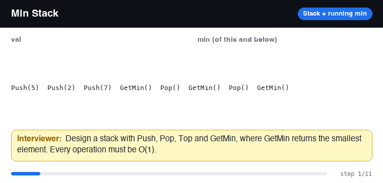

# Walkthrough: Min Stack

**Module:** [06 · Stacks & Monotonic Stacks](../README.md) · **Difficulty:** Medium · **Solution:** [`p02_min_stack.go`](../p02_min_stack.go)



## The problem in plain words

Build a stack that can also tell you its smallest element instantly, at any moment, even after you pop things off.

```
Push(5) Push(2) Push(7)  GetMin() → 2
Pop()                    GetMin() → 2
Pop()                    GetMin() → 5
```

## Mock interview

**Interviewer:** Design a stack with `Push`, `Pop`, `Top` and `GetMin`. All four must run in constant time. `Pop`, `Top` and `GetMin` are only called on a non-empty stack.

**Candidate:** Can there be duplicates? And are values plain ints, including negatives?

**Interviewer:** Duplicates are allowed, values are any ints.

**Candidate:** In the example, after pushing 5, 2, 7 the min is 2. Popping 7 leaves the min at 2. Popping 2 brings the min back to 5. That last step is the hard part.

**Candidate:** The obvious version scans the stack on `GetMin`, which is O(n). Keeping a single `min` variable fails too: after I pop the minimum, I don't know what the previous minimum was.

**Interviewer:** So what do you store?

**Candidate:** With each entry I store the minimum of that entry and everything below it. When I push `v`, its min is `min(v, top.min)`, or just `v` on an empty stack. `GetMin` reads the top entry's min. When I pop, the entry below already carries its own min, so the previous minimum comes back for free.

**Interviewer:** Why is that correct after a pop?

**Candidate:** An entry's min only depends on the entries below it, and a pop never changes those. So every remaining entry's stored min is still accurate.

**Candidate:** In code, `MinStack` holds `items []minEntry`, where `minEntry` has `val` and `min`. `Push` computes `m := v`, takes `min(m, s.items[n-1].min)` if the stack isn't empty, and appends. `Pop` reslices. `Top` and `GetMin` read the last entry.

**Candidate:** Testing: push 5 gives (5, 5). Push 2 gives (2, 2). Push 7 gives (7, 2). `GetMin` is 2. Pop removes (7, 2), and `GetMin` is still 2. Pop removes (2, 2), and `GetMin` reads (5, 5): 5.

**Candidate:** Every operation is **O(1)**. The extra `min` field costs **O(n) space**.

**Interviewer:** Could you save memory?

**Candidate:** A common variant keeps a second stack that only pushes when the new value is less than or equal to the current min. It uses less memory when the min rarely changes, but the worst case is still O(n), and the duplicate handling is easier to get wrong.

## What the animation shows

| Step | Operation | Stack (val, min), bottom → top | Result |
|---|---|---|---|
| 1 | — | empty | Problem statement |
| 2 | — | empty | Why scanning or one `min` variable fails |
| 3 | `Push(5)` | (5,5) | |
| 4 | `Push(2)` | (5,5) (2,2) | |
| 5 | `Push(7)` | (5,5) (2,2) (7,2) | |
| 6 | `GetMin()` | (5,5) (2,2) (7,2) | 2 |
| 7 | `Pop()` | (5,5) (2,2) | |
| 8 | `GetMin()` | (5,5) (2,2) | 2 |
| 9 | `Pop()` | (5,5) | |
| 10 | `GetMin()` | (5,5) | 5 |
| 11 | — | (5,5) | All operations O(1), space O(n) |

## Detailed explanation

The idea is to store derived state alongside each element. The invariant is: for every entry `k`, `items[k].min` is the minimum of `items[0..k].val`. `Push` keeps it true by combining the new value with the min below. `Pop` keeps it true because it removes only the top and never touches anything below.

Because the answer to `GetMin` is always stored at the top, there's nothing to search. That's the general lesson: if you need an aggregate of "everything below", cache it in each stack entry.

Duplicates need no special handling here. Pushing a second 2 stores (2, 2), and popping it leaves the first (2, 2) in place.

## Complexity

| Operation | Time | Space |
|---|---|---|
| `Push`, `Pop`, `Top`, `GetMin` on `MinStack` | O(1) each | O(n) total |
| Scan for min on every `GetMin` (naive) | O(n) per `GetMin` | O(n) |

## Common mistakes

- Keeping one global `min` and not restoring it after popping the minimum.
- In the two-stack variant, pushing to the min stack only on strictly smaller values, which breaks with duplicates.
- Forgetting the empty-stack case in `Push`, which reads `items[-1]`.

## Try it yourself

```sh
go test ./course/06-stacks-monotonic/ -run TestMinStackExample -v
```
