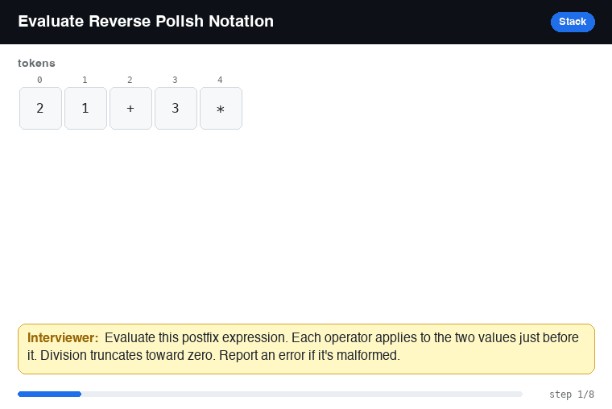

# Walkthrough: Evaluate Reverse Polish Notation

**Module:** [06 · Stacks & Monotonic Stacks](../README.md) · **Difficulty:** Medium · **Solution:** [`p03_eval_rpn.go`](../p03_eval_rpn.go)



## The problem in plain words

An expression is written with the operator after its two numbers, like `2 1 +` for 2 + 1. Work out the value.

```
["2","1","+","3","*"]   → 9     ((2 + 1) * 3)
["4","13","5","/","+"]  → 6     (4 + 13/5)
["-7","2","/"]          → -3    (division truncates toward zero)
```

## Mock interview

**Interviewer:** Evaluate a postfix expression given as tokens. Each token is an integer or one of `+ - * /`. Division truncates toward zero. Return an error if the expression is malformed.

**Candidate:** What counts as malformed? A bad token, an operator without two operands, leftover values at the end, and division by zero?

**Interviewer:** Exactly those four.

**Candidate:** The first example is (2 + 1) × 3 = 9. The third one, −7 / 2, should give −3, not −4. Go's integer division already truncates toward zero, so that comes for free.

**Candidate:** A brute-force approach: find the first operator, replace it and its two operands with the result, and rescan. Each rescan is O(n), so O(n²).

**Interviewer:** How would you do it in one pass?

**Candidate:** An operator always uses the two most recent values that haven't been used yet. That's the top of a stack. Numbers get pushed. An operator pops two values, computes, and pushes the result. At the end exactly one value should remain.

**Interviewer:** Which popped value is the left operand?

**Candidate:** The second one. The right operand was pushed last, so it's on top. I pop `b` first, then `a`, and compute `a op b`. For `+` and `*` it doesn't matter, but for `-` and `/` it does.

**Candidate:** In code, `EvalRPN` loops over tokens with a `Stack[int]`. For an operator, it pops `b` then `a`, and returns an `ErrMalformed` error if either pop fails. It returns a division-by-zero error if `b == 0`. Otherwise it parses the token with `strconv.Atoi`, and a parse error is also `ErrMalformed`. After the loop, `st.Len()` must be 1.

**Candidate:** Testing: push 2, push 1, `+` pops 1 and 2 and pushes 3, push 3, `*` pops 3 and 3 and pushes 9. One value is left: 9.

**Candidate:** **O(n) time** and up to **O(n) space** for the stack.

## What the animation shows

| Step | Token | Action | Stack after |
|---|---|---|---|
| 1 | — | Problem statement | |
| 2 | — | Brute force: collapse and rescan, O(n²) | |
| 3 | `2` | push | 2 |
| 4 | `1` | push | 2 1 |
| 5 | `+` | b = 1, a = 2, push 3 | 3 |
| 6 | `3` | push | 3 3 |
| 7 | `*` | b = 3, a = 3, push 9 | 9 |
| 8 | — | One value left → 9; O(n) time and space | 9 |

## Detailed explanation

Postfix notation has no parentheses because the order of tokens already fixes the order of operations. Each operator's operands are the two results produced just before it. The stack holds exactly those pending results, and its top is the most recent one.

The error checks match the four ways the input can be broken:

- A token that is neither an operator nor an integer.
- An operator with fewer than two values on the stack, as in `["1", "+"]`.
- More than one value left at the end, as in `["1", "2"]`.
- Division by zero.

Errors wrap `ErrMalformed` with `%w`, so callers can check them with `errors.Is`. Division by zero is a separate error.

## Complexity

| Approach | Time | Space |
|---|---|---|
| Collapse and rescan (brute force) | O(n²) | O(n) |
| Operand stack (`EvalRPN`) | O(n) | O(n) |

## Common mistakes

- Popping in the wrong order, which turns `a - b` into `b - a`.
- Using floor division (as in Python) instead of truncation toward zero.
- Returning the top of the stack without checking that exactly one value is left.
- Treating `"-7"` as an operator because it starts with `-`. Matching the whole token, as the `switch` does, avoids this.

## Try it yourself

```sh
go test ./course/06-stacks-monotonic/ -run TestEvalRPN -v
```
