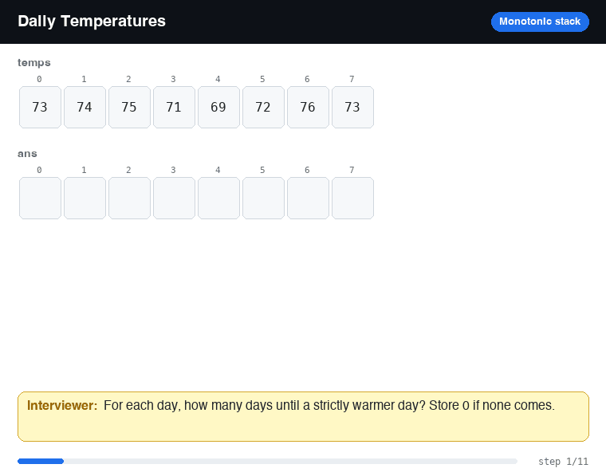

# Walkthrough: Daily Temperatures

**Module:** [06 · Stacks & Monotonic Stacks](../README.md) · **Difficulty:** Medium · **Solution:** [`p04_daily_temperatures.go`](../p04_daily_temperatures.go)



## The problem in plain words

For each day, count how many days you have to wait until it gets warmer. If it never gets warmer, write 0.

```
[73, 74, 75, 71, 69, 72, 76, 73] → [1, 1, 4, 2, 1, 1, 0, 0]
[30, 20, 10]                     → [0, 0, 0]
```

## Mock interview

**Interviewer:** Given daily temperatures, return for each day the number of days until a strictly warmer day, or 0 if none comes.

**Candidate:** Strictly warmer, so an equal temperature doesn't count? And the answer is a distance in days, not the temperature?

**Interviewer:** Right on both.

**Candidate:** Day 2 is 75. The next warmer day is day 6 at 76, so the answer is 4. A falling sequence like `[30, 20, 10]` gives all zeros.

**Candidate:** Brute force: from each day, scan forward until something warmer appears. On a falling sequence that's O(n²).

**Interviewer:** How do you avoid rescanning?

**Candidate:** I keep a stack of days that are still waiting for a warmer day. When a new day arrives, it's the answer for every waiting day that is colder. Those are all at the top of the stack, so I pop them and record `i − j`. Then I push the new day. The temperatures on the stack only go down from bottom to top. That's why it's called a monotonic stack.

**Interviewer:** Why are the colder days always on top?

**Candidate:** If a colder day were below a warmer one, the warmer one would have popped it when it arrived. So the stack is always decreasing, and the moment I hit a day that isn't colder than the new one, nothing below it is colder either. I can stop.

**Candidate:** In code, `DailyTemperatures` loops `for i, t := range temps`. While the stack's top `j` has `temps[j] < t`, it pops and sets `ans[j] = i - j`. Then it pushes `i`. Days left on the stack keep the default 0.

**Candidate:** Testing: day 1 resolves day 0, day 2 resolves day 1. Days 3 and 4 are colder, so they wait. Day 5 at 72 resolves day 4 (wait 1) and day 3 (wait 2). Day 6 at 76 resolves day 5 (1) and day 2 (4). Day 7 waits. Days 6 and 7 stay 0. That's `[1, 1, 4, 2, 1, 1, 0, 0]`.

**Interviewer:** The inner loop can pop many times. Why is it still linear?

**Candidate:** Each index is pushed once and popped at most once. So across the whole run there are at most n pops. That's **O(n) time** and **O(n) space**.

## What the animation shows

| Step | Day `i` (temp) | Popped (resolved) | Stack after (index:temp) |
|---|---|---|---|
| 1 | — | — | Problem statement |
| 2 | — | — | Brute force O(n²) |
| 3 | 0 (73) | — | 0:73 |
| 4 | 1 (74) | 0 → ans 1 | 1:74 |
| 5 | 2 (75) | 1 → ans 1 | 2:75 |
| 6 | 3 (71) | — | 2:75 3:71 |
| 7 | 4 (69) | — | 2:75 3:71 4:69 |
| 8 | 5 (72) | 4 → ans 1, 3 → ans 2 | 2:75 5:72 |
| 9 | 6 (76) | 5 → ans 1, 2 → ans 4 | 6:76 |
| 10 | 7 (73) | — | 6:76 7:73 |
| 11 | — | Days 6 and 7 stay 0 | Answer `[1,1,4,2,1,1,0,0]` |

## Detailed explanation

The stack holds the indices of days with no warmer day found yet. Its invariant: temperatures are non-increasing from bottom to top. A new day `i` pops every index whose temperature is strictly lower, and for each of them day `i` is the *first* warmer day. It's the first because every day between `j` and `i` was either popped by an earlier day or is still on the stack above `j` with a temperature no higher than `temps[j]`. None of them was warmer than `temps[j]`.

The stack stores indices, not temperatures, because the answer is a distance. The temperature is looked up with `temps[j]`.

Equal temperatures don't pop each other, because the condition is `temps[j] < t`. That matches "strictly warmer".

## Complexity

| Approach | Time | Space |
|---|---|---|
| Scan forward (`DailyTemperaturesBrute`) | O(n²) | O(1) extra |
| Monotonic stack (`DailyTemperatures`) | O(n) | O(n) |

## Common mistakes

- Pushing temperatures instead of indices, which loses the distance.
- Using `<=` in the pop condition, which treats equal days as warmer.
- Thinking the nested loop makes it O(n²). Count pushes and pops instead.
- Forgetting that unresolved days must be 0. Go's zero value handles it here.

## Try it yourself

```sh
go test ./course/06-stacks-monotonic/ -run TestDailyTemperatures -v
```
