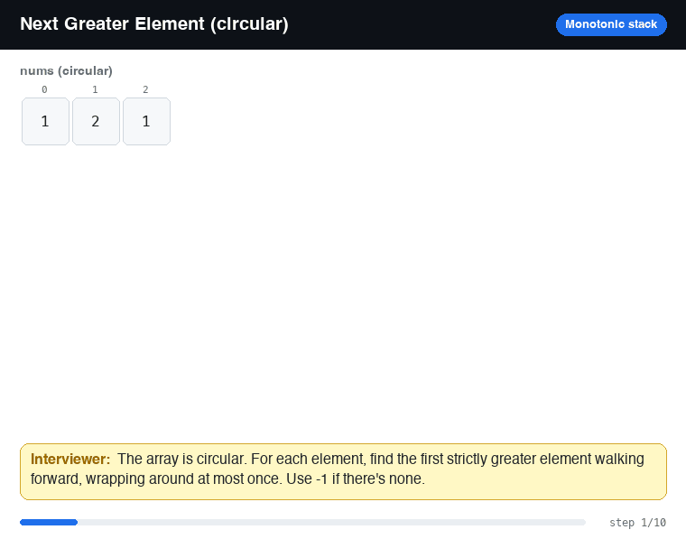

# Walkthrough: Next Greater Element (circular)

**Module:** [06 · Stacks & Monotonic Stacks](../README.md) · **Difficulty:** Medium · **Solution:** [`p05_next_greater_circular.go`](../p05_next_greater_circular.go)



## The problem in plain words

The list wraps around: after the last element comes the first one again. For each element, find the first bigger value you meet when walking forward. If there's none, write −1.

```
[1, 2, 1]       → [2, -1, 2]       (the last 1 wraps around to find 2)
[5, 4, 3, 2, 1] → [-1, 5, 5, 5, 5]
```

## Mock interview

**Interviewer:** The array is circular. For each element, return the first strictly greater element walking forward, wrapping at most once. Use −1 if none exists.

**Candidate:** I return the value, not the index? And an element never counts as its own answer, even after a full lap?

**Interviewer:** The value, and no, it never counts itself.

**Candidate:** In `[1, 2, 1]`, index 0 finds 2 right away. Index 1 is the maximum, so −1. Index 2 has nothing after it, but wrapping around it finds 2 at index 1. With duplicates of the maximum, both get −1.

**Candidate:** Brute force: from each index, walk forward up to n − 1 steps using `(i + step) % n`. That's O(n²).

**Interviewer:** You know the non-circular version with a monotonic stack. What changes?

**Candidate:** The only change is that late elements need to see the early ones. So I loop `i` from 0 to 2n − 1 and read `nums[i % n]`. That simulates walking the array twice. The stack holds indices still waiting for a greater value, with values decreasing from bottom to top. Each new value pops and resolves every smaller value on top.

**Interviewer:** Doesn't the second lap double the stack?

**Candidate:** Only the first lap pushes: `if i < n`. The second lap only resolves. Every index is pushed once, so the stack stays O(n), and anything still on it after two laps has no greater element. It keeps the −1 it started with.

**Candidate:** In code, `NextGreaterCircular` fills `ans` with −1, then loops `i` from 0 to `2*n - 1` with `v := nums[i%n]`. While the top `j` has `nums[j] < v`, it pops and sets `ans[j] = v`. Then, if `i < n`, it pushes `i`.

**Candidate:** Testing: i = 0 pushes index 0. i = 1 (value 2) pops 0, so `ans[0] = 2`, and pushes 1. i = 2 (value 1) pushes 2. Second lap: i = 3 reads 1, nothing to pop. i = 4 reads 2, pops index 2, so `ans[2] = 2`. i = 5 reads 1, nothing. Index 1 is left, so `ans[1] = −1`. Result `[2, -1, 2]`.

**Candidate:** The loop runs 2n times, and each index is pushed once and popped at most once. **O(n) time, O(n) space**.

## What the animation shows

| Step | `i` | Value | Action | Stack after (index:value) |
|---|---|---|---|---|
| 1 | — | — | Problem statement | |
| 2 | — | — | Brute force with modulo, O(n²) | |
| 3 | — | — | Idea: two laps over `i % n`, only the first pushes | |
| 4 | 0 | 1 | push 0 | 0:1 |
| 5 | 1 | 2 | pop 0 → `ans[0] = 2`; push 1 | 1:2 |
| 6 | 2 | 1 | push 2 | 1:2 2:1 |
| 7 | 3 | 1 | nothing smaller; no push | 1:2 2:1 |
| 8 | 4 | 2 | pop 2 → `ans[2] = 2`; no push | 1:2 |
| 9 | 5 | 1 | nothing smaller; no push | 1:2 |
| 10 | — | — | Index 1 stays −1; answer `[2, -1, 2]` | |

## Detailed explanation

In the non-circular version, one pass with a decreasing stack gives every element its next greater value to the right. The circular version adds one requirement: an element near the end may find its answer near the start. Walking the array a second time puts every element "after" every other element at least once, which is exactly what wrapping means.

The invariant is the same as in Daily Temperatures: the stack holds unresolved indices, and their values are non-increasing from bottom to top. When a value arrives, it is the first greater value for everything it pops, because anything between them was smaller or equal.

The second lap never pushes. Pushing again would put duplicate indices on the stack and could overwrite a correct answer with a later, wrong one. Not pushing also keeps the stack at most n entries.

Elements equal to the maximum are never popped, since the condition is strict. They keep −1.

## Complexity

| Approach | Time | Space |
|---|---|---|
| Walk forward with modulo (`NextGreaterCircularBrute`) | O(n²) | O(1) extra |
| Monotonic stack over two laps (`NextGreaterCircular`) | O(n) | O(n) |

## Common mistakes

- Pushing during the second lap as well.
- Forgetting to start `ans` at −1, so unresolved elements end up as 0.
- Looping only n times, which misses answers that wrap around.
- Using `<=` in the pop condition, which treats equal values as greater.

## Try it yourself

```sh
go test ./course/06-stacks-monotonic/ -run TestNextGreaterCircular -v
```
