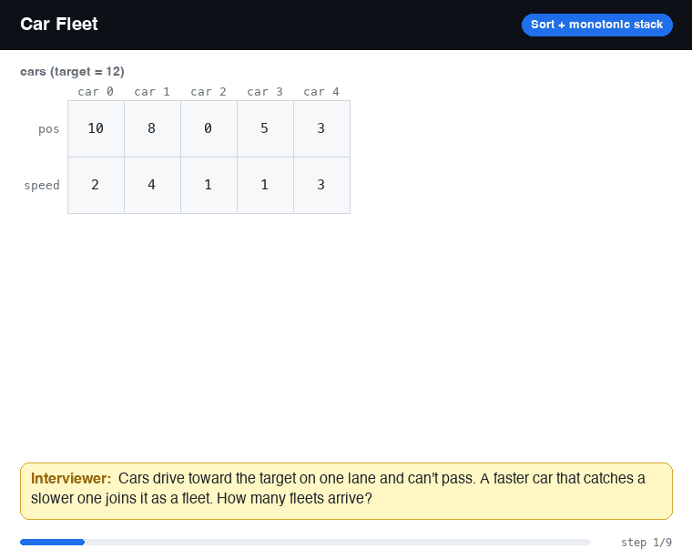

# Walkthrough: Car Fleet

**Module:** [06 · Stacks & Monotonic Stacks](../README.md) · **Difficulty:** Medium · **Solution:** [`p06_car_fleet.go`](../p06_car_fleet.go)



## The problem in plain words

Cars drive along a one-lane road toward the same finish line. A faster car that catches up with a slower one can't pass it, so they drive on together as a group. How many groups cross the finish line?

```
target = 12, position = [10, 8, 0, 5, 3], speed = [2, 4, 1, 1, 3]  → 3
target = 10, position = [3], speed = [3]                            → 1
```

## Mock interview

**Interviewer:** Cars start at distinct positions, all before the target, each with a constant speed. A car that catches a slower one ahead joins it as a fleet. Catching up exactly at the target also counts. How many fleets arrive?

**Candidate:** Once cars join, the fleet moves at the speed of the slowest car in it? And positions are all distinct?

**Interviewer:** Yes, and yes.

**Candidate:** In the example, the cars at 10 and 8 both arrive at time 1, so they meet at the target: one fleet. The car at 0 arrives alone at time 12. The cars at 5 and 3 meet before the target, at time 7. So 3 fleets.

**Candidate:** A brute-force approach simulates time steps and merges cars as they meet. It's slow, and exact ties at the target are easy to get wrong.

**Interviewer:** What actually decides whether two cars merge?

**Candidate:** Only the arrival time each car would have if it drove alone, `(target − position) / speed`, and the order of cars on the road. A car can only be held up by cars ahead of it. So I sort by position, closest to the target first, and walk backwards down the road.

**Candidate:** I keep a stack of fleet arrival times. For each car: if its solo time is less than or equal to the fleet directly ahead, it catches that fleet before or at the target, so it merges and I do nothing. If its time is strictly greater, it never catches up, so it starts a new fleet and I push its time. The answer is the stack size.

**Interviewer:** Why compare only with the fleet directly ahead?

**Candidate:** That fleet blocks the car from everything further ahead. If the car catches it, it joins it. If it doesn't, it can't reach anything further ahead either.

**Interviewer:** Any Go detail with the times?

**Candidate:** The times are fractions. Comparing `float64` values can get exact ties wrong, and a tie means a merge. So the solution keeps `arrival{dist, speed}` and compares by cross-multiplying: `a.dist*b.speed > b.dist*a.speed`.

**Candidate:** In code, `CarFleet` sorts an index slice by position descending with `slices.SortFunc`. Then for each car it builds `t`. If the stack has a top `ahead` and `!t.slowerThan(ahead)`, it continues. Otherwise it pushes `t`. It returns `fleets.Len()`.

**Candidate:** Testing: sorted order is positions 10, 8, 5, 3, 0 with times 1, 1, 7, 3, 12. Push 1. Time 1 ≤ 1, merge. Time 7 > 1, push. Time 3 ≤ 7, merge. Time 12 > 7, push. The stack is [1, 7, 12]: 3 fleets.

**Candidate:** The sort costs **O(n log n)**, the pass is O(n), and the stack and index slice are **O(n) space**.

## What the animation shows

| Step | Car (pos, speed) | Solo time | Action | Stack after |
|---|---|---|---|---|
| 1 | — | — | Problem statement | |
| 2 | — | — | Brute force: simulate the road | |
| 3 | — | — | Sort closest first; compute times | |
| 4 | car 0 (10, 2) | 1 | stack empty → push | 1 |
| 5 | car 1 (8, 4) | 1 | 1 ≤ 1 → merges | 1 |
| 6 | car 3 (5, 1) | 7 | 7 > 1 → push | 1 7 |
| 7 | car 4 (3, 3) | 3 | 3 ≤ 7 → merges | 1 7 |
| 8 | car 2 (0, 1) | 12 | 12 > 7 → push | 1 7 12 |
| 9 | — | — | Answer 3; O(n log n) time, O(n) space | |

## Detailed explanation

Process cars from the front of the road to the back. The top of the stack is the arrival time of the fleet directly ahead of the current car. A fleet's arrival time is the arrival time of its leading car, because the cars behind are slowed down to match it.

If the current car's solo time is at most the fleet's time, the car would reach the target no later than the fleet, so it must catch the fleet at or before the target. It becomes part of that fleet, and the fleet's arrival time doesn't change. If its solo time is greater, it can never catch up, and it becomes the leader of a new fleet.

Since a new fleet is only pushed when its time is strictly greater than the top, the stack is strictly increasing from bottom to top. That's the monotonic stack here. In fact only the top is ever read, so a single "last fleet time" variable would also work. The stack makes the fleets visible and matches the module's pattern.

Cross-multiplying avoids float rounding. Both distances and speeds are positive, so the inequality direction doesn't change.

## Complexity

| Approach | Time | Space |
|---|---|---|
| Time-step simulation (brute force) | depends on the time scale; slow | O(n) |
| Sort + stack of arrival times (`CarFleet`) | O(n log n) | O(n) |

## Common mistakes

- Sorting in the wrong direction. The car closest to the target must come first.
- Using `<` instead of `<=`, which misses cars that meet exactly at the target.
- Comparing float times and getting a tie wrong.
- Comparing each car with the car directly ahead instead of with the fleet ahead.

## Try it yourself

```sh
go test ./course/06-stacks-monotonic/ -run TestCarFleet -v
```
