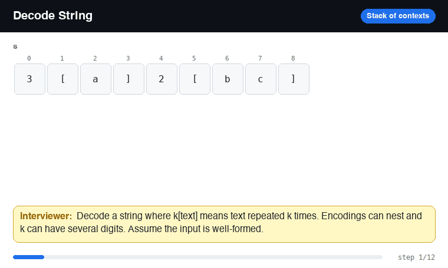

# Walkthrough: Decode String

**Module:** [06 · Stacks & Monotonic Stacks](../README.md) · **Difficulty:** Medium · **Solution:** [`p07_decode_string.go`](../p07_decode_string.go)



## The problem in plain words

`3[a]` means "write `a` three times". These patterns can be nested inside each other. Expand the whole string.

```
"3[a]2[bc]"   → "aaabcbc"
"3[a2[c]]"    → "accaccacc"
"2[ab]3[x]y"  → "ababxxxy"
```

## Mock interview

**Interviewer:** Decode a string where `k[text]` means `text` repeated k times. Encodings can nest, k can have several digits, and letters outside brackets stay as they are. The input is well-formed.

**Candidate:** k is always positive and always followed by `[`? And digits only appear as counts, never as text?

**Interviewer:** Yes to both.

**Candidate:** `"3[a]2[bc]"` gives `aaa` then `bcbc`. The nested one, `"3[a2[c]]"`, expands the inside first: `a2[c]` is `acc`, and three of those give `accaccacc`. I should also handle `"12[a]"`, where k has two digits.

**Candidate:** A brute-force approach: find an innermost `k[...]`, expand it in place, and rescan. That rebuilds the string many times.

**Interviewer:** What would you do instead?

**Candidate:** Nesting means a stack. I keep `cur`, the text built at the current bracket level, and `k`, the number being read. On `[`, I push a frame with what I've built so far and the repeat count, then reset both to start the inside fresh. On `]`, I pop the frame and set `cur` to the saved prefix plus the inner text repeated k times. Letters append to `cur`. Digits build `k` with `k*10 + digit`.

**Interviewer:** Why save the prefix on the stack rather than keep one big string?

**Candidate:** The repeat only applies to the text inside the brackets. When I reach `]`, I need the inner text on its own, and I need to know what came before it. Saving the prefix at `[` keeps the two apart. Nested brackets just push more frames.

**Candidate:** In code, `DecodeString` uses a `Stack[decodeFrame]` with `prefix` and `k`, and a `strings.Builder` for `cur`. On `]`, it pops `f`, reads `inner := cur.String()`, resets `cur`, writes `f.prefix`, then writes `strings.Repeat(inner, f.k)`.

**Candidate:** Testing `"3[a]2[bc]"`: `3` sets k = 3. `[` pushes `("", 3)`. `a` makes cur `"a"`. `]` pops and sets cur to `"" + "aaa"`. `2` sets k = 2. `[` pushes `("aaa", 2)`. `b`, `c` make cur `"bc"`. `]` pops and sets cur to `"aaa" + "bcbc"` = `"aaabcbc"`.

**Candidate:** Time and space are both **O(output length)**, which is what the solution's comment states. Strictly, each `]` copies its level's text once more, so very deep nesting adds a factor of the nesting depth.

## What the animation shows

| Step | Char | Action | Stack after | `cur` |
|---|---|---|---|---|
| 1 | — | Problem statement | | |
| 2 | — | Brute force: expand innermost and rescan | | |
| 3 | — | Start: cur = "", k = 0 | empty | "" |
| 4 | `3` | k = 3 | empty | "" |
| 5 | `[` | push ("", 3), reset | ("", 3) | "" |
| 6 | `a` | append | ("", 3) | "a" |
| 7 | `]` | pop: "" + "a"×3 | empty | "aaa" |
| 8 | `2` | k = 2 | empty | "aaa" |
| 9 | `[` | push ("aaa", 2), reset | ("aaa", 2) | "" |
| 10 | `b`, `c` | append both | ("aaa", 2) | "bc" |
| 11 | `]` | pop: "aaa" + "bc"×2 | empty | "aaabcbc" |
| 12 | — | Answer and complexity | | |

## Detailed explanation

Each `[` starts a new level, and each `]` ends the most recent one. That's last-in, first-out, so a stack of saved contexts fits. A frame stores the two things a level needs when it closes: the text that came before the bracket, and how many times to repeat what's inside.

The invariant: `cur` is always the fully decoded text of the current level so far. When a level closes, its decoded text is repeated and attached to its parent's prefix, which becomes the parent's `cur`. Inner levels finish before outer ones, so nested input like `"3[a2[c]]"` works without extra code.

Two details matter:

- `k` is reset to 0 after a push. Otherwise digits of the next count would be appended to the old one.
- Multi-digit counts work because each digit does `k = k*10 + digit`.

The work is proportional to the output, which can be much longer than the input. For example `"9[9[9[a]]]"` is 10 characters long but decodes to 729.

## Complexity

| Approach | Time | Space |
|---|---|---|
| Expand innermost and rescan (brute force) | O(n · output) | O(output) |
| Stack of saved contexts (`DecodeString`) | O(output) | O(output) |

## Common mistakes

- Reading k as a single digit, which breaks `"12[a]"`.
- Forgetting to reset `k` after `[`.
- Repeating the whole `cur` (prefix included) instead of only the inner text.
- Using two separate stacks for counts and strings and letting them get out of sync. One frame type keeps them together.

## Try it yourself

```sh
go test ./course/06-stacks-monotonic/ -run TestDecodeString -v
```
