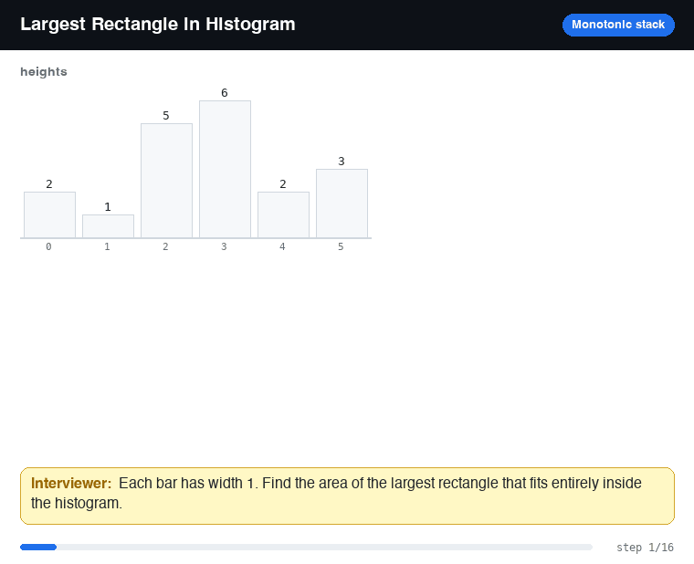

# Walkthrough: Largest Rectangle in Histogram

**Module:** [06 · Stacks & Monotonic Stacks](../README.md) · **Difficulty:** Hard · **Solution:** [`p08_largest_rectangle.go`](../p08_largest_rectangle.go)



## The problem in plain words

You have a bar chart where every bar is 1 unit wide. Find the biggest rectangle you can draw that stays inside the bars.

```
[2, 1, 5, 6, 2, 3] → 10    (bars 5 and 6, height 5, width 2)
[2, 4]             → 4
```

## Mock interview

**Interviewer:** Given bar heights, each bar of width 1, find the area of the largest rectangle that fits entirely inside the histogram.

**Candidate:** Heights are non-negative integers? And an empty histogram gives 0?

**Interviewer:** Yes, and yes.

**Candidate:** In the example, bars 2 and 3 have heights 5 and 6, so a rectangle of height 5 and width 2 gives 10. A wide, short one also exists: height 1 across all six bars gives 6. And `[2, 4]` gives 4, either the tall bar alone or height 2 across both.

**Candidate:** Brute force: for each left edge, extend to the right, track the minimum height, and compute `minH × width`. That's O(n²).

**Interviewer:** How would you get to linear?

**Candidate:** Look at it from each bar's point of view. The best rectangle that uses a bar's full height stretches left until the previous shorter bar and right until the next shorter bar. If I can find both for every bar, I'm done.

**Candidate:** A monotonic increasing stack finds both. I keep indices of bars with increasing heights. When a bar arrives that is not taller than the top, that new bar is the next shorter bar for the top. I pop the top. The bar now beneath it on the stack is its previous shorter bar. So the width is `i − left − 1`, where `left` is the new top, or −1 if the stack is empty.

**Interviewer:** What about bars still on the stack at the end?

**Candidate:** I add a sentinel: at `i == len(heights)` I use height 0. It's shorter than every bar, so it pops everything that's left.

**Candidate:** In code, `LargestRectangle` loops `i` from 0 to `len(heights)`, with `h = 0` for the sentinel. While the top has `heights[top] >= h`, it pops, finds `left` from the new top or −1, and updates `best` with `heights[top]*(i-left-1)`. Then it pushes `i`.

**Candidate:** Testing: push 0. Bar 1 (height 1) pops bar 0: width 1, area 2. Push 1, 2, 3. Bar 4 (height 2) pops bar 3: width 1, area 6. Then it pops bar 2: left is 1, width 4 − 1 − 1 = 2, area 10. Push 4, push 5. The sentinel pops bar 5 (area 3), bar 4 (width 4, area 8), and bar 1 (width 6, area 6). Best is 10.

**Interviewer:** Why `>=` in the pop condition and not `>`?

**Candidate:** With equal heights, popping the earlier one first gives it a width that's too short, but the later equal bar is still on the stack and will get the full width when it pops. So the maximum is still correct, and the stack stays strictly increasing.

**Candidate:** Each index is pushed once and popped once: **O(n) time, O(n) space**.

## What the animation shows

| Step | `i` | Action | Area | `best` |
|---|---|---|---|---|
| 1 | — | Problem statement | | |
| 2 | — | Brute force: every left edge, O(n²) | | |
| 3 | — | Idea: previous and next shorter bar; sentinel 0 | | 0 |
| 4 | 0 | push 0 | | 0 |
| 5 | 1 | pop 0: width 1 | 2 | 2 |
| 6 | 1 | push 1 | | 2 |
| 7 | 2 | push 2 | | 2 |
| 8 | 3 | push 3 | | 2 |
| 9 | 4 | pop 3: width 1 | 6 | 6 |
| 10 | 4 | pop 2: width 2 | 10 | 10 |
| 11 | 4 | push 4 | | 10 |
| 12 | 5 | push 5 | | 10 |
| 13 | 6 (sentinel) | pop 5: width 1 | 3 | 10 |
| 14 | 6 (sentinel) | pop 4: width 4 | 8 | 10 |
| 15 | 6 (sentinel) | pop 1: width 6 | 6 | 10 |
| 16 | — | Answer 10; O(n) time and space | | |

## Detailed explanation

The largest rectangle has some bar as its shortest bar, and it must use that bar's full height. Otherwise you could make it taller. So the answer is the maximum, over all bars, of `height × (next shorter − previous shorter − 1)`.

The stack keeps indices whose heights strictly increase from bottom to top. That gives both boundaries at pop time:

- **Right boundary:** the bar `i` that causes the pop is the first bar to the right that is not taller. Every bar between the popped bar and `i` was taller, or it would have popped it already.
- **Left boundary:** the index just below the popped one on the stack is the nearest bar to the left that is shorter. Anything between them was popped earlier by a bar that was not taller, so those bars were all at least as tall as the popped bar.

With an empty stack below, the bar is the shortest so far, so its rectangle reaches index 0. That's why `left = -1`.

The sentinel height 0 at `i = n` guarantees every bar gets popped and measured, without a separate cleanup loop.

## Complexity

| Approach | Time | Space |
|---|---|---|
| Every left edge, extend right (`LargestRectangleBrute`) | O(n²) | O(1) |
| Monotonic increasing stack (`LargestRectangle`) | O(n) | O(n) |

## Common mistakes

- Computing the width as `i − top` instead of `i − left − 1`. The rectangle can extend left past the popped bar's own index.
- Forgetting the sentinel, so bars left on the stack are never measured.
- Using `left = 0` instead of −1 when the stack is empty, which makes the width one too small.
- Storing heights instead of indices, which loses the positions needed for the width.

## Try it yourself

```sh
go test ./course/06-stacks-monotonic/ -run TestLargestRectangle -v
```
